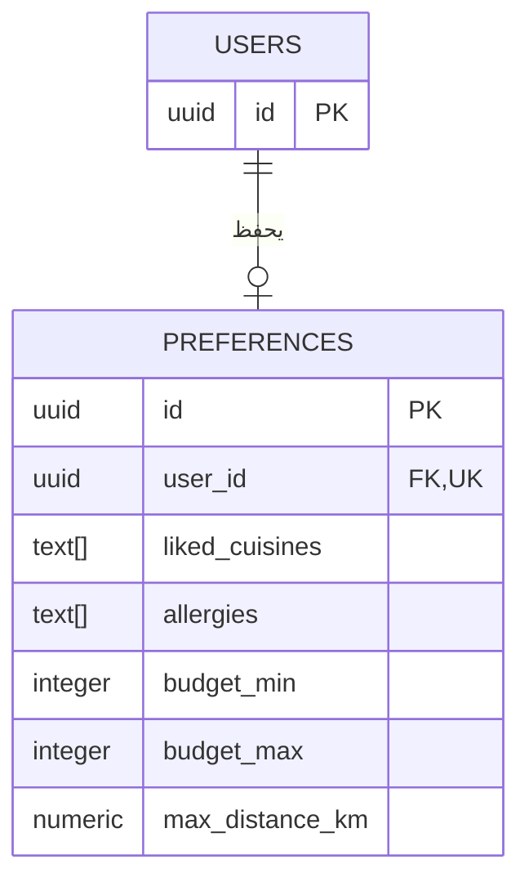
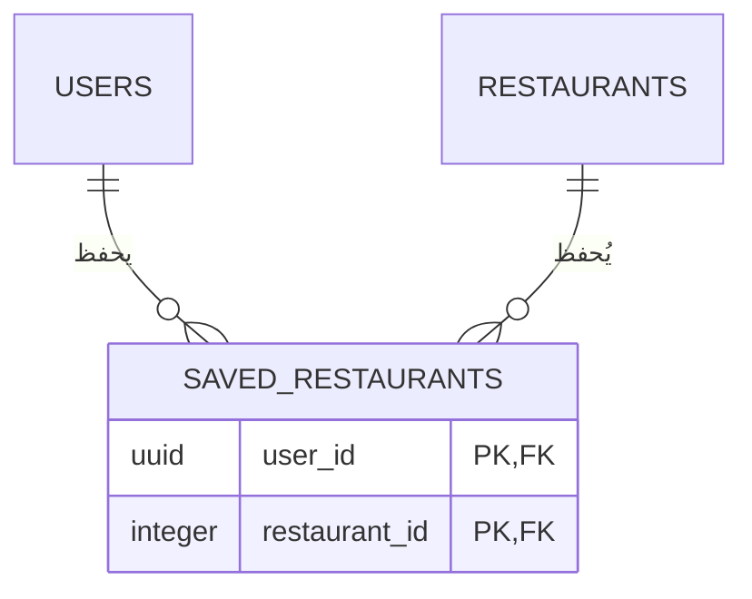

# دليل قاعدة البيانات: تفضيلات الحساب والمطاعم المحفوظة — DB-14 / DB-15

## ما الذي تنفذه المهمة؟

يملك الحساب في `users` صفرًا أو مجموعة واحدة من التفضيلات في `preferences`.
غياب الصف يعني أن الحساب لم يحفظ تفضيلاته بعد. عند الحفظ يحدد الخادم `user_id`
من الحساب المصادق عليه، ولا يقبل اختيار المالك من العميل. انتهاء رمز الدخول لا
يحذف صف التفضيلات؛ دخول الحساب نفسه من جديد يستخدم المعرف نفسه لقراءتها.
مسارات الحفظ والقراءة مسؤولية #63؛ هذه المهمة توفر التخزين والنموذج فقط.

## لماذا نستخدم هذه القيود؟

- `FOREIGN KEY`: يمنع الإشارة إلى حساب غير موجود، ويمنع حذف حساب له تفضيلات قبل معالجة بياناته صراحة.
- `UNIQUE(user_id)`: يمنع إنشاء مجموعتين للحساب نفسه؛ الحفظ التالي يعدل الصف الموجود.
- `NOT NULL`: يفرض مالكًا للحساب في القاعدة الجديدة.
- `CHECK`: الميزانية عدد صحيح غير سالب، والأدنى لا يتجاوز الأعلى عند وجودهما، والمسافة رقم موجب محدود، ويمكن أن تكون مثل `1.5` كم.

الميزانية والمسافة اختياريتان. `NULL` يعني عدم تحديد القيمة؛ لا نحوله إلى صفر.
لا يوجد سقف تجاري للميزانية، لكن نوع `INTEGER` له حدود تقنية للتخزين.
نخزن المطابخ والحساسيات في `text[]`، ونحافظ على الفرق بين `NULL` والقائمة الفارغة.
التحقق من مفاتيح المطابخ وطول النصوص وصلاحية طلبات API يبقى ضمن #63.

## كيف نحافظ على البيانات القديمة؟

القاعدة القديمة المشتركة قد تحتوي `participant_id`. نبقي صفوف المشاركين ومفاتيحها
كما هي، ونفرض مالكًا واحدًا فقط لكل صف: حساب أو مشارك. تطبق قيود الأرقام الجديدة
على صفوف الحسابات فقط. إنشاء جداول المشاركين والدعوات وتوسعة الجلسات يبقى في #12.

الترحيل `0003_account_preferences` يحول النص القديم إلى مصفوفة عندما يكون قائمة
JSON من النصوص أو صيغة مصفوفة PostgreSQL واضحة. لا يخمن معنى نص مفصول بفواصل.
عند وجود بيانات غامضة أو ملكية غير صحيحة، يتوقف ويتراجع عن التعديلات؛ لا يحذف
البيانات ولا يختار مالكًا بدلًا من صاحبها. الرجوع بترحيل يحذف التفضيلات مرفوض؛
نستخدم ترحيل إصلاح لاحقًا بعد المراجعة.

## طريقة التشغيل والتحقق

اتبع [دليل الترحيل](../database/README.md#db-14-account-preferences).
القاعدة الجديدة تستخدم `alembic upgrade head`. القاعدة القديمة بلا سجل Alembic
تحتاج فحص عقد الحساب أولًا بواسطة `adopt_existing_schema.py`، ثم `--stamp` لتسجيل
خط الأساس، ثم الترقية. نستخدم اتصال مالك القاعدة ونسخة احتياطية؛ لا نعيد ضبط قاعدة التطوير.

الاختبارات تستخدم PostgreSQL محليًا وقاعدة `thouq_test` القابلة للاستبدال.
تتحقق من رفض التكرار والصفوف اليتيمة، وتحويل القوائم، وحفظ القيم عبر اتصالات جديدة،
وبقاء آخر قيم صحيحة بعد فشل التعديل. هذا دليل تخزين حقيقي، وليس إثبات اكتمال
رحلة الدخول وواجهات #63. يبقى التصفح العام متاحًا بلا حساب أو جلسة.

[المهمة #125](https://github.com/shathaaa1110-arch/Portfolio-Project/issues/125) ·
[عقد الحساب #8](https://github.com/shathaaa1110-arch/Portfolio-Project/issues/8) ·
[دليل التحقق](../database/VALIDATION.md)

## DB-15: المطاعم المحفوظة

يربط جدول `saved_restaurants` الحساب في `users` بالمطعم في `restaurants`.
المفتاح الأساسي مركب من `user_id` من نوع UUID و`restaurant_id` من نوع INTEGER،
وكلاهما مطلوب. يستطيع الحساب حفظ عدة مطاعم، ويستطيع عدة حسابات حفظ المطعم نفسه،
لكن لا يتكرر الزوج نفسه. لا نحتاج معرفًا إضافيًا للصف.

المفتاحان الخارجيان يمنعان المراجع غير الموجودة، ويستخدمان `ON DELETE RESTRICT`:
يجب إزالة روابط الحفظ صراحة قبل حذف الحساب أو المطعم. إزالة رابط الحفظ لا تحذف
الحساب ولا المطعم. فهرس المفتاح الأساسي يخدم القراءة بحسب الحساب، ويوجد فهرس
إضافي على `restaurant_id` لفحص المراجع عند التعامل مع المطعم.

الترحيل `0006_saved_restaurants` يأتي بعد `0005_outings_and_districts` ويحافظ على
بيانات الحسابات والمطاعم الموجودة. إذا غاب جدول المطاعم، ينشئ تعريفه المعتمد مع
عمود البحث وفهارسه التي تجاوزها الترحيل 0004 عند غياب الجدول، دون تحميل بيانات
المطاعم. لا يعدل جدول مطاعم موجودًا. يتوقف إذا كانت مفاتيح الآباء غير متوافقة أو
وجد جدول محفوظات سابقًا غير مسجل بهذا الترحيل؛ لا يصلح البيانات ولا يحذفها تلقائيًا.
فشل الترحيل يتراجع عن تعديلاته، والرجوع الذي قد يحذف المحفوظات مرفوض؛ نستخدم
ترحيل إصلاح لاحقًا بعد المراجعة.

مسارات الحفظ والقراءة والإزالة والمصادقة مسؤولية عاصم في #126. يستخرج الخادم
`user_id` من الحساب المصادق عليه. يمنع القيد التكرار حتى مع الطلبات المتزامنة؛
يمكن استخدام `ON CONFLICT (user_id, restaurant_id) DO NOTHING` للحفظ المتكرر.
تحدد القراءة الحساب، وتحدد الإزالة الحساب والمطعم معًا. يبقى التصفح العام بلا تسجيل.

تتحقق اختبارات PostgreSQL المعزولة من التكرار والمراجع والقيم الفارغة وسياسة الحذف،
ومن الترقية على قاعدة جديدة أو موجودة وحفظ بياناتها والتراجع عند الفشل. اتبع
[دليل التشغيل](../database/README.md#db-15-saved-restaurants)، وراجع
[نتائج التنفيذ الفعلية](../database/VALIDATION.md).

[المهمة #130](https://github.com/shathaaa1110-arch/Portfolio-Project/issues/130) ·
[خدمة المحفوظات #126](https://github.com/shathaaa1110-arch/Portfolio-Project/issues/126).
تبقى الساعات الأربع تقديرية ليراجع حسن المتبقي، دون تغيير إجمالي السبرنت ١ البالغ ١٤٦ ساعة.
