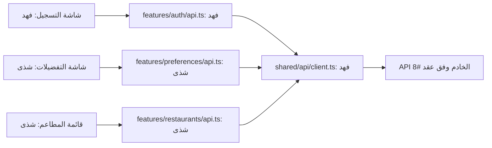
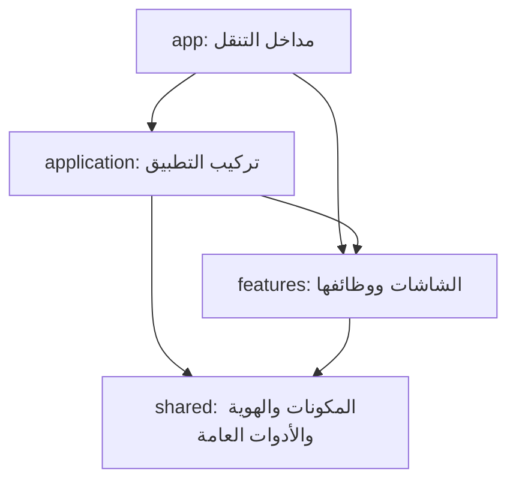

# تقسيم الفرونت والعمل بين شذى وفهد

اعتماد ١٨ أكتوبر ٢٠٢٦. هذا الدليل يشرح **الكود الموجود في هذا التغيير** ثم **أماكن تنفيذ المهام القادمة**. أسماء الملفات المخططة لا تعني أنها أُنشئت أو أن المهمة اكتملت. مراجع التصميم في `Docs/mockups/` منفصلة عن تطبيق Expo داخل `frontend/`.

**قرار الواجهة:** نموذج الحساب القديم الموجود في المصدر غير معتمد للتسليم. ستُبنى واجهات تسجيل ودخول جديدة في #21 حسب التصميم الجديد المتفق عليه مع شذى. بقاؤه مؤقتًا في هذا النقل يبقي المشروع قابلًا للتشغيل؛ لا يُطلب من فهد المحافظة على تصميمه أو إعادة استخدام منطقه.

## ما الذي تغير فعلًا؟

قبل التقسيم كان `frontend/src/app/index.tsx` يحتوي الشاشة والمدخلات والحالة والألوان والزر معًا. الآن أصبح مدخلًا صغيرًا يستدعي شاشة التسجيل من `features/auth`. انتقلت القيم البصرية إلى `shared/theme.ts` واستُخرجت مكونات `AppButton` و`AppInput` و`AppText`. وانتقل تركيب `Stack` إلى `application/ApplicationRoot.tsx`.

**أحجام النصوص — ٢٠ أكتوبر ٢٠٢٦:**

توجد الأحجام في theme.typography:
العنوان 31، والنص العادي 14، وتسمية الحقل 13،
والكتابة داخل الحقل 16، ونص الزر الأساسي 15.

يقرأ AppText أحجام النصوص حسب variant،
ويقرأ AppInput حجم الكتابة من inputSize.

التحقق من الأحجام: نجح npm run check، وعُوينت النصوص على
iPhone 17 Pro بنظام iOS 26.4 دون قصّ ظاهر بالحجم الحالي.

**حافظ التغيير على الشاشة الحالية وسلوكها:** الاسم والجوال، تفعيل الزر عند وجود اسم وجوال من ١٠ خانات يبدأ بـ05، ورسالة `Alert` الموجودة. هذه الرسالة مجرد سلوك أولي سابق؛ **لا ترسل SMS ولا تنشئ حسابًا ولا تثبت تسجيل الدخول**. الربط الفعلي في #20 و#21. لم يُنفذ تسجيل دخول أو تفضيلات أو رئيسية جديدة ضمن إعادة التنظيم.

لا يتغير عقد API أو الباك أو قاعدة البيانات/ERD في هذا التغيير؛ لا توجد طلبات شبكة جديدة. لذلك تبقى وثائق تلك الطبقات ورسومها كما هي. مخطط الاستيراد أدناه وخريطة المستودع وشرح الفرونت هي الأجزاء المتأثرة. مراجع الشرح التاريخية والتصاميم لا يعاد وصفها كتطبيق عامل.

## الفكرة التي نشرحها لفهد

- **المكون Component:** قطعة واجهة مثل زر أو حقل. يعرف كيف يظهر ويستقبل خصائصه. الزر يستقبل `onPress`، لكنه لا يعرف هل الضغط لتسجيل الدخول أو لحفظ تفضيلات.
- **الهوية Theme:** مصدر الألوان والخطوط والأحجام والمسافات. تغيير اللون المشترك هنا ينعكس على المكونات التي تستخدمه.
- **الميزة Feature:** كل ما يخص مهمة وظيفية، مثل الحساب. تحتوي شاشاتها وحالة النماذج وطلبات الحساب ومكوناتها الخاصة.
- **صفحة التركيب Application page:** تجمع أكثر من ميزة، مثل الرئيسية التي تعرض قائمة مطاعم وتستفيد من حالة الحساب. لا تنقل إليها تفاصيل التحقق من رقم الجوال.
- **المسار Route:** ملف صغير داخل `app` يحدد ما الذي يفتح عند زيارة عنوان. محتوى الشاشة لا يُكدس داخله.

نستخدم `features/auth` و`features/preferences` بدل مجلد لكل User Story؛ لأن قصص التسجيل والدخول والتحقق تشترك في ميزة واحدة. تبقى الـUser Stories في GitHub للتخطيط والقبول. ويمكن تسمية الشاشة `Screen` والصفحة التي تجمع ميزات `Page` كما في هذا الدليل.

## لماذا theme.ts بدل index.css؟

المشروع React Native مع Expo، ويعمل على الآيفون والويب. العناصر الأساسية مثل `View` و`Text` تستقبل أنماط React Native؛ لذلك نستخدم **`theme.ts` للقيم و`StyleSheet` لتنسيق المكونات والشاشات**. إضافة CSS وحده لا يجعل واجهة الآيفون تتبعه.

استيراد الهوية لا يطبقها تلقائيًا على كل نص: `AppText` و`AppInput` يقرآن إعداد الخط، و`AppButton` يقرأ لون الزر. إذا استخدمنا `Text` مباشرة في موضع خاص يجب أن نعطيه النمط المقصود.

عند إعادة تنظيم الفرونت في ١٨ أكتوبر، بقي خط النظام والألوان القديمة.
في تحديث الهوية بتاريخ ٢٠ أكتوبر، أُضيف خط IBM Plex Sans Arabic
وطُبّقت ألوان التصميم على المكونات المشتركة، كما يوضح القسم التالي.

**تحديث الخطوط — ٢٠ أكتوبر ٢٠٢٦:**

يستخدم التطبيق خط IBM Plex Sans Arabic بوزني Regular وBold.
توجد ملفات الخط وترخيصها داخل frontend/assets/fonts.

يحمّل ApplicationRoot الخطوط باستخدام expo-font قبل عرض الشاشات.
أثناء التحميل تبقى شاشة البداية ظاهرة. عند نجاح التحميل تظهر الشاشات،
وعند فشله يسمح التطبيق بمتابعة العرض حتى لا يبقى عالقًا في البداية.

توجد أسماء الخطوط في shared/theme.ts:
- fontFamily للنصوص العادية وحقول الإدخال.
- fontFamilyBold للعناوين وتسميات الحقول ونصوص الأزرار.

يختار AppText الخط حسب variant، ويستخدم AppInput الخط العادي.
ويستفيد AppButton من الخط العريض لأنه يعرض نصه باستخدام AppText.

التحقق: نجح npm run check، بما يشمل فحص TypeScript وقواعد
المعمارية والاختبارات السبعة. تمت معاينة الشاشة الحالية على
iPhone 17 Pro بنظام iOS 26.4، وظهر الفرق بين الوزنين.

طُبّقت ألوان الخلفية والحقول والزر من التصميم المعتمد.
يقرأ AppText لون النص الأساسي من theme.colors.text،
ويستخدم AppInput اللون نفسه للكتابة داخل الحقول.
يبقى نص الزر بلون onPrimary، والمثال داخل الحقل بلون placeholder.
يستخدم الزر المعطّل opacity.disabled بقيمة 0.43 من الهوية.
تقل عتامة خلفيته ونصه، وتمنع خاصية disabled التفاعل معه.
القيمة مأخوذة من حالة التعطيل في التصميم المعتمد.
التحقق من ألوان النصوص: نجح npm run check والاختبارات السبعة،
وعُوينت ألوان العنوان وتسميات الحقول والنص الإرشادي ونص الزر
على السيميوليتر
عُوين الزر في حالتي التفعيل والتعطيل:
يظهر بلون الهوية عند التفعيل، وتقل عتامته عند التعطيل.


**المسافات والحواف — ٢٠ أكتوبر ٢٠٢٦:**

توجد القيم المشتركة في theme.ts، ويستخدمها AppInput وAppButton.

المسافات الداخلية للحقل: 12 فوق وتحت، و16 يمينًا ويسارًا.
المسافات الداخلية للزر: 12 فوق وتحت، و20 يمينًا ويسارًا.

استدارة الحقل 15، واستدارة الزر 28، وسماكة الإطار 1.
الحد الأدنى لارتفاع الحقل والزر 54؛ يسمح minHeight لهما
بالنمو عندما يحتاج المحتوى مساحة أكبر.

في شاشة التسجيل الحالية، المسافة بين آخر حقل والزر 32:
هامش أسفل الحقل 20، وهامش أعلى الزر 12.

التحقق: نجح npm run check، بما يشمل TypeScript وحدود المعمارية
والاختبارات السبعة. عُوينت الحقول والزر على السيميوليتر،
وجُرّب تفعيل الزر وتعطيله ببيانات محلية.

هذا التحديث بصري؛ لم يضف اتصالًا بالـAPI أو يغيّر قاعدة البيانات.

## خريطة الملفات المنفذة

```text
Portfolio-Project/
├── architecture.json                # قائمة الميزات واعتمادياتها
├── package.json                     # أوامر فحص من جذر المستودع
├── Docs/
│   ├── Frontend-Architecture.ar.md  # هذا الدليل
│   └── Frontend-API-Usage.ar.md     # طريقة استخدام أداة الطلبات #20
└── frontend/
    ├── assets/                      # الصور والخطوط
    │   └── fonts/                   # ملفات الخط وترخيصه
    │       ├── IBMPlexSansArabic-Regular.ttf
    │       ├── IBMPlexSansArabic-Bold.ttf
    │       └── OFL.txt              # ترخيص الخط
    ├── .env.example                 # متغيرات البيئة المطلوبة #20
    ├── package.json
    ├── package-lock.json
    ├── app.json
    ├── tsconfig.json
    ├── scripts/
    │   ├── check-architecture.mjs
    │   └── check-architecture.test.mjs
    └── src/
        ├── app/
        │   ├── _layout.tsx          # يستدعي ApplicationRoot
        │   ├── index.tsx            # يستدعي SignUpScreen حاليًا
        │   ├── sign-up.tsx          # التسجيل #21
        │   ├── login.tsx            # الدخول #21
        │   └── verify-phone.tsx     # رمز التحقق #21
        ├── application/
        │   └── ApplicationRoot.tsx  # تحميل الخطوط وتركيب Stack وتسجيل ردود Mock
        ├── features/
        │   └── auth/                # #21
        │       ├── SignUpScreen.tsx      # التسجيل بالاسم والجوال
        │       ├── LoginScreen.tsx       # الدخول بالجوال فقط
        │       ├── VerifyPhoneScreen.tsx # الرمز وإعادة الإرسال
        │       ├── SignOutButton.tsx     # زر الخروج لأي شاشة
        │       ├── api.ts                # طلبات الحساب عبر client
        │       ├── mocks.ts              # ردود تجريبية مطابقة للعقد
        │       ├── session.ts            # حفظ الجلسة واسترجاعها ومسحها
        │       ├── authErrors.ts         # رسائل الأخطاء للشاشات الثلاث
        │       ├── navigation.ts         # التنقل بين شاشات الحساب
        │       └── index.ts              # المدخل العام للميزة
        └── shared/
            ├── theme.ts
            ├── api/                 # أداة الطلبات #20
            │   ├── client.ts
            │   ├── config.ts
            │   ├── errors.ts
            │   └── mockTransport.ts
            └── components/
                ├── AppButton.tsx
                ├── AppInput.tsx
                ├── AppText.tsx
                └── index.ts
```

لا ننشئ مجلدًا أو Hook أو Service فارغًا لكل شيء. حالة الاسم والجوال البسيطة تبقى داخل الشاشة. نفصل Hook عندما توجد وظيفة معقدة أو قابلة لإعادة الاستخدام تستدعيه.

## مثال حقيقي من شاشة التسجيل

ملف المسار `frontend/src/app/index.tsx` صار:

```tsx
export { SignUpScreen as default } from "@/features/auth";
```

وفهرس الميزة `frontend/src/features/auth/index.ts` يصدر الشاشة:

```tsx
export { SignUpScreen } from "./SignUpScreen";
```

وفي الشاشة نستدعي المكونات والهوية:

```tsx
import { AppButton, AppInput, AppText } from "@/shared/components";
import { theme } from "@/shared/theme";
```

`SignUpScreen` تملك `name` و`phone` و`canContinue`، وتمرر إلى `AppInput` القيمة و`onChangeText`، وإلى `AppButton` النص و`disabled` و`onPress`. **المكون مسؤول عن العرض والتفاعل العام، والشاشة مسؤولة عن معنى هذا التفاعل.**

عند تنفيذ #21 يبني فهد شاشات الحساب الجديدة في هذه المسارات ويستبدل النموذج المؤقت. تربط الشاشة الجديدة دالة التسجيل من `auth/api.ts`، مع التحميل والخطأ والانتقال بعد نجاح الطلب. لا يضع طلب التسجيل داخل `AppButton`. إن احتاج مؤشر تحميل عام داخل الزر ينسق خاصية `loading` مع شذى؛ هذه الخاصية ليست منفذة الآن.

## من يعدل ماذا؟

| الجزء | المسؤول | حدود العمل |
|---|---|---|
| `shared/theme.ts` و`shared/components/*` والخطوط | شذى | الهوية والمكونات العامة، بما فيها فهرس المكونات |
| `shared/api/*` | فهد | أداة HTTP عامة والأخطاء والإعداد والنقل التجريبي؛ ملفات مخططة في #20 |
| `features/auth/*` ومسارات التسجيل/الدخول/الرمز | فهد | الشاشات ووظيفتها وAPI والجلسة وفهرس auth |
| `features/preferences/*` | شذى | النموذج والشاشات وAPI وبيانات التجربة وفهرس الميزة |
| `features/restaurants/*` | شذى | القائمة والبطاقة والتفاصيل وAPI وبيانات التجربة والفهرس |
| `application/*` والجذر والتبويبات | شذى | تجميع المزايا والتنقل؛ استثناء محدد: `GuestInvitationPage.tsx` لفهد في #67 |
| إعداد Expo والحزم وملف القفل وفحص المعمارية | شذى | تنسق تغييرات فهد المطلوبة في الملفات المشتركة |
| `features/sessions/*` | مقسم بالملف | شذى: `CreateSessionScreen.tsx` و`api/create.ts`. فهد: الانضمام والانتظار والحالة والإجراءات وبقية API و`index.ts` |
| `features/suggestions/*` و`features/results/*` | شذى | الاقتراحات والإعادة والنتيجة في المهام اللاحقة |
| `features/voting/*` و`features/notifications/*` و`features/personalSuggestions/*` | فهد | التصويت والإشعارات والترشيح الفردي بحسب سبرنتاتها |
| `features/groups/*` — مؤجل | مقسم بالملف | شذى: القائمة والتفاصيل و`api/groups.ts` و`index.ts`. فهد: `components/AttendanceCard.tsx` و`api/attendance.ts` و`useAttendance.ts` |

**كل صاحب ميزة يكتب غلاف طلبات ميزته، وليس خادم الباك.** مثلًا شذى تكتب `preferences/api.ts` داخل تطبيق الموبايل لاستدعاء API، بينما تنفيذ API في Python له مهمة مستقلة #63. وفهد يكتب `auth/api.ts` ويستخدم خدمة الباك التي ينفذها عاصم. وجود كلمة API في ملف الفرونت لا يحوله إلى باك إند.

صاحب الشاشة يملك أيضًا ملف مسارها الصغير المذكور في مهمته. الجذر `app/index.tsx` و`app/_layout.tsx` وهيكل التبويبات ملفات مشتركة تنسقها شذى. إذا تعارض اسمان أو احتاج أحدهما تغيير ملف الآخر، يحددان التعديل في المهمة ويسلمانه لصاحبه أو يتفقان على فرع واحد؛ لا يعملان في نسختين متزامنتين من الملف نفسه.

## ملفات السبرنت العاجل التي ستضاف مع مهامها

هذه **خطة ملفات**، وليست قائمة شاشات منفذة في هذا التغيير:

```text
frontend/src/
├── app/
│   ├── sign-up.tsx, login.tsx, verify-phone.tsx  # فهد #21
│   ├── preferences.tsx                         # شذى #25
│   └── (tabs)/                                 # شذى #97
│       ├── _layout.tsx, index.tsx
│       └── saved.tsx, account.tsx
├── application/
│   ├── HomePage.tsx, MainTabs.tsx               # شذى #97
│   └── SavedPlaceholderPage.tsx, AccountPlaceholderPage.tsx
├── features/
│   ├── auth/
│   │   ├── LoginScreen.tsx, VerifyPhoneScreen.tsx
│   │   └── api.ts, session.ts, mocks.ts          # فهد #21
│   ├── preferences/
│   │   ├── AccountPreferencesScreen.tsx
│   │   ├── components/PreferencesForm.tsx
│   │   └── api.ts, mocks.ts, index.ts           # شذى #25
│   └── restaurants/
│       ├── RestaurantList.tsx
│       ├── components/RestaurantCard.tsx
│       └── api.ts, mocks.ts, index.ts           # شذى #102
└── shared/api/
    └── client.ts, errors.ts, config.ts, mockTransport.ts # فهد #20
```

عند ربط #97 تنقل شذى مدخل التطبيق إلى الاكتشاف العام؛ وفهد يجعل التسجيل في مساره الخاص. **لا يصبح فتح التطبيق أو تصفح المطاعم مشروطًا بحساب.** الحساب الجديد/غير المكتمل يستكمل تفضيلاته، والسابق المكتمل يصل للرئيسية وفق حالة موثقة من الباك. تظل الدعوات والتخطيط المباشر ممكنين دون إنشاء مجموعة محفوظة.

قبل الأربعاء، آخر موعد **الثلاثاء ٢٠ أكتوبر ٢٠٢٦، ١١:٥٩ مساءً بتوقيت الرياض**: تسجيل جديد ودخول فعليان، حفظ التفضيلات، رئيسية ببيانات مطاعم عامة، وشريط الرئيسية/المحفوظة/حسابي. الخوارزمية ليست مطلوبة، ومحتوى حسابي والمحفوظة الكامل ليس شرطًا. القيود المدخلة تحفظ، والقائمة العامة لا تقدم على أنها مطابقة للحساسية أو ترشيح شخصي.

## كيف تتصل الشاشة بالباك؟

المسار التالي **مخطط للتنفيذ في المهام، وليس اتصالًا يعمل في هذا التغيير**:



فهد يحتاج من عاصم عقد #8 وعنوان الخادم الذي يصل إليه الهاتف من #57: المسارات والطرق والحقول وأنواعها وأمثلة النجاح والخطأ، طريقة رمز الجلسة وانتهائه، ودورة SMS وإعادة الإرسال. شذى تنسق عقد التفضيلات #63 مع عاصم، والمطاعم العامة من #101. لا نخمن مسارًا ثم نعتبره جاهزًا.

`client.ts` يعرف النقل فقط؛ لا يستورد `auth/session.ts`. يمرر صاحب الاستدعاء الرمز كمدخل أو تهيئه طبقة `application` من واجهة auth العامة. حفظ الرمز واستعادته ومسحه شأن auth. استخدام واجهة عامة لا يعفي من التصريح باعتمادية الميزة.

البيانات التجريبية الخاصة بالتسجيل داخل `auth/mocks.ts`، والتفضيلات داخل `preferences/mocks.ts`، والمطاعم داخل `restaurants/mocks.ts`. يمكن أن يستخدم الجميع `mockTransport` عامًا يستقبل هذه البيانات. `shared` لا يستورد ملفات الميزات لتجميعها؛ هذا التركيب مكانه `application`. وضع التجربة صريح ولا يتحول إليه التطبيق تلقائيًا إذا فشل الخادم. قبول السبرنت يحتاج ربطًا حقيقيًا، ولا يكتمل بالـMock.

## حدود الاستيراد وفحصها

الأسهم التالية تعني «يستورد من». الفرع المنفذ حاليًا يحتوي auth فقط، وباقي الميزات تضاف حين يبدأ تنفيذها:



- `shared` لا يستورد أي ميزة، والميزة لا تستورد `application` أو ملفات المسارات `app`.
- الاستيراد من خارج ميزة يمر عبر `index.ts`، مثل `@/features/auth`؛ لا يستورد `@/features/auth/SignUpScreen` مباشرة. داخل الميزة نفسها يمكن الاستيراد من ملفاتها الداخلية.
- بطاقة مطعم تعرف بيانات المطاعم تبقى داخل `restaurants`؛ نموذج التفضيلات يبقى داخل `preferences`. المشاركة بين شاشتين لا تعني نقل منطق الميزة إلى `shared`.
- عند إضافة ميزة نضيف اسمها إلى `architecture.json` مع اعتمادياتها الفعلية فقط. عند حاجة voting إلى restaurants نصرح بذلك عند تنفيذهما؛ لا نسمح بكل الاتجاهات مسبقًا.
- الفحص يرفض الاعتماديات غير المعلنة والاستيراد الداخلي من ميزة أخرى ودورات الاعتماد. حل الدورة يكون بإعادة توزيع المسؤولية أو تركيب الميزات في `application`.
- الفحص يتحقق من الاستيرادات المحلية ذات المسارات الثابتة في TS/JS، ومنها إعادة التصدير و`import()` و`require()`. لا يقيّم مسارًا محسوبًا وقت التشغيل؛ استخدموا مسارات ثابتة ومراجعة للكود. ويظل `typecheck` مطلوبًا.

## خطوات العمل اليومية

1. يقرأ كل شخص مهمته وحدود الملفات فيها، ويتأكد من فرع الأساس المعتمد للفريق. هذا التنظيم مقدم في فرع `codex/frontend-architecture` لدمجه إلى `deployment`؛ لا يبدأ زميل من النسخة القديمة ثم يعيد إنشاء الهيكل.
2. صاحب الشاشة يستخدم المكونات الموجودة. إن احتاج تغييرًا عامًا يسلمه لشذى مع مثال الخصائص المطلوبة، ويكمل ما لا يتوقف عليه.
3. فهد يسلم أداة الطلبات بمثال مدخل/نتيجة/خطأ. كل صاحب ميزة يربط غلاف API الخاص به والشاشة، بعد اعتماد العقد.
4. يضيف كل شخص صادرات ميزته واعتمادياتها مع تنفيذها. `sessions/index.ts` عند فهد و`groups/index.ts` عند شذى لتجنب تضارب الفهارس المشتركة.
5. يحدث شرح البنية والتدفق المتأثر في نفس PR. إذا تغيرت بيانات الباك أو العقد تحدث وثائقها أيضًا؛ لا تغير طبقة غير متأثرة لمجرد إضافة فرق.
6. يشغل الفحوص من جذر الريبو بعد تثبيت حزم الفرونت، ثم يجرب الشاشة على الجهاز/الويب المطلوب في مهمته:

```sh
npm --prefix frontend ci
npm run check:architecture
npm run check
cd frontend
npx expo start
```

للويب: `npm run web`. وللتحقق من البناء: `npx expo export --platform web`. استخدموا نسخة Expo Go المتوافقة مع SDK 57 أو بناء التطوير المتفق عليه في #58. مشروع التطبيق يستخدم SDK 57 المثبت؛ لا ترقوه لمجرد إعادة التنظيم.

أمر `npm run check` يجمع TypeScript وحدود المعمارية واختبارات أداة الفحص. أمر `lint` القديم موجود، لكن إعداد ESLint وحزمه لم تكن مجهزة في المصدر الذي أعيد تنظيمه؛ لا نسجل نجاح lint قبل إعدادها في #54. لا تعتمدوا نجاح البناء دليلًا على SMS أو الحفظ الفعلي.

7. يرفع صاحب التغيير فرعه ويفتح PR للفرع المعتمد، ويذكر رقم المهمة وملفاتها وطريقة الاختبار. يستخدم `Closes #رقم` فقط إذا أنجز شروط المهمة كاملة. إعادة التنظيم مرتبطة بـ#54/#21 وليست إغلاقًا لهما. يراجع الآخر الملفات المشتركة قبل الدمج.

## خريطة بقية المهام

الجدول التالي يسهل الوصول، والتفصيل ملفًا بملف موجود في قسم «مكان العمل» داخل كل Issue. كل الأسماء غير الموجودة في الخريطة المنفذة أعلاه مخططة، والمهمات المؤجلة تظل مؤجلة.

| المهمة | المسؤول | منطقة العمل |
|---|---|---|
| [#9 — الهوية والمكونات المشتركة وتسليم التصميم](https://github.com/shathaaa1110-arch/Portfolio-Project/issues/9) | شذى | `frontend/src/shared/`، `frontend/assets/fonts/`، `Docs/mockups/` |
| [#20 — أداة الاتصال المشتركة](https://github.com/shathaaa1110-arch/Portfolio-Project/issues/20) | فهد | `frontend/src/shared/`، `Docs/Frontend-API-Usage.ar.md` |
| [#21 — التسجيل والدخول والتحقق وجلسة الحساب](https://github.com/shathaaa1110-arch/Portfolio-Project/issues/21) | فهد | `frontend/src/features/auth/`، `frontend/src/app/` |
| [#22 — إنشاء جلسة مباشرة](https://github.com/shathaaa1110-arch/Portfolio-Project/issues/22) | شذى | `frontend/src/features/sessions/`، `frontend/src/app/`، `frontend/src/application/` |
| [#24 — الانتظار والتحديثات المباشرة](https://github.com/shathaaa1110-arch/Portfolio-Project/issues/24) | فهد | `frontend/src/features/sessions/`، `frontend/src/app/` |
| [#25 — تفضيلات الحساب](https://github.com/shathaaa1110-arch/Portfolio-Project/issues/25) | شذى | `frontend/src/features/preferences/`، `frontend/src/app/` |
| [#32 — الاقتراحات وبطاقة المطعم](https://github.com/shathaaa1110-arch/Portfolio-Project/issues/32) | شذى | `frontend/src/features/restaurants/`، `frontend/src/features/suggestions/`، `frontend/src/app/` |
| [#33 — التصويت والمراجعة](https://github.com/shathaaa1110-arch/Portfolio-Project/issues/33) | فهد | `frontend/src/features/voting/`، `frontend/src/app/` |
| [#34 — النتيجة](https://github.com/shathaaa1110-arch/Portfolio-Project/issues/34) | شذى | `frontend/src/features/results/`، `frontend/src/app/` |
| [#44 — المجموعات المحفوظة — مؤجل](https://github.com/shathaaa1110-arch/Portfolio-Project/issues/44) | شذى | `frontend/src/features/groups/`، `frontend/src/app/` |
| [#45 — الإشعارات والروابط](https://github.com/shathaaa1110-arch/Portfolio-Project/issues/45) | فهد | `frontend/src/features/notifications/` |
| [#47 — البحث والفلترة العامة](https://github.com/shathaaa1110-arch/Portfolio-Project/issues/47) | شذى | `frontend/src/features/restaurants/`، `frontend/src/app/` |
| [#49 — اختر لي — مؤجل](https://github.com/shathaaa1110-arch/Portfolio-Project/issues/49) | فهد | `frontend/src/features/personalSuggestions/`، `frontend/src/app/` |
| [#54 — تأسيس المشروع وتشغيله](https://github.com/shathaaa1110-arch/Portfolio-Project/issues/54) | شذى | `frontend/package.json`، `frontend/package-lock.json`، `frontend/tsconfig.json` |
| [#58 — إعداد بناء الآيفون](https://github.com/shathaaa1110-arch/Portfolio-Project/issues/58) | شذى | `frontend/app.json`، `frontend/eas.json`، `frontend/package.json` |
| [#65 — الانضمام برمز](https://github.com/shathaaa1110-arch/Portfolio-Project/issues/65) | فهد | `frontend/src/features/sessions/`، `frontend/src/app/` |
| [#66 — تفضيلات الجلسة](https://github.com/shathaaa1110-arch/Portfolio-Project/issues/66) | شذى | `frontend/src/features/preferences/`، `frontend/src/app/` |
| [#67 — دعوة الضيف في المتصفح](https://github.com/shathaaa1110-arch/Portfolio-Project/issues/67) | فهد | `frontend/src/application/`، `frontend/src/features/sessions/`، `frontend/src/app/` |
| [#74 — تقدم التصويت](https://github.com/shathaaa1110-arch/Portfolio-Project/issues/74) | فهد | `frontend/src/features/voting/`، `frontend/src/app/` |
| [#75 — فحص العربية والتحميل والأخطاء](https://github.com/shathaaa1110-arch/Portfolio-Project/issues/75) | فهد | `Docs/Frontend-QA.ar.md`، `frontend/src/features/auth/`، `frontend/src/features/sessions/` |
| [#79 — الحضور والإزالة — مؤجل](https://github.com/shathaaa1110-arch/Portfolio-Project/issues/79) | فهد | `frontend/src/features/groups/` |
| [#81 — تفاصيل المطعم](https://github.com/shathaaa1110-arch/Portfolio-Project/issues/81) | شذى | `frontend/src/features/restaurants/`، `frontend/src/app/` |
| [#89 — مغادرة الجلسة وإزالة مشارك](https://github.com/shathaaa1110-arch/Portfolio-Project/issues/89) | فهد | `frontend/src/features/sessions/` |
| [#91 — لا نتائج وإعادة المحاولة](https://github.com/shathaaa1110-arch/Portfolio-Project/issues/91) | شذى | `frontend/src/features/suggestions/`، `frontend/src/app/` |
| [#97 — الرئيسية والشريط السفلي](https://github.com/shathaaa1110-arch/Portfolio-Project/issues/97) | شذى | `frontend/src/application/`، `frontend/src/app/` |
| [#102 — قائمة المطاعم العامة](https://github.com/shathaaa1110-arch/Portfolio-Project/issues/102) | شذى | `frontend/src/features/restaurants/`، `frontend/src/application/` |

## التحقق من هذا التغيير

- نجح `npm run check` من جذر المستودع: TypeScript، وحدود المجلدات، و٧ اختبارات لفاحص المعمارية. تشمل منع الاستيراد من shared إلى ميزة، والوصول إلى ملفات ميزة الداخلية، والاعتمادية غير المعلنة والدورات.
- نجح `CI=1 npx expo export --platform web` باستخدام حزم القفل الحالية؛ لا توجد ترقية للحزم.
- فُتحت نسخة الويب المبنية في المتصفح: النموذج الفارغ يعطل الزر؛ إدخال اسم ورقم تجريبي من ١٠ خانات يبدأ بـ05 يفعله؛ تغيير البداية إلى 04 يعطله. هذا فحص تفاعل الواجهة فقط، دون إرسال طلب أو إثبات SMS.
- لم يُختبر بناء iPhone في هذا التغيير. لم تُختبر SMS أو API لأنها ليست منفذة في هذا النقل. تبقى أدلة الجهاز والربط الفعلي ضمن #54/#58/#21 واختبار القبول #99.

مراجع التقنية: [Expo SDK 57](https://docs.expo.dev/versions/v57.0.0/)، [تنظيم Expo Router](https://docs.expo.dev/router/basics/core-concepts/)، [أنماط React Native 0.86](https://reactnative.dev/docs/0.86/style).
