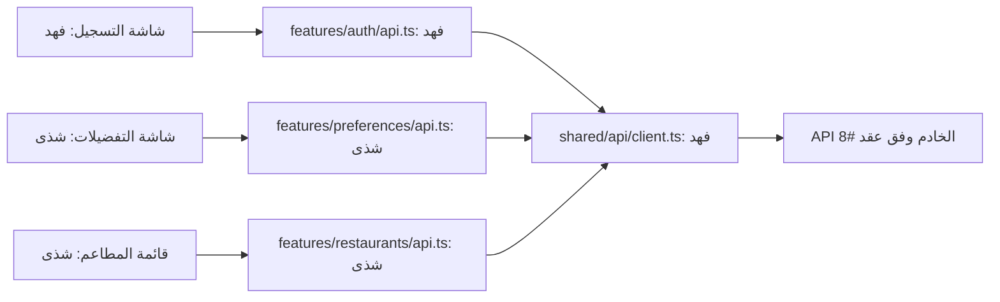
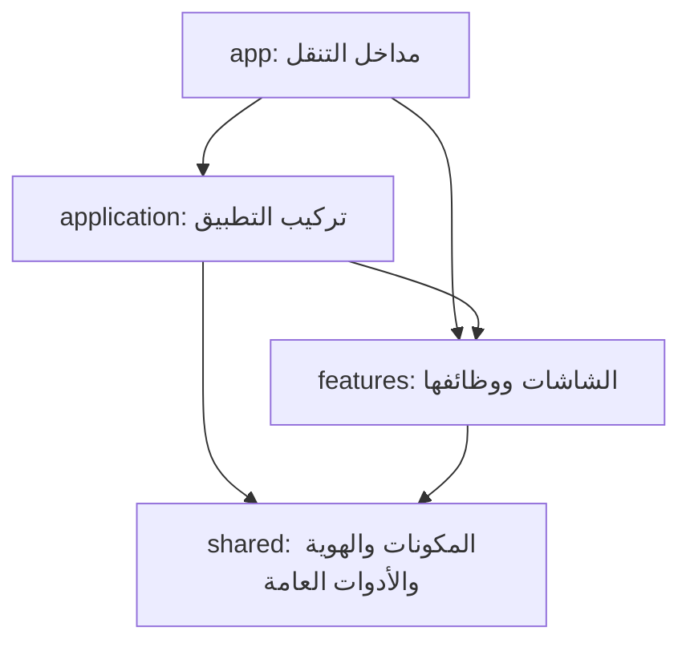

# تقسيم الفرونت والعمل بين شذى وفهد

بدأ هذا الدليل مع تقسيم الفرونت في ١٨ أكتوبر ٢٠٢٦.
آخر تحديث: ٢١ أكتوبر ٢٠٢٦، لواجهة الرئيسية في فرع
`feature/home-tabs`.

يفصل الدليل بين الملفات المنفذة والخطط المستقبلية.
مراجع التصميم داخل `Docs/mockups/` منفصلة عن تطبيق Expo
داخل `frontend/`.

**قرار الواجهة:** نموذج الحساب القديم مؤقت وغير معتمد للتسليم.
يوجد الآن في المسار `/sign-up`. ستستبدله واجهات الحساب الجديدة
ضمن #21.

## الرئيسية المنفذة حاليًا

- يفتح التطبيق على الرئيسية دون اشتراط تسجيل الدخول.
- يحتوي الشريط السفلي على الرئيسية والمحفوظة وحسابي.
- المحفوظة وحسابي صفحتان مؤقتتان.
- تعرض الرئيسية النصوص العربية وحقل البحث وبطاقة الجلسة وقائمة المطاعم.
- يبحث الحقل محليًا في أسماء المطاعم وأنواع المطابخ.
- تعرض بطاقات المطاعم صورة طعام توضيحية عامة.
- تدعم القائمة حالات التحميل والخطأ وعدم وجود نتائج.
- يظهر زر إعادة المحاولة عند وجود خطأ وتمرير إجراء للمحاولة.
- بطاقة «نختار وين نتعشّى؟» للعرض؛ زر إنشاء الجلسة معطّل وموسوم «قريبًا».

في وضع التطوير، تعرض الرئيسية ثلاثة مطاعم تجريبية من `mocks.ts`.
خارج وضع التطوير، تمرر الرئيسية قائمة فارغة حاليًا.

البحث يفلتر البيانات الموجودة في القائمة فقط؛ لا يرسل طلبًا للخادم.
إعادة المحاولة الحالية تعيد حالة المعاينة إلى `ready`؛ لا تجلب بيانات جديدة.

ربط المطاعم بالخادم، وتسجيل الدخول الفعلي، والتفضيلات، وإنشاء
الجلسات ما زالت أعمالًا غير مكتملة في هذا الفرع.

## كيف يعمل البحث؟

1. يحتفظ `HomePage` بالنص المكتوب داخل الحالة `searchQuery`.
2. يحدّث `TextInput` هذه الحالة باستخدام `onChangeText`.
3. تمرر الصفحة نص البحث وبيانات المطاعم إلى `RestaurantList`.
4. تزيل القائمة المسافات من بداية البحث ونهايته وتوحد حالة الأحرف.
5. تحتفظ بالمطاعم التي يحتوي اسمها أو أحد مطابخها على نص البحث.
6. يعرض `FlatList` النتائج باستخدام `RestaurantCard`.
7. عند عدم وجود نتائج تظهر رسالة فارغة، وعند مسح البحث تعود البطاقات.

هذه فلترة نصية بسيطة، وليست ترشيحًا شخصيًا أو مطابقة للحساسيات.

## سجل تأسيس الواجهة والهوية — ١٨ إلى ٢٠ أكتوبر ٢٠٢٦

قبل التقسيم كان `frontend/src/app/index.tsx` يحتوي شاشة التسجيل
والمدخلات والحالة والألوان والزر معًا.

في إعادة التنظيم بتاريخ ١٨ أكتوبر، انتقلت الشاشة إلى `features/auth`،
والقيم البصرية إلى `shared/theme.ts`، واستُخرجت المكونات
`AppButton` و`AppInput` و`AppText`. وانتقل تركيب `Stack`
إلى `application/ApplicationRoot.tsx`.

لاحقًا، في تحديث الرئيسية، انتقل مدخل الصفحة إلى
`app/(tabs)/index.tsx`، وأصبح التسجيل في `app/sign-up.tsx`.


**أحجام النصوص — ٢٠ أكتوبر ٢٠٢٦:**

توجد الأحجام في theme.typography:
العنوان 31، والنص العادي 14، وتسمية الحقل 13،
والكتابة داخل الحقل 16، ونص الزر الأساسي 15.

يقرأ AppText أحجام النصوص حسب variant،
ويقرأ AppInput حجم الكتابة من inputSize.

التحقق من الأحجام: نجح npm run check، وعُوينت النصوص على
iPhone 17 Pro بنظام iOS 26.4 دون قصّ ظاهر بالحجم الحالي.

**حافظ التغيير على الشاشة الحالية وسلوكها:** الاسم والجوال، تفعيل الزر عند وجود اسم وجوال من ١٠ خانات يبدأ بـ05، ورسالة `Alert` الموجودة. هذه الرسالة مجرد سلوك أولي سابق؛ **لا ترسل SMS ولا تنشئ حسابًا ولا تثبت تسجيل الدخول**. الربط الفعلي في #20 و#21. لم يُنفذ تسجيل دخول أو تفضيلات أو رئيسية جديدة ضمن إعادة التنظيم.

لا يتغير عقد API أو الباك أو قاعدة البيانات/ERD في هذا التغيير؛ لا توجد طلبات شبكة جديدة. لذلك تبقى وثائق تلك الطبقات ورسومها كما هي. مخطط الاستيراد أدناه وخريطة المستودع وشرح الفرونت هي الأجزاء المتأثرة. مراجع الشرح التاريخية والتصاميم لا يعاد وصفها كتطبيق عامل.

## الفكرة التي نشرحها لفهد

- **المكون Component:** قطعة واجهة مثل زر أو حقل. يعرف كيف يظهر ويستقبل خصائصه. الزر يستقبل `onPress`، لكنه لا يعرف هل الضغط لتسجيل الدخول أو لحفظ تفضيلات.
- **الهوية Theme:** مصدر الألوان والخطوط والأحجام والمسافات. تغيير اللون المشترك هنا ينعكس على المكونات التي تستخدمه.
- **الميزة Feature:** كل ما يخص مهمة وظيفية، مثل الحساب. تحتوي شاشاتها وحالة النماذج وطلبات الحساب ومكوناتها الخاصة.
- **صفحة التركيب Application page:** تجمع أكثر من ميزة، مثل الرئيسية التي تعرض قائمة مطاعم وتستفيد من حالة الحساب. لا تنقل إليها تفاصيل التحقق من رقم الجوال.
- **المسار Route:** ملف صغير داخل `app` يحدد ما الذي يفتح عند زيارة عنوان. محتوى الشاشة لا يُكدس داخله.

نستخدم `features/auth` و`features/preferences` بدل مجلد لكل User Story؛ لأن قصص التسجيل والدخول والتحقق تشترك في ميزة واحدة. تبقى الـUser Stories في GitHub للتخطيط والقبول. ويمكن تسمية الشاشة `Screen` والصفحة التي تجمع ميزات `Page` كما في هذا الدليل.

## لماذا theme.ts بدل index.css؟

المشروع React Native مع Expo، ويعمل على الآيفون والويب. العناصر الأساسية مثل `View` و`Text` تستقبل أنماط React Native؛ لذلك نستخدم **`theme.ts` للقيم و`StyleSheet` لتنسيق المكونات والشاشات**. إضافة CSS وحده لا يجعل واجهة الآيفون تتبعه.

استيراد الهوية لا يطبقها تلقائيًا على كل نص: `AppText` و`AppInput` يقرآن إعداد الخط، و`AppButton` يقرأ لون الزر. إذا استخدمنا `Text` مباشرة في موضع خاص يجب أن نعطيه النمط المقصود.

عند إعادة تنظيم الفرونت في ١٨ أكتوبر، بقي خط النظام والألوان القديمة.
في تحديث الهوية بتاريخ ٢٠ أكتوبر، أُضيف خط IBM Plex Sans Arabic
وطُبّقت ألوان التصميم على المكونات المشتركة، كما يوضح القسم التالي.

**تحديث الخطوط — ٢٠ أكتوبر ٢٠٢٦:**

يستخدم التطبيق خط IBM Plex Sans Arabic بوزني Regular وBold.
توجد ملفات الخط وترخيصها داخل frontend/assets/fonts.

يحمّل ApplicationRoot الخطوط باستخدام expo-font قبل عرض الشاشات.
أثناء التحميل تبقى شاشة البداية ظاهرة. عند نجاح التحميل تظهر الشاشات،
وعند فشله يسمح التطبيق بمتابعة العرض حتى لا يبقى عالقًا في البداية.

توجد أسماء الخطوط في shared/theme.ts:
- fontFamily للنصوص العادية وحقول الإدخال.
- fontFamilyBold للعناوين وتسميات الحقول ونصوص الأزرار.

يختار AppText الخط حسب variant، ويستخدم AppInput الخط العادي.
ويستفيد AppButton من الخط العريض لأنه يعرض نصه باستخدام AppText.

التحقق: نجح npm run check، بما يشمل فحص TypeScript وقواعد
المعمارية والاختبارات السبعة. تمت معاينة الشاشة الحالية على
iPhone 17 Pro بنظام iOS 26.4، وظهر الفرق بين الوزنين.

طُبّقت ألوان الخلفية والحقول والزر من التصميم المعتمد.
يقرأ AppText لون النص الأساسي من theme.colors.text،
ويستخدم AppInput اللون نفسه للكتابة داخل الحقول.
يبقى نص الزر بلون onPrimary، والمثال داخل الحقل بلون placeholder.
يستخدم الزر المعطّل opacity.disabled بقيمة 0.43 من الهوية.
تقل عتامة خلفيته ونصه، وتمنع خاصية disabled التفاعل معه.
القيمة مأخوذة من حالة التعطيل في التصميم المعتمد.
التحقق من ألوان النصوص: نجح npm run check والاختبارات السبعة،
وعُوينت ألوان العنوان وتسميات الحقول والنص الإرشادي ونص الزر
على السيميوليتر
عُوين الزر في حالتي التفعيل والتعطيل:
يظهر بلون الهوية عند التفعيل، وتقل عتامته عند التعطيل.


**المسافات والحواف — ٢٠ أكتوبر ٢٠٢٦:**

توجد القيم المشتركة في theme.ts، ويستخدمها AppInput وAppButton.

المسافات الداخلية للحقل: 12 فوق وتحت، و16 يمينًا ويسارًا.
المسافات الداخلية للزر: 12 فوق وتحت، و20 يمينًا ويسارًا.

استدارة الحقل 15، واستدارة الزر 28، وسماكة الإطار 1.
الحد الأدنى لارتفاع الحقل والزر 54؛ يسمح minHeight لهما
بالنمو عندما يحتاج المحتوى مساحة أكبر.

في شاشة التسجيل الحالية، المسافة بين آخر حقل والزر 32:
هامش أسفل الحقل 20، وهامش أعلى الزر 12.

التحقق: نجح npm run check، بما يشمل TypeScript وحدود المعمارية
والاختبارات السبعة. عُوينت الحقول والزر على السيميوليتر،
وجُرّب تفعيل الزر وتعطيله ببيانات محلية.

هذا التحديث بصري؛ لم يضف اتصالًا بالـAPI أو يغيّر قاعدة البيانات.

## خريطة الملفات المنفذة

هذه خريطة مختصرة للملفات المرتبطة بالواجهة الحالية،
وليست قائمة بجميع ملفات المستودع.

```text
Portfolio-Project/
├── architecture.json
├── package.json
├── Docs/
│   └── Frontend-Architecture.ar.md
└── frontend/
    ├── README.md
    ├── assets/
    │   ├── fonts/
    │   │   ├── IBMPlexSansArabic-Regular.ttf
    │   │   ├── IBMPlexSansArabic-Bold.ttf
    │   │   └── OFL.txt
    │   └── images/
    │       └── food-illustration.png
    ├── scripts/
    │   ├── check-architecture.mjs
    │   └── check-architecture.test.mjs
    └── src/
        ├── app/
        │   ├── _layout.tsx
        │   ├── sign-up.tsx
        │   └── (tabs)/
        │       ├── _layout.tsx
        │       ├── index.tsx
        │       ├── saved.tsx
        │       └── account.tsx
        ├── application/
        │   ├── ApplicationRoot.tsx
        │   ├── MainTabs.tsx
        │   ├── HomePage.tsx
        │   ├── SavedPlaceholderPage.tsx
        │   └── AccountPlaceholderPage.tsx
        ├── features/
        │   ├── auth/
        │   │   ├── SignUpScreen.tsx
        │   │   └── index.ts
        │   └── restaurants/
        │       ├── RestaurantList.tsx
        │       ├── types.ts
        │       ├── mocks.ts
        │       ├── index.ts
        │       └── components/
        │           └── RestaurantCard.tsx
        └── shared/
            ├── theme.ts
            └── components/
                ├── AppButton.tsx
                ├── AppInput.tsx
                ├── AppText.tsx
                └── index.ts
```

### مسؤولية كل جزء

- `app`: ملفات صغيرة تربط المسارات بالصفحات.
- `ApplicationRoot`: تحميل الخطوط وتركيب التنقل الأساسي.
- `MainTabs`: تعريف الشريط السفلي وتبويباته.
- `HomePage`: تجميع مقدمة الرئيسية وحقل البحث وبطاقة الجلسة والقائمة.
- `RestaurantList`: البحث المحلي وعرض البطاقات وحالات القائمة.
- `RestaurantCard`: عرض بيانات مطعم واحد وصورته التوضيحية.
- `types.ts`: تعريف شكل بيانات المطعم التي تحتاجها الواجهة.
- `mocks.ts`: بيانات تجريبية للمعاينة أثناء التطوير.
- `index.ts` داخل الميزة: صادراتها العامة التي تستخدمها الملفات خارجها.
- `shared`: المكونات العامة وقيم الهوية المستخدمة في أكثر من ميزة.

المجلد `(tabs)` يجمع مسارات التبويبات، ولا يظهر اسمه في عنوان الصفحة.
لذلك يفتح `app/(tabs)/index.tsx` الرئيسية عند `/`.

يبقى منطق المطاعم داخل `features/restaurants`،
وتجمعه صفحة `HomePage` عبر المدخل العام للميزة.

لا ننشئ Hook أو Service فارغًا. نفصل الوظائف عندما يحتاجها
السلوك الفعلي أو إعادة الاستخدام.

## مثال حقيقي من شاشة التسجيل

ملف المسار `frontend/src/app/sign-up.tsx` يستدعي شاشة التسجيل المؤقتة:

```tsx
export { SignUpScreen as default } from "@/features/auth";
```

وفهرس الميزة `frontend/src/features/auth/index.ts` يصدر الشاشة:

```tsx
export { SignUpScreen } from "./SignUpScreen";
```

وفي الشاشة نستدعي المكونات والهوية:

```tsx
import { AppButton, AppInput, AppText } from "@/shared/components";
import { theme } from "@/shared/theme";
```

`SignUpScreen` تملك `name` و`phone` و`canContinue`، وتمرر إلى `AppInput` القيمة و`onChangeText`، وإلى `AppButton` النص و`disabled` و`onPress`. **المكون مسؤول عن العرض والتفاعل العام، والشاشة مسؤولة عن معنى هذا التفاعل.**

عند تنفيذ #21 يبني فهد شاشات الحساب الجديدة في هذه المسارات ويستبدل النموذج المؤقت. تربط الشاشة الجديدة دالة التسجيل من `auth/api.ts`، مع التحميل والخطأ والانتقال بعد نجاح الطلب. لا يضع طلب التسجيل داخل `AppButton`. إن احتاج مؤشر تحميل عام داخل الزر ينسق خاصية `loading` مع شذى؛ هذه الخاصية ليست منفذة الآن.

## من يعدل ماذا؟

| الجزء | المسؤول | حدود العمل |
|---|---|---|
| `shared/theme.ts` و`shared/components/*` والخطوط | شذى | الهوية والمكونات العامة، بما فيها فهرس المكونات |
| `shared/api/*` | فهد | أداة HTTP عامة والأخطاء والإعداد والنقل التجريبي؛ ملفات مخططة في #20 |
| `features/auth/*` ومسارات التسجيل/الدخول/الرمز | فهد | الشاشات ووظيفتها وAPI والجلسة وفهرس auth |
| `features/preferences/*` | شذى | النموذج والشاشات وAPI وبيانات التجربة وفهرس الميزة |
| `features/restaurants/*` | شذى | القائمة والبطاقة والتفاصيل وAPI وبيانات التجربة والفهرس |
| `application/*` والجذر والتبويبات | شذى | تجميع المزايا والتنقل؛ استثناء محدد: `GuestInvitationPage.tsx` لفهد في #67 |
| إعداد Expo والحزم وملف القفل وفحص المعمارية | شذى | تنسق تغييرات فهد المطلوبة في الملفات المشتركة |
| `features/sessions/*` | مقسم بالملف | شذى: `CreateSessionScreen.tsx` و`api/create.ts`. فهد: الانضمام والانتظار والحالة والإجراءات وبقية API و`index.ts` |
| `features/suggestions/*` و`features/results/*` | شذى | الاقتراحات والإعادة والنتيجة في المهام اللاحقة |
| `features/voting/*` و`features/notifications/*` و`features/personalSuggestions/*` | فهد | التصويت والإشعارات والترشيح الفردي بحسب سبرنتاتها |
| `features/groups/*` — مؤجل | مقسم بالملف | شذى: القائمة والتفاصيل و`api/groups.ts` و`index.ts`. فهد: `components/AttendanceCard.tsx` و`api/attendance.ts` و`useAttendance.ts` |

**كل صاحب ميزة يكتب غلاف طلبات ميزته، وليس خادم الباك.** مثلًا شذى تكتب `preferences/api.ts` داخل تطبيق الموبايل لاستدعاء API، بينما تنفيذ API في Python له مهمة مستقلة #63. وفهد يكتب `auth/api.ts` ويستخدم خدمة الباك التي ينفذها عاصم. وجود كلمة API في ملف الفرونت لا يحوله إلى باك إند.

صاحب الشاشة يملك أيضًا ملف مسارها الصغير المذكور في مهمته.
تنسق شذى ملفات `app/_layout.tsx` و`app/(tabs)/_layout.tsx`
ومدخل الرئيسية `app/(tabs)/index.tsx`.

عند الحاجة إلى تغيير ملف مشترك، يتفق أصحاب العمل على التعديل
قبل تنفيذه لتجنب التعارض.

## الأعمال المتبقية للربط والميزات القادمة

الرئيسية والتبويبات وبطاقات المطاعم والبحث المحلي موجودة في هذا الفرع.
القائمة التالية خطة للأجزاء التي لم تُنفذ فيه بعد:

```text
frontend/src/
├── app/
│   ├── login.tsx
│   ├── verify-phone.tsx
│   └── preferences.tsx
├── features/
│   ├── auth/
│   │   ├── LoginScreen.tsx
│   │   ├── VerifyPhoneScreen.tsx
│   │   ├── api.ts
│   │   ├── session.ts
│   │   └── mocks.ts
│   ├── preferences/
│   │   ├── AccountPreferencesScreen.tsx
│   │   ├── components/PreferencesForm.tsx
│   │   ├── api.ts
│   │   ├── mocks.ts
│   │   └── index.ts
│   └── restaurants/
│       └── api.ts
└── shared/api/
    ├── client.ts
    ├── errors.ts
    ├── config.ts
    └── mockTransport.ts
```

- #20: أداة الاتصال المشتركة، عند فهد.
- #21: واجهات الحساب الجديدة وربط الدخول والتحقق والجلسة، عند فهد.
- #25: نموذج التفضيلات وربطه، عند شذى.
- #97: استكمال متطلبات الرئيسية والتنقل بعد دمج الأجزاء المطلوبة.
- #102: ربط قائمة المطاعم بالبيانات الحقيقية وحالات طلب الشبكة.

فتح الرئيسية لا يشترط حسابًا. أما توجيه الحساب غير المكتمل إلى
التفضيلات فيحتاج ربط حالة الحساب، ولم يُنفذ في هذا الفرع.

من متطلبات التدفقات القادمة إتاحة التخطيط المباشر والدعوات
دون اشتراط إنشاء مجموعة محفوظة، مع الحفاظ على قيود المشاركين.
وجود بطاقة الجلسة الحالية لا يعني تنفيذ هذه التدفقات.

موعد تسليم شذى المحدد لهذه المرحلة:
الأربعاء ٢١ أكتوبر ٢٠٢٦، الساعة ٨ صباحًا بتوقيت الرياض.
الموعد لا يغيّر شروط قبول المهام ولا يجعل الربط غير المنفذ مكتملًا.

القائمة الحالية عامة؛ لا تمثل توصيات شخصية أو مطابقة للحساسيات.
اكتمال واجهة المعاينة وحده لا يغلق مهام الربط.

## كيف تتصل الشاشة بالباك؟

المسار التالي **مخطط للتنفيذ في المهام، وليس اتصالًا يعمل في هذا التغيير**:



فهد يحتاج من عاصم عقد #8 وعنوان الخادم الذي يصل إليه الهاتف من #57: المسارات والطرق والحقول وأنواعها وأمثلة النجاح والخطأ، طريقة رمز الجلسة وانتهائه، ودورة SMS وإعادة الإرسال. شذى تنسق عقد التفضيلات #63 مع عاصم، والمطاعم العامة من #101. لا نخمن مسارًا ثم نعتبره جاهزًا.

`client.ts` يعرف النقل فقط؛ لا يستورد `auth/session.ts`. يمرر صاحب الاستدعاء الرمز كمدخل أو تهيئه طبقة `application` من واجهة auth العامة. حفظ الرمز واستعادته ومسحه شأن auth. استخدام واجهة عامة لا يعفي من التصريح باعتمادية الميزة.

البيانات التجريبية الخاصة بالتسجيل داخل `auth/mocks.ts`، والتفضيلات داخل `preferences/mocks.ts`، والمطاعم داخل `restaurants/mocks.ts`. يمكن أن يستخدم الجميع `mockTransport` عامًا يستقبل هذه البيانات. `shared` لا يستورد ملفات الميزات لتجميعها؛ هذا التركيب مكانه `application`. وضع التجربة صريح ولا يتحول إليه التطبيق تلقائيًا إذا فشل الخادم. قبول السبرنت يحتاج ربطًا حقيقيًا، ولا يكتمل بالـMock.

## حدود الاستيراد وفحصها

الأسهم التالية تعني «يستورد من».
الميزات الموجودة في هذا الفرع هي `auth` و`restaurants`،
وكلتاهما مسجلة في `architecture.json` دون اعتماد على ميزة أخرى.
تضاف بقية الميزات واعتمادياتها عند تنفيذها.



- `shared` لا يستورد أي ميزة، والميزة لا تستورد `application` أو ملفات المسارات `app`.
- الاستيراد من خارج ميزة يمر عبر `index.ts`، مثل `@/features/auth`؛ لا يستورد `@/features/auth/SignUpScreen` مباشرة. داخل الميزة نفسها يمكن الاستيراد من ملفاتها الداخلية.
- بطاقة مطعم تعرف بيانات المطاعم تبقى داخل `restaurants`؛ نموذج التفضيلات يبقى داخل `preferences`. المشاركة بين شاشتين لا تعني نقل منطق الميزة إلى `shared`.
- عند إضافة ميزة نضيف اسمها إلى `architecture.json` مع اعتمادياتها الفعلية فقط. عند حاجة voting إلى restaurants نصرح بذلك عند تنفيذهما؛ لا نسمح بكل الاتجاهات مسبقًا.
- الفحص يرفض الاعتماديات غير المعلنة والاستيراد الداخلي من ميزة أخرى ودورات الاعتماد. حل الدورة يكون بإعادة توزيع المسؤولية أو تركيب الميزات في `application`.
- الفحص يتحقق من الاستيرادات المحلية ذات المسارات الثابتة في TS/JS، ومنها إعادة التصدير و`import()` و`require()`. لا يقيّم مسارًا محسوبًا وقت التشغيل؛ استخدموا مسارات ثابتة ومراجعة للكود. ويظل `typecheck` مطلوبًا.

## خطوات العمل اليومية

1. يقرأ كل شخص مهمته وحدود الملفات، ويتأكد من فرع الأساس المتفق عليه مع الفريق ومن وجود التغييرات التي يعتمد عليها عمله قبل إنشاء فرعه.
2. صاحب الشاشة يستخدم المكونات الموجودة. إن احتاج تغييرًا عامًا يسلمه لشذى مع مثال الخصائص المطلوبة، ويكمل ما لا يتوقف عليه.
3. فهد يسلم أداة الطلبات بمثال مدخل/نتيجة/خطأ. كل صاحب ميزة يربط غلاف API الخاص به والشاشة، بعد اعتماد العقد.
4. يضيف كل شخص صادرات ميزته واعتمادياتها مع تنفيذها. `sessions/index.ts` عند فهد و`groups/index.ts` عند شذى لتجنب تضارب الفهارس المشتركة.
5. يحدث شرح البنية والتدفق المتأثر في نفس PR. إذا تغيرت بيانات الباك أو العقد تحدث وثائقها أيضًا؛ لا تغير طبقة غير متأثرة لمجرد إضافة فرق.
6. يشغل الفحوص من جذر الريبو بعد تثبيت حزم الفرونت، ثم يجرب الشاشة على الجهاز/الويب المطلوب في مهمته:

```sh
npm --prefix frontend ci
npm run check:architecture
npm run check
cd frontend
npx expo start
```

للويب: `npm run web`. وللتحقق من البناء: `npx expo export --platform web`. استخدموا نسخة Expo Go المتوافقة مع SDK 57 أو بناء التطوير المتفق عليه في #58. مشروع التطبيق يستخدم SDK 57 المثبت؛ لا ترقوه لمجرد إعادة التنظيم.

أمر `npm run check` يجمع TypeScript وحدود المعمارية واختبارات أداة الفحص. أمر `lint` القديم موجود، لكن إعداد ESLint وحزمه لم تكن مجهزة في المصدر الذي أعيد تنظيمه؛ لا نسجل نجاح lint قبل إعدادها في #54. لا تعتمدوا نجاح البناء دليلًا على SMS أو الحفظ الفعلي.

7. يرفع صاحب التغيير فرعه ويفتح PR للفرع المعتمد، ويذكر رقم المهمة وملفاتها وطريقة الاختبار. يستخدم `Closes #رقم` فقط إذا أنجز شروط المهمة كاملة. إعادة التنظيم مرتبطة بـ#54/#21 وليست إغلاقًا لهما. يراجع الآخر الملفات المشتركة قبل الدمج.

## خريطة بقية المهام

الجدول التالي يسهل الوصول، والتفصيل ملفًا بملف موجود في قسم «مكان العمل» داخل كل Issue. كل الأسماء غير الموجودة في الخريطة المنفذة أعلاه مخططة، والمهمات المؤجلة تظل مؤجلة.

| المهمة | المسؤول | منطقة العمل |
|---|---|---|
| [#9 — الهوية والمكونات المشتركة وتسليم التصميم](https://github.com/shathaaa1110-arch/Portfolio-Project/issues/9) | شذى | `frontend/src/shared/`، `frontend/assets/fonts/`، `Docs/mockups/` |
| [#20 — أداة الاتصال المشتركة](https://github.com/shathaaa1110-arch/Portfolio-Project/issues/20) | فهد | `frontend/src/shared/`، `Docs/Frontend-API-Usage.ar.md` |
| [#21 — التسجيل والدخول والتحقق وجلسة الحساب](https://github.com/shathaaa1110-arch/Portfolio-Project/issues/21) | فهد | `frontend/src/features/auth/`، `frontend/src/app/` |
| [#22 — إنشاء جلسة مباشرة](https://github.com/shathaaa1110-arch/Portfolio-Project/issues/22) | شذى | `frontend/src/features/sessions/`، `frontend/src/app/`، `frontend/src/application/` |
| [#24 — الانتظار والتحديثات المباشرة](https://github.com/shathaaa1110-arch/Portfolio-Project/issues/24) | فهد | `frontend/src/features/sessions/`، `frontend/src/app/` |
| [#25 — تفضيلات الحساب](https://github.com/shathaaa1110-arch/Portfolio-Project/issues/25) | شذى | `frontend/src/features/preferences/`، `frontend/src/app/` |
| [#32 — الاقتراحات وبطاقة المطعم](https://github.com/shathaaa1110-arch/Portfolio-Project/issues/32) | شذى | `frontend/src/features/restaurants/`، `frontend/src/features/suggestions/`، `frontend/src/app/` |
| [#33 — التصويت والمراجعة](https://github.com/shathaaa1110-arch/Portfolio-Project/issues/33) | فهد | `frontend/src/features/voting/`، `frontend/src/app/` |
| [#34 — النتيجة](https://github.com/shathaaa1110-arch/Portfolio-Project/issues/34) | شذى | `frontend/src/features/results/`، `frontend/src/app/` |
| [#44 — المجموعات المحفوظة — مؤجل](https://github.com/shathaaa1110-arch/Portfolio-Project/issues/44) | شذى | `frontend/src/features/groups/`، `frontend/src/app/` |
| [#45 — الإشعارات والروابط](https://github.com/shathaaa1110-arch/Portfolio-Project/issues/45) | فهد | `frontend/src/features/notifications/` |
| [#47 — البحث والفلترة العامة](https://github.com/shathaaa1110-arch/Portfolio-Project/issues/47) | شذى | `frontend/src/features/restaurants/`، `frontend/src/app/` |
| [#49 — اختر لي — مؤجل](https://github.com/shathaaa1110-arch/Portfolio-Project/issues/49) | فهد | `frontend/src/features/personalSuggestions/`، `frontend/src/app/` |
| [#54 — تأسيس المشروع وتشغيله](https://github.com/shathaaa1110-arch/Portfolio-Project/issues/54) | شذى | `frontend/package.json`، `frontend/package-lock.json`، `frontend/tsconfig.json` |
| [#58 — إعداد بناء الآيفون](https://github.com/shathaaa1110-arch/Portfolio-Project/issues/58) | شذى | `frontend/app.json`، `frontend/eas.json`، `frontend/package.json` |
| [#65 — الانضمام برمز](https://github.com/shathaaa1110-arch/Portfolio-Project/issues/65) | فهد | `frontend/src/features/sessions/`، `frontend/src/app/` |
| [#66 — تفضيلات الجلسة](https://github.com/shathaaa1110-arch/Portfolio-Project/issues/66) | شذى | `frontend/src/features/preferences/`، `frontend/src/app/` |
| [#67 — دعوة الضيف في المتصفح](https://github.com/shathaaa1110-arch/Portfolio-Project/issues/67) | فهد | `frontend/src/application/`، `frontend/src/features/sessions/`، `frontend/src/app/` |
| [#74 — تقدم التصويت](https://github.com/shathaaa1110-arch/Portfolio-Project/issues/74) | فهد | `frontend/src/features/voting/`، `frontend/src/app/` |
| [#75 — فحص العربية والتحميل والأخطاء](https://github.com/shathaaa1110-arch/Portfolio-Project/issues/75) | فهد | `Docs/Frontend-QA.ar.md`، `frontend/src/features/auth/`، `frontend/src/features/sessions/` |
| [#79 — الحضور والإزالة — مؤجل](https://github.com/shathaaa1110-arch/Portfolio-Project/issues/79) | فهد | `frontend/src/features/groups/` |
| [#81 — تفاصيل المطعم](https://github.com/shathaaa1110-arch/Portfolio-Project/issues/81) | شذى | `frontend/src/features/restaurants/`، `frontend/src/app/` |
| [#89 — مغادرة الجلسة وإزالة مشارك](https://github.com/shathaaa1110-arch/Portfolio-Project/issues/89) | فهد | `frontend/src/features/sessions/` |
| [#91 — لا نتائج وإعادة المحاولة](https://github.com/shathaaa1110-arch/Portfolio-Project/issues/91) | شذى | `frontend/src/features/suggestions/`، `frontend/src/app/` |
| [#97 — الرئيسية والشريط السفلي](https://github.com/shathaaa1110-arch/Portfolio-Project/issues/97) | شذى | `frontend/src/application/`، `frontend/src/app/` |
| [#102 — قائمة المطاعم العامة](https://github.com/shathaaa1110-arch/Portfolio-Project/issues/102) | شذى | `frontend/src/features/restaurants/`، `frontend/src/application/` |


## التحقق من الرئيسية — ٢١ أكتوبر ٢٠٢٦

- نجح `npm run check`: فحص TypeScript وحدود المعمارية والاختبارات السبعة.
- عُوينت الرئيسية على السيميوليتر iPhone 17 Pro بنظام iOS 26.4.
- ظهر النص العربي بمحاذاته الحالية، وظهرت صورة الطعام داخل البطاقة.
- أظهر البحث عن «شامي» المطعم المطابق.
- أظهر البحث عن «باسم طويل» البطاقة المطابقة للاسم.
- أظهر البحث عن «بيتزا» رسالة عدم وجود نتائج.
- أعاد مسح البحث البطاقات التجريبية الثلاث.
- جُرّب الانتقال إلى صفحتي المحفوظة وحسابي المؤقتتين والعودة للرئيسية.
- زر إنشاء الجلسة معطّل وموسوم «قريبًا».

البحث الحالي وإعادة المحاولة يعملان على المعاينة المحلية.
لم يُختبر طلب مطاعم حقيقي أو تسجيل دخول أو SMS في هذا التحديث.
لم يُنفذ بناء ويب جديد ضمن هذه المراجعة.

الاختبارات السبعة تخص فاحص المعمارية؛ لا تغطي جميع تفاعلات الشاشة.

لا يغيّر هذا العمل عقد API أو قاعدة البيانات أو ERD،
لذلك لم تتغير وثائق تلك الطبقات ورسومها.

هذه نتائج إعادة التنظيم بتاريخ ١٨ أكتوبر، وليست فحصًا جديدًا للرئيسية:

- نجح `npm run check`، بما يشمل TypeScript وحدود المعمارية والاختبارات السبعة.
- نجح `CI=1 npx expo export --platform web` باستخدام حزم القفل حينها.
- جُرّب نموذج التسجيل في نسخة الويب: النموذج الفارغ يعطل الزر، والاسم ورقم الجوال المقبول يفعلانه، والرقم غير المقبول يعطله.
- لم تُختبر SMS أو API في ذلك التغيير، ولم يُختبر بناء iPhone.

مراجع التقنية: [Expo SDK 57](https://docs.expo.dev/versions/v57.0.0/)، [تنظيم Expo Router](https://docs.expo.dev/router/basics/core-concepts/)، [أنماط React Native 0.86](https://reactnative.dev/docs/0.86/style).
