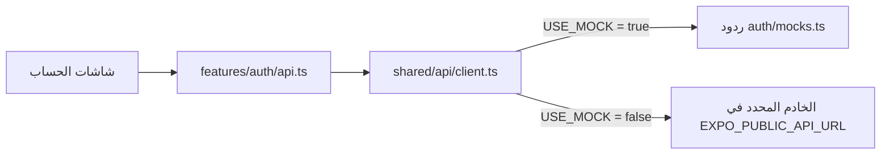
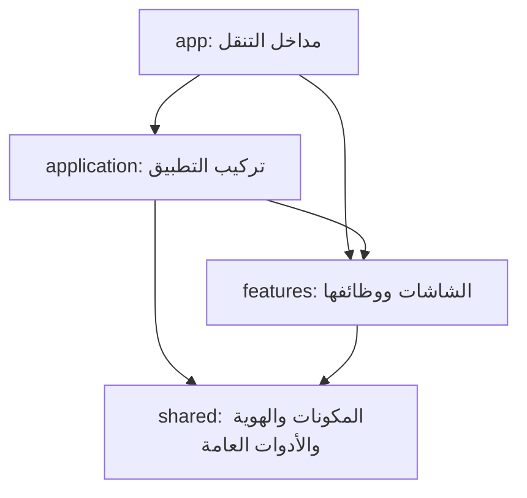

# معمارية الفرونت ورحلة البيانات

بدأ الدليل مع التقسيم في ١٨ أكتوبر ٢٠٢٦. آخر تحديث: ٣ نوفمبر ٢٠٢٦.
يوصف هنا التنفيذ المحلي؛ نشر خدمات التفضيلات والتوصيات والبحث واختبارها حيًا ما زال مطلوبًا.
التصاميم المرجعية داخل `Docs/mockups/`، والتطبيق داخل `frontend/`.

## الحساب والتفضيلات

شاشات الدخول والتسجيل والتحقق في `features/auth` تستخدم العميل المشترك. الجلسة في SecureStore على الجوال وlocalStorage على الويب. بعد التحقق يوجه `goToApp` الحساب غير المكتمل إلى التفضيلات، والمكتمل إلى الرئيسية؛ التصفح العام متاح دون حساب.

`PreferencesForm` يدير ست خطوات واختياراتها، بينما `AccountPreferencesScreen` يقرأ الجلسة ويرسل GET وPUT. نجاح الحفظ يحدّث علامة الجلسة للحساب نفسه ثم يعيد للرئيسية. فشل الحفظ يبقي الإجابات؛ فشل القراءة لا يفتح نموذجًا فارغًا قد يستبدل بيانات موجودة. لا توجد مسودة دائمة غير محفوظة.

تعيد `useHomePreferences` القراءة عند التركيز أو تحديث الرئيسية. لا تعتمد الرئيسية على علامة الجلسة وحدها لإظهار سبب شخصي. [تفصيل الملفات والعقد والاختبار](Preferences-Implementation.ar.md).

## الرئيسية والقائمة

- يفتح التطبيق على الرئيسية دون تسجيل دخول، مع تبويبات الرئيسية والمحفوظة وحسابي.
- الرئيسية تجمع التحية والموقع، «ذوق يدلك»، البحث، اقتراح اليوم والقائمة. تخطيط الطلعات موسوم «قريبًا».
- المحفوظة تستخدم `savedRestaurants` وزر فهد المشترك. صفحة الحساب المحلية تعرض الجلسة والتفضيلات والخروج؛ صفحة الحساب الكاملة في عمل فهد ليست إعلانًا عن دمجها هنا.
- صور البطاقات توضيحية حسب التصنيف وليست صورًا موثقة للمطعم نفسه.

تطلب `restaurants/api.ts` صفحة عامة دون توكن عبر `GET /restaurants?limit=20&offset=...`.
يتحقق الغلاف من الرد، ويدير `useRestaurants(search)` صفحة واحدة وحالات الطلب. التالي والسابق أسفل القائمة، والتحديث بالسحب من أعلى. فشل طلب لاحق يبقي آخر نتائج ناجحة مع تنبيه وإعادة محاولة؛ فشل البداية يعرض حالة الخطأ داخل القائمة. لا توجد عودة تلقائية إلى Mock.

### البحث الشامل

1. يحدّث `HomePage` النص، ويمرره إلى `useRestaurants`.
2. يعاد offset إلى صفر عند تغيير النص، مع تأخير ٣٥٠ms أثناء الكتابة.
3. عند تفعيل الدعم ترسل `getRestaurants(offset, search)` معامل `search` إلى الخادم.
4. الخادم مسؤول عن الفلترة قبل التقسيم وعن `total` الصحيح.
5. يتجاهل hook الردود المتأخرة ولا يعرض نتائج بحث سابق تحت النص الجديد.

البحث الشامل مجهز لكنه معطل عبر `EXPO_PUBLIC_RESTAURANT_SEARCH_ENABLED=false` حتى نشر #46. في هذه الحالة يخفي `HomePage` خانة البحث بالكامل. زر «ألقى مطعم» يزيد `scrollToResultsRequest` في `RestaurantList`؛ تقيس القائمة ارتفاع مقدمتها ثم تنتقل إلى البطاقات. لا يُفتح بحث غير مدعوم، ولا تُفلتر أول ٢٠ نتيجة محليًا. بعد تفعيل الدعم تعود الخانة والبحث الشامل، ويظل الزر ينقل إلى القائمة.

### الموقع والاقتراحات

`HomeLocationBar` يعرض `personalSuggestions/LocationPicker`: GPS عند طلبه، أو حي من GET `/districts`، أو الاستمرار دون موقع. يستخدم الحي معرف الباك النصي. البحث داخل قائمة الأحياء محلي؛ لا تُختلق معرفات من أسماء.

`HomeTodayPick` يجمع حالة التفضيلات والموقع مع `usePersonalRecommendations`. يرسل GPS أو `district_id` مع رمز الحساب إلى `/users/me/recommendations`. بعد الرد يظهر اقتراح اليوم مع سبب عربي، ويمكن عرض بقية النتائج. تغيير الحساب أو الموقع يعزل الردود السابقة، والحفظ أو تحديث الرئيسية يعيد الطلب.

لا تتحول القائمة العامة إلى توصية شخصية عند تعطل الخدمة. عدم وجود موقع يفتح إجراء تحديده؛ وعدم وجود تفضيلات يفتح النموذج.

### تفاصيل المطعم

1. صورة البطاقة واسمها وتقييمها تفتح `RestaurantDetails`.
2. النافذة `Modal` من أسفل، و`pageSheet` على iOS؛ لا تتمدد البطاقة داخل الصف.
3. تظهر الصورة والاسم والتصنيف والحي والتقييم. السعر والمسافة عند توفر قيم صحيحة فقط؛ لا ساعات عمل أو تصويت.
4. `RestaurantMapLink` يفتح الرابط الخارجي، أو يوضح عدم توفره.
5. الرجوع العلوي أو سحب النافذة في iOS يغلقها دون طلب جديد أو تغيير ترتيب القائمة.

سبب الاختيار يأتي من التوصية بعد التفضيلات فقط. `presentation.ts` لا يحول `price_tier` إلى مبلغ ولا يخترع بيانات مفقودة.

## اتجاه العناصر ولوحة المفاتيح

`shared/layout.ts` يصدّر `layoutDirection`: يستخدم `writingDirection` على الويب و`direction` على الجوال. يمنع تمرير خاصية غير مدعومة إلى React Native Web مع بقاء تخطيط الجوال.
المصدر: [توثيق أنماط React Native Web](https://necolas.github.io/react-native-web/docs/styling/).

`keyboardDismissMode` يساوي `none` على الويب داخل النموذج وقائمة المطاعم ومنتقي الموقع، و`on-drag` على الجوال. يمنع فقد التركيز عند ظهور رسالة تحقق وتغيّر ارتفاع المحتوى.
يحافظ `MainTabs` على مساحات الأيقونة والتسمية والمنطقة الآمنة.

## التحقق الحالي

نجح TypeScript وحدود المعمارية و٤٧ اختبارًا. على iPhone 17 Pro Simulator / iOS 26.4 عُرضت مطاعم حقيقية، وفُتحت التفاصيل وعاد الرجوع للقائمة. فُحصت الرئيسية على الويب بعرض ٤٠٢ بكسل، وجُرّبت خطوات التفضيلات والحفظ والاسترجاع في نسخة Mock معزولة. لم تُثبت التفضيلات أو التوصيات على Neon بعد. لم يتغير SQL أو ERD.

راجع [قائمة التسليم وحدود القبول](Frontend-Delivery-2026-11-02.ar.md) قبل إغلاق الإيشيوز. السجل التالي يصف تأسيس النسخ السابقة؛ لا تُقرأ أمثلته القديمة على أنها السلوك الحالي.

## سجل تأسيس الواجهة والهوية — ١٨ إلى ٢٠ أكتوبر ٢٠٢٦

قبل التقسيم كان `frontend/src/app/index.tsx` يحتوي شاشة التسجيل
والمدخلات والحالة والألوان والزر معًا.

في إعادة التنظيم بتاريخ ١٨ أكتوبر، انتقلت الشاشة إلى `features/auth`،
والقيم البصرية إلى `shared/theme.ts`، واستُخرجت المكونات
`AppButton` و`AppInput` و`AppText`. وانتقل تركيب `Stack`
إلى `application/ApplicationRoot.tsx`.

لاحقًا، في تحديث الرئيسية، انتقل مدخل الصفحة إلى
`app/(tabs)/index.tsx`، وأصبح التسجيل في `app/sign-up.tsx`.


**أحجام النصوص — ٢٠ أكتوبر ٢٠٢٦:**

توجد الأحجام في theme.typography:
العنوان 31، والنص العادي 14، وتسمية الحقل 13،
والكتابة داخل الحقل 16، ونص الزر الأساسي 15.

يقرأ AppText أحجام النصوص حسب variant،
ويقرأ AppInput حجم الكتابة من inputSize.

التحقق من الأحجام: نجح npm run check، وعُوينت النصوص على
iPhone 17 Pro بنظام iOS 26.4 دون قصّ ظاهر بالحجم الحالي.

**حافظ التغيير على الشاشة الحالية وسلوكها:** الاسم والجوال، تفعيل الزر عند وجود اسم وجوال من ١٠ خانات يبدأ بـ05، ورسالة `Alert` الموجودة. هذه الرسالة مجرد سلوك أولي سابق؛ **لا ترسل SMS ولا تنشئ حسابًا ولا تثبت تسجيل الدخول**. الربط الفعلي في #20 و#21. لم يُنفذ تسجيل دخول أو تفضيلات أو رئيسية جديدة ضمن إعادة التنظيم.

لا يتغير عقد API أو الباك أو قاعدة البيانات/ERD في هذا التغيير؛ لا توجد طلبات شبكة جديدة. لذلك تبقى وثائق تلك الطبقات ورسومها كما هي. مخطط الاستيراد أدناه وخريطة المستودع وشرح الفرونت هي الأجزاء المتأثرة. مراجع الشرح التاريخية والتصاميم لا يعاد وصفها كتطبيق عامل.

## الفكرة التي نشرحها لفهد

- **المكون Component:** قطعة واجهة مثل زر أو حقل. يعرف كيف يظهر ويستقبل خصائصه. الزر يستقبل `onPress`، لكنه لا يعرف هل الضغط لتسجيل الدخول أو لحفظ تفضيلات.
- **الهوية Theme:** مصدر الألوان والخطوط والأحجام والمسافات. تغيير اللون المشترك هنا ينعكس على المكونات التي تستخدمه.
- **الميزة Feature:** كل ما يخص مهمة وظيفية، مثل الحساب. تحتوي شاشاتها وحالة النماذج وطلبات الحساب ومكوناتها الخاصة.
- **صفحة التركيب Application page:** تجمع أكثر من ميزة، مثل الرئيسية التي تعرض قائمة مطاعم وتستفيد من حالة الحساب. لا تنقل إليها تفاصيل التحقق من رقم الجوال.
- **المسار Route:** ملف صغير داخل `app` يحدد ما الذي يفتح عند زيارة عنوان. محتوى الشاشة لا يُكدس داخله.

نستخدم `features/auth` و`features/preferences` بدل مجلد لكل User Story؛ لأن قصص التسجيل والدخول والتحقق تشترك في ميزة واحدة. تبقى الـUser Stories في GitHub للتخطيط والقبول. ويمكن تسمية الشاشة `Screen` والصفحة التي تجمع ميزات `Page` كما في هذا الدليل.

## لماذا theme.ts بدل index.css؟

المشروع React Native مع Expo، ويعمل على الآيفون والويب. العناصر الأساسية مثل `View` و`Text` تستقبل أنماط React Native؛ لذلك نستخدم **`theme.ts` للقيم و`StyleSheet` لتنسيق المكونات والشاشات**. إضافة CSS وحده لا يجعل واجهة الآيفون تتبعه.

استيراد الهوية لا يطبقها تلقائيًا على كل نص: `AppText` و`AppInput` يقرآن إعداد الخط، و`AppButton` يقرأ لون الزر. إذا استخدمنا `Text` مباشرة في موضع خاص يجب أن نعطيه النمط المقصود.

عند إعادة تنظيم الفرونت في ١٨ أكتوبر، بقي خط النظام والألوان القديمة.
في تحديث الهوية بتاريخ ٢٠ أكتوبر، أُضيف خط IBM Plex Sans Arabic
وطُبّقت ألوان التصميم على المكونات المشتركة، كما يوضح القسم التالي.

**تحديث الخطوط — ٢٠ أكتوبر ٢٠٢٦:**

يستخدم التطبيق خط IBM Plex Sans Arabic بوزني Regular وBold.
توجد ملفات الخط وترخيصها داخل frontend/assets/fonts.

يحمّل ApplicationRoot الخطوط باستخدام expo-font قبل عرض الشاشات.
أثناء التحميل تبقى شاشة البداية ظاهرة. عند نجاح التحميل تظهر الشاشات،
وعند فشله يسمح التطبيق بمتابعة العرض حتى لا يبقى عالقًا في البداية.

توجد أسماء الخطوط في shared/theme.ts:
- fontFamily للنصوص العادية وحقول الإدخال.
- fontFamilyBold للعناوين وتسميات الحقول ونصوص الأزرار.

يختار AppText الخط حسب variant، ويستخدم AppInput الخط العادي.
ويستفيد AppButton من الخط العريض لأنه يعرض نصه باستخدام AppText.

التحقق: نجح npm run check، بما يشمل فحص TypeScript وقواعد
المعمارية والاختبارات السبعة. تمت معاينة الشاشة الحالية على
iPhone 17 Pro بنظام iOS 26.4، وظهر الفرق بين الوزنين.

طُبّقت ألوان الخلفية والحقول والزر من التصميم المعتمد.
يقرأ AppText لون النص الأساسي من theme.colors.text،
ويستخدم AppInput اللون نفسه للكتابة داخل الحقول.
يبقى نص الزر بلون onPrimary، والمثال داخل الحقل بلون placeholder.
يستخدم الزر المعطّل opacity.disabled بقيمة 0.43 من الهوية.
تقل عتامة خلفيته ونصه، وتمنع خاصية disabled التفاعل معه.
القيمة مأخوذة من حالة التعطيل في التصميم المعتمد.
التحقق من ألوان النصوص: نجح npm run check والاختبارات السبعة،
وعُوينت ألوان العنوان وتسميات الحقول والنص الإرشادي ونص الزر
على السيميوليتر
عُوين الزر في حالتي التفعيل والتعطيل:
يظهر بلون الهوية عند التفعيل، وتقل عتامته عند التعطيل.


**المسافات والحواف — ٢٠ أكتوبر ٢٠٢٦:**

توجد القيم المشتركة في theme.ts، ويستخدمها AppInput وAppButton.

المسافات الداخلية للحقل: 12 فوق وتحت، و16 يمينًا ويسارًا.
المسافات الداخلية للزر: 12 فوق وتحت، و20 يمينًا ويسارًا.

استدارة الحقل 15، واستدارة الزر 28، وسماكة الإطار 1.
الحد الأدنى لارتفاع الحقل والزر 54؛ يسمح minHeight لهما
بالنمو عندما يحتاج المحتوى مساحة أكبر.

في شاشة التسجيل الحالية، المسافة بين آخر حقل والزر 32:
هامش أسفل الحقل 20، وهامش أعلى الزر 12.

التحقق: نجح npm run check، بما يشمل TypeScript وحدود المعمارية
والاختبارات السبعة. عُوينت الحقول والزر على السيميوليتر،
وجُرّب تفعيل الزر وتعطيله ببيانات محلية.

هذا التحديث بصري؛ لم يضف اتصالًا بالـAPI أو يغيّر قاعدة البيانات.


## خريطة الملفات المنفذة

هذه خريطة مختصرة للملفات المرتبطة بالرئيسية والحساب وأداة الاتصال.
وجود ملفات الحساب لا يعني اكتمال اختبار الدخول مع الخادم الحقيقي.

```text
Portfolio-Project/
├── architecture.json
├── package.json
├── Docs/
│   ├── Frontend-Architecture.ar.md
│   ├── Frontend-API-Usage.ar.md
│   ├── Preferences-Implementation.ar.md
│   └── Frontend-Delivery-2026-11-02.ar.md
└── frontend/
    ├── README.md
    ├── .env.example
    ├── package.json
    ├── package-lock.json
    ├── app.json
    ├── tsconfig.json
    ├── assets/
    │   ├── fonts/
    │   │   ├── IBMPlexSansArabic-Regular.ttf
    │   │   ├── IBMPlexSansArabic-Bold.ttf
    │   │   └── OFL.txt
    │   └── images/
    │       ├── auth/
    │       ├── food-illustration.png
    │       ├── preferences/
    │       ├── home/
    │       └── restaurant-categories/
    ├── scripts/
    │   ├── check-architecture.mjs
    │   ├── check-architecture.test.mjs
    │   ├── preferences.test.cjs
    │   ├── restaurants-api.test.cjs
    │   ├── preferences-flow.test.cjs
    │   ├── home-recommendations.test.cjs
    │   ├── discovery-flow.test.cjs
    │   └── helpers/render-feature.cjs
    └── src/
        ├── app/
        │   ├── _layout.tsx
        │   ├── sign-up.tsx
        │   ├── login.tsx
        │   ├── verify-phone.tsx
        │   ├── preferences.tsx
        │   └── (tabs)/
        │       ├── _layout.tsx
        │       ├── index.tsx
        │       ├── saved.tsx
        │       └── account.tsx
        ├── application/
        │   ├── ApplicationRoot.tsx
        │   ├── MainTabs.tsx
        │   ├── HomePage.tsx
        │   ├── HomeIntro.tsx
        │   ├── HomeLocationBar.tsx
        │   ├── HomeTodayPick.tsx
        │   ├── useHomePreferences.ts
        │   ├── SavedPlaceholderPage.tsx
        │   └── AccountPlaceholderPage.tsx
        ├── features/
        │   ├── auth/
        │   │   ├── AuthHero.tsx
        │   │   ├── SignUpScreen.tsx
        │   │   ├── LoginScreen.tsx
        │   │   ├── VerifyPhoneScreen.tsx
        │   │   ├── SignOutButton.tsx
        │   │   ├── api.ts
        │   │   ├── mocks.ts
        │   │   ├── session.ts
        │   │   ├── authErrors.ts
        │   │   ├── navigation.ts
        │   │   └── index.ts
        │   ├── preferences/
        │   │   ├── AccountPreferencesScreen.tsx
        │   │   ├── PreferencesForm.tsx
        │   │   ├── api.ts
        │   │   ├── model.ts
        │   │   ├── errors.ts
        │   │   ├── mocks.ts
        │   │   ├── validation.ts
        │   │   ├── steps.ts
        │   │   ├── cuisineOptions.ts
        │   │   ├── foodTypes.ts
        │   │   ├── plateImages.ts
        │   │   ├── allergyOptions.ts
        │   │   ├── index.ts
        │   │   └── components/
        │   │       ├── PreferencesProgress.tsx
        │   │       ├── CuisineCard.tsx
        │   │       ├── FoodTypeCard.tsx
        │   │       ├── FoodPlate.tsx
        │   │       ├── SeatingChoices.tsx
        │   │       ├── DistanceFields.tsx
        │   │       ├── AllergyChoices.tsx
        │   │       └── AllergyCard.tsx
        │   ├── personalSuggestions/
        │   │   ├── api.ts
        │   │   ├── districts.ts
        │   │   ├── location.ts
        │   │   ├── LocationPicker.tsx
        │   │   ├── types.ts
        │   │   ├── usePersonalRecommendations.ts
        │   │   └── index.ts
        │   ├── savedRestaurants/
        │   │   ├── SavedRestaurantsScreen.tsx
        │   │   ├── SaveRestaurantButton.tsx
        │   │   └── index.ts (وبقية ملفات الميزة)
        │   └── restaurants/
        │       ├── api.ts
        │       ├── useRestaurants.ts
        │       ├── RestaurantList.tsx
        │       ├── types.ts
        │       ├── categoryImage.ts
        │       ├── presentation.ts
        │       ├── mocks.ts
        │       ├── index.ts
        │       └── components/
        │           ├── RestaurantCard.tsx
        │           ├── RestaurantDetails.tsx
        │           ├── RestaurantMapLink.tsx
        │           └── RestaurantPagination.tsx
        └── shared/
            ├── theme.ts
            ├── layout.ts
            ├── api/
            │   ├── client.ts
            │   ├── config.ts
            │   ├── errors.ts
            │   └── mockTransport.ts
            └── components/
                ├── AppButton.tsx
                ├── AppInput.tsx
                ├── AppText.tsx
                ├── AppChip.tsx
                └── index.ts
```

### مسؤولية كل جزء

- `app`: ملفات صغيرة تربط المسارات بالصفحات.
- `ApplicationRoot`: تحميل الخطوط وتركيب التنقل الأساسي، وتسجيل ردود الحساب والتفضيلات التجريبية عند تفعيل وضع Mock.
- `MainTabs`: تعريف الشريط السفلي وتبويباته.
- `HomePage`: يجمع مقدمة الرئيسية والبحث والموقع والتوصيات والقائمة ويشترك في تحديثها.
- `HomeTodayPick`: يركب حالات التفضيلات والموقع ونتائج التوصيات.
- `personalSuggestions`: طلبات الأحياء والتوصيات، عزل الردود المتأخرة ومنتقي الموقع.
- `restaurants/api.ts`: يطلب صفحة محددة من ٢٠ مطعمًا عبر أداة الاتصال المشتركة دون رمز دخول، ويتحقق من الرد. يطلب أول صفحة عند عدم تمرير offset.
- `useRestaurants.ts`: يدير البحث المؤجل وصفحة النتائج وحالة الطلب، ويحمي من الردود المتأخرة ويوفر إعادة المحاولة.
- `RestaurantList`: عرض نتائج الخادم والبطاقات وحالات القائمة دون فلترة محلية للبحث.
- `RestaurantCard`: ملخص المطعم وصورته التوضيحية، وفتح نافذة تفاصيل مستقلة.
- `RestaurantDetails`: نافذة التفاصيل والتحكم في إغلاقها، دون طلب شبكة إضافي.
- `RestaurantMapLink`: التحقق من رابط الموقع وفتحه والتعامل مع تعذر الفتح.
- `presentation.ts`: أسماء التصنيفات والأرقام المشرقية والسعر الاختياري؛ لا يختلق بيانات مفقودة.
- `types.ts`: تعريف شكل بيانات المطعم التي تحتاجها الواجهة.
- `mocks.ts`: بيانات تجريبية للمعاينة أثناء التطوير.
- `index.ts` داخل الميزة: صادراتها العامة التي تستخدمها الملفات خارجها.
- `shared`: المكونات العامة وقيم الهوية المستخدمة في أكثر من ميزة.

المجلد `(tabs)` يجمع مسارات التبويبات، ولا يظهر اسمه في عنوان الصفحة.
لذلك يفتح `app/(tabs)/index.tsx` الرئيسية عند `/`.

يبقى منطق المطاعم داخل `features/restaurants`،
وتجمعه صفحة `HomePage` عبر المدخل العام للميزة.

لا ننشئ Hook أو Service فارغًا. نفصل الوظائف عندما يحتاجها
السلوك الفعلي أو إعادة الاستخدام.

## مثال حقيقي من شاشة التسجيل

ملف المسار `frontend/src/app/sign-up.tsx` يفتح شاشة التسجيل:

```tsx
export { SignUpScreen as default } from "@/features/auth";
```

تمر الشاشة عبر المدخل العام للميزة `features/auth/index.ts`.
يصدّر هذا المدخل شاشات الحساب وزر الخروج وأدوات الجلسة
ودالة تجهيز الردود التجريبية.

تحتفظ `SignUpScreen` بالاسم والجوال وحالات التحميل والأخطاء.
عند الضغط على الزر، تتحقق من المدخلات ثم تستدعي `requestCode`
من `auth/api.ts`، وتعالج النتيجة والانتقال إلى شاشة التحقق.

تعرض `VerifyPhoneScreen` حقل الرمز وإعادة الإرسال.
بعد نجاح التحقق، تحفظ الجلسة باستخدام `expo-secure-store`
ثم تستدعي `goToApp(hasSavedPreferences)`: الحساب غير المكتمل يفتح التفضيلات والمكتمل يفتح الرئيسية. التصفح العام يظل متاحًا. هذا توجيه منفذ في الفرونت؛ قبول التكامل يحتاج خدمة التفضيلات الحية.

تستخدم الشاشات `AppInput` و`AppButton` و`AppText` والهوية المشتركة.
تتبع الشاشات الثلاث تصميم UX-01: صورة الواجهة في التسجيل والدخول من `AuthHero`،
وحقل رمز واحد في التحقق تظهر فوقه خانات الأرقام، ويبقى الحقل الحقيقي تحتها حتى يعمل اللصق والتعبئة التلقائية.
يبقى منطق طلب الرمز داخل ميزة الحساب، ولا يوضع داخل `AppButton`.

المكونات المشتركة مسؤولة عن العرض والتفاعل العام.
شاشات الحساب مسؤولة عن التحقق والطلبات والأخطاء والتنقل.

## من يعدل ماذا؟

| الجزء | المسؤول | حدود العمل |
|---|---|---|
| `shared/theme.ts` و`shared/components/*` والخطوط | شذى | الهوية والمكونات العامة، بما فيها فهرس المكونات |
| `shared/api/*` | فهد | أداة HTTP مشتركة منفذة، تشمل الإعداد والأخطاء والنقل التجريبي؛ يبقى اختبار الربط الحقيقي |
| `features/auth/*` ومسارات التسجيل/الدخول/الرمز | فهد | الشاشات ووظيفتها وAPI والجلسة وفهرس auth |
| `features/preferences/*` | شذى | النموذج والشاشات وAPI وبيانات التجربة وفهرس الميزة |
| `features/restaurants/*` | شذى | القائمة والبطاقة والتفاصيل وAPI وبيانات التجربة والفهرس |
| `application/*` والجذر والتبويبات | شذى | تجميع المزايا والتنقل؛ استثناء محدد: `GuestInvitationPage.tsx` لفهد في #67 |
| إعداد Expo والحزم وملف القفل وفحص المعمارية | شذى | تنسق تغييرات فهد المطلوبة في الملفات المشتركة |
| `features/sessions/*` | مقسم بالملف | شذى: `CreateSessionScreen.tsx` و`api/create.ts`. فهد: الانضمام والانتظار والحالة والإجراءات وبقية API و`index.ts` |
| `features/suggestions/*` و`features/results/*` | شذى | الاقتراحات والإعادة والنتيجة في المهام اللاحقة |
| `features/voting/*` و`features/notifications/*` | فهد | التصويت والإشعارات بحسب سبرنتاتها |
| `features/personalSuggestions/*` | شذى | واجهة الترشيح الشخصي #49؛ خوارزمية الباك عند عاصم |
| `features/groups/*` — مؤجل | مقسم بالملف | شذى: القائمة والتفاصيل و`api/groups.ts` و`index.ts`. فهد: `components/AttendanceCard.tsx` و`api/attendance.ts` و`useAttendance.ts` |

**كل صاحب ميزة يكتب غلاف طلبات ميزته، وليس خادم الباك.** مثلًا شذى تكتب `preferences/api.ts` داخل تطبيق الموبايل لاستدعاء API، بينما تنفيذ API في Python له مهمة مستقلة #63. وفهد يكتب `auth/api.ts` ويستخدم خدمة الباك التي ينفذها عاصم. وجود كلمة API في ملف الفرونت لا يحوله إلى باك إند.

صاحب الشاشة يملك أيضًا ملف مسارها الصغير المذكور في مهمته.
تنسق شذى ملفات `app/_layout.tsx` و`app/(tabs)/_layout.tsx`
ومدخل الرئيسية `app/(tabs)/index.tsx`.

عند الحاجة إلى تغيير ملف مشترك، يتفق أصحاب العمل على التعديل
قبل تنفيذه لتجنب التعارض.

## الأعمال المتبقية للربط والميزات القادمة

المصدر الحالي هو [تسليم ٢ نوفمبر](Frontend-Delivery-2026-11-02.ar.md): خدمات التفضيلات والتوصيات والأحياء والبحث تنتظر النشر والتحقق. الواجهة المحلية مجهزة لهذه الطلبات، والتصفح العام يبقى مستقلًا.

#58 يحتاج إعداد نسخة تطوير الآيفون المشتركة وتثبيتها على الأجهزة المطلوبة؛ نجاح السيميوليتر أو Expo Go لا يغطيه. التخطيط والطلعات والمجموعات والتصويت مهام لاحقة وليست ضمن هذا التسليم. لا تُغلق الإيشيوز بناءً على Mock.

## كيف تتصل الشاشة بالباك؟

مسار طلبات الحساب منفذ في الكود:



في وضع التجربة، يسجل `ApplicationRoot` ردود الحساب باستخدام
`registerAuthMocks` و`registerPreferencesMocks`. يمرر العميل الطلب إلى `mockTransport`،
الذي يختار الرد المسجل للعملية المطلوبة.

عند تعطيل وضع التجربة، يرسل العميل الطلب إلى عنوان الخادم.
يمرر المستدعي رمز الدخول عند الحاجة، ويضيفه العميل إلى الطلب.
يعالج العميل أخطاء الشبكة والمهلة وأخطاء الخادم.

وجود مسار الاتصال في الكود لا يثبت نجاح الربط الحقيقي.
ما زال يلزم اختبار التسجيل والدخول وSMS مع عنوان خادم متاح للهاتف.

لا يتحول التطبيق إلى بيانات تجريبية تلقائيًا عند فشل الخادم.

يحفظ `auth/session.ts` جلسة الحساب ويسترجعها ويمسحها.
لا يستورد العميل المشترك هذا الملف؛ يمرر المستدعي الرمز إليه.

قائمة المطاعم تستخدم `restaurants/api.ts` وأداة الاتصال المشتركة لقراءة المطاعم العامة.
التفضيلات تستخدم `preferences/api.ts` لطلبي GET وPUT مع رمز الدخول.
`model.ts` يحوّل أسماء خيارات الأكل والأرقام والنصوص إلى الصيغة المتفق عليها ويقرأ الرد بالعكس.
لا تُرسل هوية المستخدم في جسم الطلب؛ يستنتجها الباك من رمز الدخول.
هذه الإضافة لا تغيّر قاعدة البيانات أو ERD؛ تنفيذ الحفظ في الباك مسؤولية #63.

يبقى منطق كل ميزة وبياناتها التجريبية داخل مجلدها.
تجمع طبقة `application` هذه الأجزاء؛ ولا يستورد `shared` الميزات.
## حدود الاستيراد وفحصها

الأسهم التالية تعني «يستورد من».
الميزات الموجودة هي `auth` و`restaurants` و`preferences` و`savedRestaurants` و`personalSuggestions`.
يعتمد `preferences` على `auth`، و`savedRestaurants` على `restaurants` و`auth`، و`personalSuggestions` على `restaurants`. الاعتماديات معلنة في `architecture.json` وتستخدم المداخل العامة.
يبقى النموذج نفسه قابلًا لإعادة الاستخدام دون طلبات حساب؛ غلاف الحساب هو الذي يستدعي أدوات الجلسة.



- `shared` لا يستورد أي ميزة، والميزة لا تستورد `application` أو ملفات المسارات `app`.
- الاستيراد من خارج ميزة يمر عبر `index.ts`، مثل `@/features/auth`؛ لا يستورد `@/features/auth/SignUpScreen` مباشرة. داخل الميزة نفسها يمكن الاستيراد من ملفاتها الداخلية.
- بطاقة مطعم تعرف بيانات المطاعم تبقى داخل `restaurants`؛ نموذج التفضيلات يبقى داخل `preferences`. المشاركة بين شاشتين لا تعني نقل منطق الميزة إلى `shared`.
- عند إضافة ميزة نضيف اسمها إلى `architecture.json` مع اعتمادياتها الفعلية فقط. عند حاجة voting إلى restaurants نصرح بذلك عند تنفيذهما؛ لا نسمح بكل الاتجاهات مسبقًا.
- الفحص يرفض الاعتماديات غير المعلنة والاستيراد الداخلي من ميزة أخرى ودورات الاعتماد. حل الدورة يكون بإعادة توزيع المسؤولية أو تركيب الميزات في `application`.
- الفحص يتحقق من الاستيرادات المحلية ذات المسارات الثابتة في TS/JS، ومنها إعادة التصدير و`import()` و`require()`. لا يقيّم مسارًا محسوبًا وقت التشغيل؛ استخدموا مسارات ثابتة ومراجعة للكود. ويظل `typecheck` مطلوبًا.

## خطوات العمل اليومية

1. يقرأ كل شخص مهمته وحدود الملفات، ويتأكد من فرع الأساس المتفق عليه مع الفريق ومن وجود التغييرات التي يعتمد عليها عمله قبل إنشاء فرعه.
2. صاحب الشاشة يستخدم المكونات الموجودة. إن احتاج تغييرًا عامًا يسلمه لشذى مع مثال الخصائص المطلوبة، ويكمل ما لا يتوقف عليه.
3. فهد يسلم أداة الطلبات بمثال مدخل/نتيجة/خطأ. كل صاحب ميزة يربط غلاف API الخاص به والشاشة، بعد اعتماد العقد.
4. يضيف كل شخص صادرات ميزته واعتمادياتها مع تنفيذها. `sessions/index.ts` عند فهد و`groups/index.ts` عند شذى لتجنب تضارب الفهارس المشتركة.
5. يحدث شرح البنية والتدفق المتأثر في نفس PR. إذا تغيرت بيانات الباك أو العقد تحدث وثائقها أيضًا؛ لا تغير طبقة غير متأثرة لمجرد إضافة فرق.
6. يشغل الفحوص من جذر الريبو بعد تثبيت حزم الفرونت، ثم يجرب الشاشة على الجهاز/الويب المطلوب في مهمته:

```sh
npm --prefix frontend ci
npm run check:architecture
npm run check
cd frontend
npx expo start
```

للويب: `npm run web`. وللتحقق من البناء: `npx expo export --platform web`. استخدموا نسخة Expo Go المتوافقة مع SDK 58 المثبت في `package.json` أو بناء التطوير المتفق عليه في #58. المراجع التاريخية لـSDK 57 أدناه تخص مرحلة تأسيس المشروع.

أمر `npm run check` يجمع TypeScript وحدود المعمارية و٤٩ اختبارًا للمعمارية وميزات الواجهة. أمر `lint` القديم موجود، لكن إعداد ESLint وحزمه لم تكن مجهزة في المصدر الذي أعيد تنظيمه؛ لا نسجل نجاح lint قبل إعدادها في #54. لا تعتمدوا نجاح البناء دليلًا على SMS أو الحفظ الفعلي.

7. يرفع صاحب التغيير فرعه ويفتح PR للفرع المعتمد، ويذكر رقم المهمة وملفاتها وطريقة الاختبار. يستخدم `Closes #رقم` فقط إذا أنجز شروط المهمة كاملة. إعادة التنظيم مرتبطة بـ#54/#21 وليست إغلاقًا لهما. يراجع الآخر الملفات المشتركة قبل الدمج.

## خريطة بقية المهام

الجدول التالي يسهل الوصول، والتفصيل ملفًا بملف موجود في قسم «مكان العمل» داخل كل Issue. كل الأسماء غير الموجودة في الخريطة المنفذة أعلاه مخططة، والمهمات المؤجلة تظل مؤجلة.

| المهمة | المسؤول | منطقة العمل |
|---|---|---|
| [#9 — الهوية والمكونات المشتركة وتسليم التصميم](https://github.com/shathaaa1110-arch/Portfolio-Project/issues/9) | شذى | `frontend/src/shared/`، `frontend/assets/fonts/`، `Docs/mockups/` |
| [#20 — أداة الاتصال المشتركة](https://github.com/shathaaa1110-arch/Portfolio-Project/issues/20) | فهد | `frontend/src/shared/`، `Docs/Frontend-API-Usage.ar.md` |
| [#21 — التسجيل والدخول والتحقق وجلسة الحساب](https://github.com/shathaaa1110-arch/Portfolio-Project/issues/21) | فهد | `frontend/src/features/auth/`، `frontend/src/app/` |
| [#22 — إنشاء جلسة مباشرة](https://github.com/shathaaa1110-arch/Portfolio-Project/issues/22) | شذى | `frontend/src/features/sessions/`، `frontend/src/app/`، `frontend/src/application/` |
| [#24 — الانتظار والتحديثات المباشرة](https://github.com/shathaaa1110-arch/Portfolio-Project/issues/24) | فهد | `frontend/src/features/sessions/`، `frontend/src/app/` |
| [#25 — تفضيلات الحساب](https://github.com/shathaaa1110-arch/Portfolio-Project/issues/25) | شذى | `frontend/src/features/preferences/`، `frontend/src/app/` |
| [#32 — الاقتراحات وبطاقة المطعم](https://github.com/shathaaa1110-arch/Portfolio-Project/issues/32) | شذى | `frontend/src/features/restaurants/`، `frontend/src/features/suggestions/`، `frontend/src/app/` |
| [#33 — التصويت والمراجعة](https://github.com/shathaaa1110-arch/Portfolio-Project/issues/33) | فهد | `frontend/src/features/voting/`، `frontend/src/app/` |
| [#34 — النتيجة](https://github.com/shathaaa1110-arch/Portfolio-Project/issues/34) | شذى | `frontend/src/features/results/`، `frontend/src/app/` |
| [#44 — المجموعات المحفوظة — مؤجل](https://github.com/shathaaa1110-arch/Portfolio-Project/issues/44) | شذى | `frontend/src/features/groups/`، `frontend/src/app/` |
| [#45 — الإشعارات والروابط](https://github.com/shathaaa1110-arch/Portfolio-Project/issues/45) | فهد | `frontend/src/features/notifications/` |
| [#47 — البحث والفلترة العامة](https://github.com/shathaaa1110-arch/Portfolio-Project/issues/47) | شذى | `frontend/src/features/restaurants/`، `frontend/src/app/` |
| [#49 — الرئيسية والتوصيات الشخصية](https://github.com/shathaaa1110-arch/Portfolio-Project/issues/49) | شذى | `frontend/src/features/personalSuggestions/`، `frontend/src/app/` |
| [#54 — تأسيس المشروع وتشغيله](https://github.com/shathaaa1110-arch/Portfolio-Project/issues/54) | شذى | `frontend/package.json`، `frontend/package-lock.json`، `frontend/tsconfig.json` |
| [#58 — إعداد بناء الآيفون](https://github.com/shathaaa1110-arch/Portfolio-Project/issues/58) | شذى | `frontend/app.json`، `frontend/eas.json`، `frontend/package.json` |
| [#65 — الانضمام برمز](https://github.com/shathaaa1110-arch/Portfolio-Project/issues/65) | فهد | `frontend/src/features/sessions/`، `frontend/src/app/` |
| [#66 — تفضيلات الجلسة](https://github.com/shathaaa1110-arch/Portfolio-Project/issues/66) | شذى | `frontend/src/features/preferences/`، `frontend/src/app/` |
| [#67 — دعوة الضيف في المتصفح](https://github.com/shathaaa1110-arch/Portfolio-Project/issues/67) | فهد | `frontend/src/application/`، `frontend/src/features/sessions/`، `frontend/src/app/` |
| [#74 — تقدم التصويت](https://github.com/shathaaa1110-arch/Portfolio-Project/issues/74) | فهد | `frontend/src/features/voting/`، `frontend/src/app/` |
| [#75 — فحص العربية والتحميل والأخطاء](https://github.com/shathaaa1110-arch/Portfolio-Project/issues/75) | فهد | `Docs/Frontend-QA.ar.md`، `frontend/src/features/auth/`، `frontend/src/features/sessions/` |
| [#79 — الحضور والإزالة — مؤجل](https://github.com/shathaaa1110-arch/Portfolio-Project/issues/79) | فهد | `frontend/src/features/groups/` |
| [#81 — تفاصيل المطعم](https://github.com/shathaaa1110-arch/Portfolio-Project/issues/81) | شذى | `frontend/src/features/restaurants/`، `frontend/src/app/` |
| [#89 — مغادرة الجلسة وإزالة مشارك](https://github.com/shathaaa1110-arch/Portfolio-Project/issues/89) | فهد | `frontend/src/features/sessions/` |
| [#91 — لا نتائج وإعادة المحاولة](https://github.com/shathaaa1110-arch/Portfolio-Project/issues/91) | شذى | `frontend/src/features/suggestions/`، `frontend/src/app/` |
| [#97 — الرئيسية والشريط السفلي](https://github.com/shathaaa1110-arch/Portfolio-Project/issues/97) | شذى | `frontend/src/application/`، `frontend/src/app/` |
| [#102 — قائمة المطاعم العامة](https://github.com/shathaaa1110-arch/Portfolio-Project/issues/102) | شذى | `frontend/src/features/restaurants/`، `frontend/src/application/` |


فتح الرئيسية لا يشترط حسابًا. مسار `/preferences` متاح من حسابي.
التوجيه التلقائي بعد الدخول منفذ: حساب غير مكتمل إلى التفضيلات، وحساب مكتمل إلى الرئيسية. يحتاج اعتماد الرحلة النهائية اختبار الحفظ والاسترجاع الحقيقيين بعد نشر الباك.

من متطلبات التدفقات القادمة إتاحة التخطيط المباشر والدعوات
دون اشتراط إنشاء مجموعة محفوظة، مع الحفاظ على قيود المشاركين.
وجود بطاقة الجلسة الحالية لا يعني تنفيذ هذه التدفقات.


## التحقق من الرئيسية — ٢١ أكتوبر ٢٠٢٦

- نجح `npm run check`: فحص TypeScript وحدود المعمارية والاختبارات السبعة.
- عُوينت الرئيسية على السيميوليتر iPhone 17 Pro بنظام iOS 26.4.
- ظهر النص العربي بمحاذاته الحالية، وظهرت صورة الطعام داخل البطاقة.
- أظهر البحث عن «شامي» المطعم المطابق.
- أظهر البحث عن «باسم طويل» البطاقة المطابقة للاسم.
- أظهر البحث عن «بيتزا» رسالة عدم وجود نتائج.
- أعاد مسح البحث البطاقات التجريبية الثلاث.
- جُرّب الانتقال إلى صفحتي المحفوظة وحسابي المؤقتتين والعودة للرئيسية.
- زر إنشاء الجلسة معطّل وموسوم «قريبًا».

البحث الحالي وإعادة المحاولة يعملان على المعاينة المحلية.
لم يُختبر طلب مطاعم حقيقي أو تسجيل دخول أو SMS في هذا التحديث.
لم يُنفذ بناء ويب جديد ضمن هذه المراجعة.

الاختبارات السبعة تخص فاحص المعمارية؛ لا تغطي جميع تفاعلات الشاشة.

لا يغيّر هذا العمل عقد API أو قاعدة البيانات أو ERD،
لذلك لم تتغير وثائق تلك الطبقات ورسومها.

هذه نتائج إعادة التنظيم بتاريخ ١٨ أكتوبر، وليست فحصًا جديدًا للرئيسية:

- نجح `npm run check`، بما يشمل TypeScript وحدود المعمارية والاختبارات السبعة.
- نجح `CI=1 npx expo export --platform web` باستخدام حزم القفل حينها.
- جُرّب نموذج التسجيل في نسخة الويب: النموذج الفارغ يعطل الزر، والاسم ورقم الجوال المقبول يفعلانه، والرقم غير المقبول يعطله.
- لم تُختبر SMS أو API في ذلك التغيير، ولم يُختبر بناء iPhone.

مراجع التقنية: [Expo SDK 57](https://docs.expo.dev/versions/v57.0.0/)، [تنظيم Expo Router](https://docs.expo.dev/router/basics/core-concepts/)، [أنماط React Native 0.86](https://reactnative.dev/docs/0.86/style).

### تحديث الرئيسية في الريبو — ٢ نوفمبر ٢٠٢٦

التحية والموقع والتوصيات والقائمة موثقة في بداية هذا الملف. حالة `district` متاحة إلى جانب GPS و`none`، والتفاصيل نافذة مستقلة من أسفل؛ لم يعد التوسع داخل صف القائمة هو السلوك المعتمد. فحص ٣ نوفمبر يشمل ٤٩ اختبارًا؛ ودليل تجربة الويب والسيميوليتر السابقة كما في [قائمة التسليم](Frontend-Delivery-2026-11-02.ar.md). نجاح التوصيات الحية ما زال ينتظر الباك.
