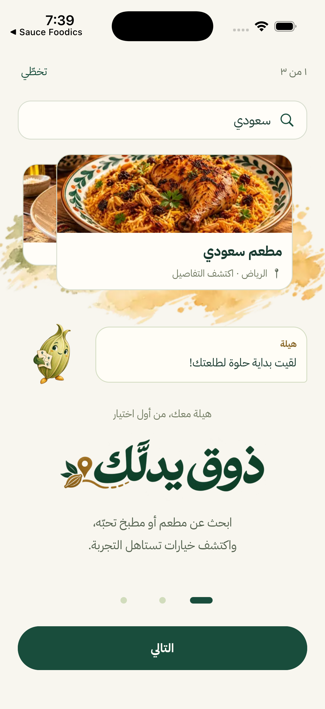
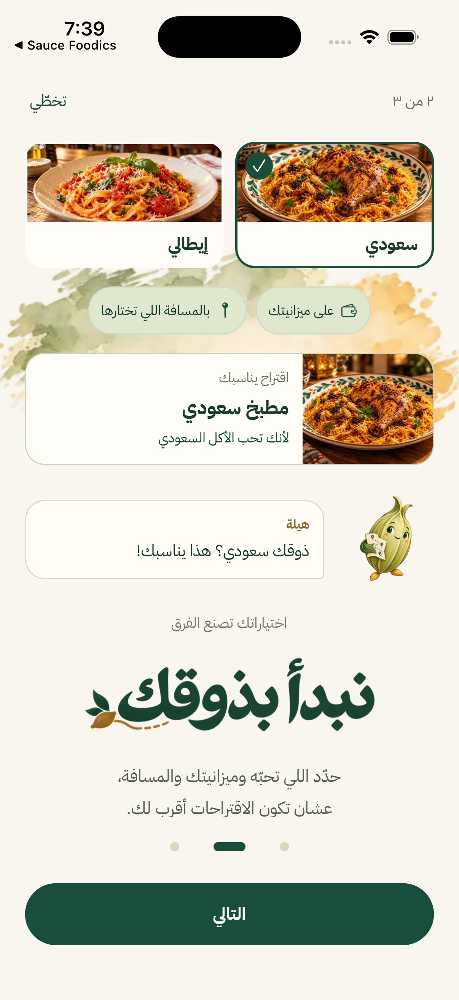
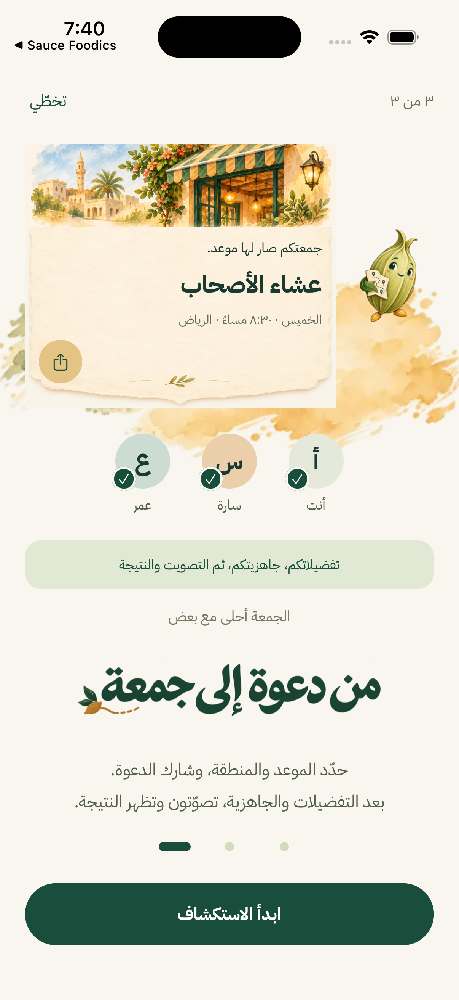
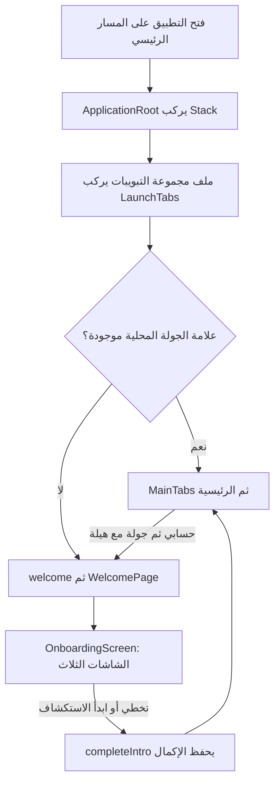

# شاشات هيلة عند أول فتح

تنفيذ بتاريخ 24 نوفمبر 2026، مبني على `deployment` عند `92e5aa4`. هذا الدليل يصف شاشات التعريف داخل التطبيق؛ نشرها للمستخدمين يعتمد على دمج التغيير وإصدار التطبيق.

## ماذا يرى المستخدم؟

عند أول فتح عادي للتطبيق تظهر ثلاث شاشات، قبل تسجيل الدخول:

1. **ذوق يدلّك:** هيلة، البحث، ثم بطاقة مطعم.
2. **نبدأ بذوقك:** اختيار مطبخ في المثال، ثم توضيح الميزانية والمسافة وظهور اقتراح وسببه. رد هيلة في صف مستقل أسفل البطاقة.
3. **من دعوة إلى جمعة:** دعوة طلعة، ظهور الأصحاب، ثم توضيح التفضيلات والجاهزية والتصويت.

«التالي» يغيّر الشاشة، والنقاط تعيد لأي واحدة منها. «تخطّي» وزر «ابدأ الاستكشاف» يفتحان الرئيسية **دون تسجيل دخول**. الحركة قصيرة وتعمل تلقائيًا ثم تتوقف؛ لا توجد أزرار إعادة مشهد أو تشغيل حركة في واجهة المستخدم.

زر الانتقال والنقاط ثابتان أسفل المساحة الآمنة في الشاشات الثلاث. المشهد والعنوان والوصف داخل `ScrollView` منفصل، بينما شريط التنقل يأتي بعده داخل `SafeAreaView`. هكذا لا يتغير مكان الزر عندما يطول الوصف أو تظهر مراحل الحركة. الشريط يحجز مساحته في التخطيط ولا يغطي نهاية المحتوى؛ يمكن تمرير المحتوى فوقه على الشاشات الصغيرة.

بعد إكمال الجولة أو تخطيها لا تظهر تلقائيًا عند الفتح التالي على الجهاز/المتصفح نفسه. «حسابي ← جولة مع هيلة» يعيد عرضها يدويًا، حتى قبل تسجيل الدخول. رابط دعوة مباشر يفتح وجهة الدعوة ولا يُحوّل إلى الجولة.

## الصور من التطبيق

هذه صور من تشغيل المكونات في iOS Simulator، وليست صفحة HTML داخل التطبيق:

| الاكتشاف | التفضيلات | الطلعة |
|---|---|---|
|  |  |  |

## من أين تبدأ الرحلة؟



`Stack` يحتوي مجموعة التبويبات ومسار `welcome` كوجهتين منفصلتين. الجولة ليست داخل `MainTabs`، لذلك لا تظهر فوق الشريط السفلي. ينتظر `LaunchTabs` قراءة العلامة قبل تركيب التبويبات؛ هذا يمنع ومضة الرئيسية وطلبات مطاعمها قبل ظهور الجولة.

الانتقال النهائي يستخدم `router.replace("/")`: يستبدل الجولة بالرئيسية، فلا يعيد زر الرجوع المستخدم إلى الجولة التي انتهى منها.

## كل ملف وما وظيفته

المسارات التالية تبدأ من `frontend/`:

| الملف | دوره ولماذا فُصل |
|---|---|
| `src/app/welcome.tsx` | يعرّف عنوان `/welcome` لـExpo Router. يصدّر `WelcomePage` فقط؛ لا يكرر تصميم الشاشة. وجود ملف داخل app هو قاعدة التوجيه بالحزمة. |
| `src/app/(tabs)/_layout.tsx` | نقطة تركيب مجموعة التبويبات. يصدّر `LaunchTabs` بدل تركيب MainTabs مباشرة. |
| `src/application/ApplicationRoot.tsx` | مدير التنقل الأساسي الموجود أصلًا. أضيف إليه إعداد مسار welcome لمنع إغلاق الجولة بسحب جانبي عارض. |
| `src/application/LaunchTabs.tsx` | يجمع قرار الإكمال مع التوجيه. `null` يعني قراءة جارية، `false` يعني افتح الجولة، و`true` يعني اعرض MainTabs. |
| `src/application/WelcomePage.tsx` | يمرر فعل النهاية للشاشة: يمنع الضغط المكرر، يحفظ العلامة، ثم يفتح الرئيسية. هذه مسؤولية تركيب وتنقل، لذلك وضعناه في application. |
| `src/features/onboarding/OnboardingScreen.tsx` | يحتفظ برقم الخطوة ويعرض المشهد والعنوان والوصف داخل ScrollView. التالي والنقاط في شريط ثابت خارج منطقة التمرير، حتى يبقيا في المكان نفسه مع اختلاف طول المشاهد والخط. |
| `src/features/onboarding/components/IntroScenes.tsx` | الرسم الفعلي للمشاهد الثلاثة بمكونات View وImage وAppText. يحتوي حالة المطبخ التوضيحي محليًا، وهيلة وفقاعتها وتنسيق البطاقات. جمعنا المشاهد الصغيرة في ملف واحد بدل ملفات متشابهة كثيرة. |
| `src/features/onboarding/components/Reveal.tsx` | حركة ظهور مشتركة: شفافية وإزاحة قصيرة باستخدام Animated. الفصل يمنع تكرار إعداد الحركة في كل عنصر. |
| `src/features/onboarding/content.ts` | النصوص الثلاثة ومراجع الصور المحلية. تعديل الوصف لا يحتاج تغيير التخزين أو التوجيه. |
| `src/features/onboarding/useIntroMotion.ts` | مراحل الحركة 0 إلى 3. لا ينتقل بين الصفحات. يوقف المؤقت عند خروج التطبيق للخلفية، ويحترم تقليل الحركة، ويلغي المؤقتات عند مغادرة الشاشة. |
| `src/features/onboarding/completion.ts` | قراءة وكتابة علامة الإكمال، وإبلاغ الواجهة عندما تتغير. لا يحفظ تفضيلات أو بيانات حساب. |
| `src/features/onboarding/index.ts` | المدخل العام: يصدّر الشاشة وفعل الإكمال وقراءة حالته. بقية الملفات خارج الميزة تستورد منه فقط. |
| `src/features/auth/AccountScreen.tsx` | أضيف صف «جولة مع هيلة» لفتح `/welcome` يدويًا. لم يتغير طلب بيانات الحساب أو تسجيل الدخول. |
| `assets/images/onboarding/` | سبع صور WebP من التصميم المعتمد: هيلة والمطبخان والخلفية وثلاثة عناوين مرسومة. رسمة المطعم تُستخدم من assets/images/sessions دون نسخها. الخط من assets/fonts الموجود أصلًا. |
| `scripts/onboarding.test.cjs` | اختبارات التدفق وحفظ الإكمال والأخطاء والحركة. يضمها npm run check. |

تقسيم `app → application → features` تنظيم المشروع، وليس شرطًا أن يكتب كل تطبيق React الملفات بهذه الأسماء. ملف `_layout.tsx` داخل app له معنى خاص لدى Expo Router؛ أما `LaunchTabs` و`WelcomePage` فاسمان اخترناهما لتوضيح المسؤولية.

`architecture.json` يعلن `onboarding: []`: الميزة تعتمد على الأدوات المشتركة فقط. لا توجد دائرة اعتماد مع auth أو preferences.

## ماذا يحدث عند الضغط؟

في `OnboardingScreen` يبدأ `step` بالقيمة صفر. المشهد هو أحد `[DiscoveryScene, PreferencesScene, OutingScene]`. «التالي» يزيد step، ويعيد موضع التمرير إلى الأعلى، ويبدأ حركة المشهد الجديد. النقاط تضبط step مباشرة. الانتقال بين هذه الشاشات تغيّر حالة داخل مكون واحد؛ لا ينشئ ثلاثة عناصر جديدة في سجل الرجوع.

اختيار الإيطالي يستدعي `setSelected("italian")`. تعيد React رسم الصورة والاسم والسبب ورد هيلة باستخدام هذه القيمة، وتظهر مراحل المثال كاملة. لا يغيّر ذلك تفضيلات الشخص الحقيقية. نموذج الحساب الحقيقي يبقى في `features/preferences` ويظهر بعد تسجيل الدخول للحساب غير المكتمل كما كان.

## إصلاح قص بطاقة الطلعة — 24 نوفمبر 2026

في المشهد الثالث داخل `/welcome` كانت رسمة المطعم تُعرض بارتفاع ثابت مع `cover`؛ اختلاف عرض البطاقة يغيّر الجزء المقتطع. وكانت صورة الورقة المعتمة تُمدد خلف الرسمة والنص معًا، فيظهر مستطيل حاد فوق الخلفية المائية.

في `IntroScenes.tsx` أصبحت الرسمة تستخدم `aspectRatio: 3` و`contentFit="contain"`، وهي نسبة أصلها 1080×360، فتظهر كاملة. البطاقة الآن ذات خلفية بلون التطبيق وإطار خفيف وزوايا دائرية؛ النص يحدد ارتفاع الجزء السفلي بدل تمديد صورة الورقة. صُغرت مساحة هيلة المجاورة مع الاحتفاظ بنسبتها لتوسيع البطاقة على الجوال. أزيل مرجع الورقة من `content.ts` فقط؛ أصل الصورة ما زال مستخدمًا في نماذج الطلعات الحقيقية.

التغيير في عرض المثال التعريفي فقط؛ لا يغيّر نموذج إنشاء الطلعة أو مراحل الجولة أو التنقل أو API أو SQL/ERD أو اعتماد الميزات.

- نجح `npm run check` وبناء الويب `expo export --platform web` بعد الإصلاح.
- روجع الشكل على الويب بعرض 320 و390 و430 بكسل: لا صور مفقودة ولا تمرير أفقي. عند 320×568 بقي زر النهاية عند `y: 500` قبل تمرير المحتوى وبعده، والوصف متاح بالتمرير.
- لم يُجرَ تحقق بصري جديد على iOS أو Android لهذا الإصلاح؛ السيميوليترات كانت مغلقة.

المعاينة التالية من الويب بعرض 390 بكسل، وهي أحدث من صور السيميوليتر أعلاه:


## أين تُحفظ علامة أول فتح؟

المفتاح `thouq.onboarding.v1`، والقيمة `done`:

- iOS وAndroid: عبر SecureStore الموجود في المشروع.
- الويب: localStorage في المتصفح والأصل الحاليين.
- الذاكرة: نسخة مؤقتة تمنع إعادة القراءة وتُحدّث الواجهة مباشرة.

هذه العلامة ليست في Neon ولا في الحساب ولا تُرسل مع طلبات API. متصفح آخر أو جهاز آخر له تخزينه؛ حذف بيانات التخزين قد يعيد الجولة. SecureStore على iOS قد يحتفظ بالمفتاح بعد إعادة تثبيت التطبيق، لذلك لا نعد بأنه يُمحى بمجرد الحذف.

إذا تعذرت القراءة نظهر الجولة. وإذا تعذرت الكتابة نحتفظ بالإكمال في الذاكرة ونفتح الرئيسية؛ لا نحبس المستخدم في الجولة. قد تتكرر عند إعادة تشغيل التطبيق إن بقي التخزين غير متاح. وإذا اكتملت الجولة أثناء قراءة بطيئة، لا يسمح الكود لنتيجة القراءة القديمة أن تلغي الإكمال.

## هل يحتاج الباك تغييرًا؟

لا. لا يوجد endpoint جديد أو تعديل لعقد تسجيل الدخول أو حفظ التفضيلات أو SQL/ERD. الميزانية والمسافة والنتيجة داخل الرسم أمثلة تعليمية. طلبات المطاعم الحقيقية تبدأ عند فتح الرئيسية وفق التنفيذ الموجود. بيانات التفضيلات الحقيقية تبقى ضمن GET وPUT `/users/me/preferences` بعد تسجيل الدخول.

## التشغيل والاختبار محليًا

من جذر هذه النسخة:

```sh
npm run check
cd frontend
EXPO_PUBLIC_USE_MOCK=true npx expo start --port 8085 --localhost
```

وضع Mock هنا لعزل اختبار الجولة عن خدمات الفريق، وليس شرطًا لعملها. عند التشغيل المعتاد يقرأ التطبيق إعدادات البيئة الموجودة. لا أضيف ملف `.env` لهذا التغيير.

لفتح الجولة مباشرة في السيميوليتر المتاح:

```sh
xcrun simctl openurl booted 'exp://localhost:8085/--/welcome'
```

إذا كان أكثر من سيميوليتر يعمل، استبدلي `booted` بمعرف الجهاز من `xcrun simctl list devices booted`. افتحي الويب على `http://localhost:8085/welcome`، أو من «حسابي ← جولة مع هيلة». الرابط المباشر يعرض الجولة حتى بعد حفظ الإكمال كي يمكن مراجعتها.

## التحقق

- نجح `npm run check`، بما فيه TypeScript وحدود المعمارية والاختبارات القائمة واختبارات الجولة السبعة.
- نجح بناء الويب عبر `expo export --platform web`؛ الناتج للاختبار المحلي ولم يُنشر.
- على iPhone 17 Pro عبر Expo Go SDK 58: ظهرت المشاهد والصور، تغيّر المثال بين المطبخين، ووصل زر النهاية للرئيسية. إعادة الجولة من حسابي متاحة قبل تسجيل الدخول.
- على الويب بعرض 320 بكسل: لا تمرير أفقي ولا صور مفقودة، ورد هيلة لا يغطي بطاقة الاقتراح. التخطي يفتح الرئيسية لمتصفح غير مسجل، وإعادة تحميلها لا تعيد الجولة.
- تحقق تثبيت التنقل: عند حجم 390×844 كان موضع زر الانتقال نفسه في المشاهد الثلاثة (`y: 776` وارتفاع 54). وعند 320×568 بقي الزر عند `y: 500` بعد تمرير المحتوى حتى نهايته، مع ظهور الوصف الأخير فوق الشريط ودون تمرير أفقي. روجعت الشاشات أيضًا في iOS Simulator، ونجح `npm run check` بعد التعديل.
- الاختبارات تتحقق من القراءة البطيئة وفشل التخزين ومنع النقر المكرر والتقليل الآلي للحركة والخروج للخلفية. إعداد تقليل الحركة اختُبر برمجيًا؛ لم نغيّر إعداد نظام المستخدم.
- لم تُختبر نسخة Android على جهاز في هذه الجولة.

راجع توثيق [Expo Router SDK 58](https://docs.expo.dev/versions/v58.0.0/sdk/router/) و[SecureStore SDK 58](https://docs.expo.dev/versions/v58.0.0/sdk/securestore/). نسخة المشروع الفعلية SDK 58؛ تمت مراجعة مرجع SDK 57 المطلوب أيضًا دون تغيير إصدارات المشروع.
