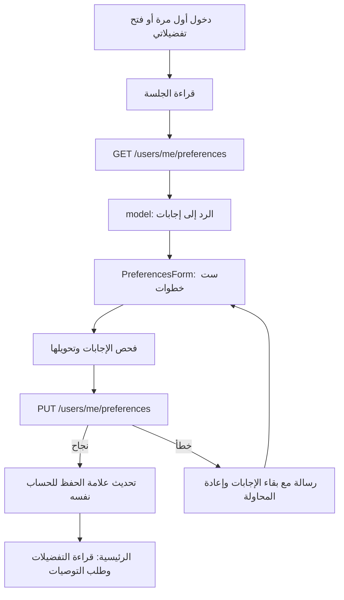

# تفضيلات الحساب: الملفات والحفظ والاختبار

آخر تحديث: ٢ نوفمبر ٢٠٢٦. هذا وصف للفرونت المحلي، وليس إعلانًا عن نشر الباك.

## ما يعمل في الواجهة؟

النموذج ست خطوات: المطابخ، الأكل، الجلسة، الميزانية، المسافة، الحساسية. بقي التصميم المعتمد والصحن وعبارة «نبدأ بذوقك». السابق والتالي يحفظان الاختيارات داخل النموذج، والخطوة الأخيرة تتحقق من الإجابات ثم ترسل الحفظ مرة واحدة.

بعد التحقق من الدخول، يوجه `auth/navigation.ts` الحساب غير المكتمل إلى `/preferences?onboarding=1`، والحساب المكتمل إلى الرئيسية. إذا كانت علامة الجلسة قديمة لكن GET يعيد `is_saved: true`، تتجاوز الشاشة نموذج البداية. تبقى التفضيلات قابلة للتعديل من الرئيسية وحسابي، والتصفح العام لا يتطلب دخولًا.

نجاح PUT يحدّث علامة الجلسة للحساب نفسه، ثم يعيد المستخدم إلى الرئيسية حيث تُقرأ التفضيلات وتُطلب التوصيات من جديد. عند تعطل خدمة التفضيلات تظهر إعادة المحاولة والعودة للتصفح؛ لا نفتح نموذجًا فارغًا قد يمسح بيانات موجودة.

في فحص OpenAPI المنشور يوم ٢ نوفمبر لم تظهر مسارات التفضيلات والتوصيات. لذلك لا نعتبر الحفظ الحقيقي أو الاقتراح الحي مكتملين حتى نشر الباك واختبارهما.

## لماذا كل هذه الملفات؟

المسارات داخل `frontend/src/features/preferences`. الفصل يجعل تعديل التصميم مستقلًا عن الاتصال والتحقق، ويسمح باختبار كل مسؤولية.

| الملف | ما يفعله |
|---|---|
| `AccountPreferencesScreen.tsx` | يقرأ الجلسة والتفضيلات، يعالج التحميل والحفظ والأخطاء، ثم ينتقل للرئيسية |
| `PreferencesForm.tsx` | يدير الخطوة والاختيارات والأزرار؛ لا يرسل HTTP ولا يقرأ الحساب |
| `steps.ts` | عناوين الخطوات الست وأوصافها وترتيبها |
| `cuisineOptions.ts` و`foodTypes.ts` و`allergyOptions.ts` | أسماء الخيارات ومفاتيحها وصورها |
| `plateImages.ts` | يربط أنواع الأكل بصور الحصص المخصصة للصحن |
| `components/` | بطاقات المطابخ والأكل، الصحن، الجلسة، المسافة، الحساسية وشريط التقدم |
| `model.ts` | يحوّل إجابات الشاشة إلى عقد الباك والعكس، ويفحص الحساسية ونص الجلسة |
| `validation.ts` | يحوّل الأرقام العربية والفارسية ويفحص الميزانية والمسافة |
| `api.ts` | GET وPUT عبر عميل الطلبات المشترك، مع التحقق من الرد |
| `errors.ts` | يحوّل أخطاء الشبكة و401 و404 و422 و503 إلى رسائل عربية |
| `mocks.ts` | حساب اختبار واحد في الذاكرة عند تشغيل الوضع التجريبي صراحة |
| `index.ts` | المدخل العام الذي تستخدمه بقية الميزات |

`application/ApplicationRoot.tsx` يسجل الردود عند تفعيل Mock فقط.
`features/auth/AccountScreen.tsx` يضيف صف التفضيلات للحساب المسجل.
`app/preferences.tsx` يفتح الشاشة. `auth/session.ts` يحدّث علامة الحفظ دون تغيير حساب آخر. `application/useHomePreferences.ts` يعيد قراءة التفضيلات عند العودة للرئيسية. الاعتماد `preferences -> auth` معلن في `architecture.json`.

## رحلة البيانات



يمكن إعادة استخدام النموذج عبر `initialValue` و`onSubmit` و`onExit` في تدفق ضيف لاحقًا، لكن تخطيط طلعة للضيف ليس جزءًا من هذه الإضافة.

## عقد الطلب

المصدر: [اتفاق API في #8](https://github.com/shathaaa1110-arch/Portfolio-Project/issues/8) وتنفيذ [PR #142](https://github.com/shathaaa1110-arch/Portfolio-Project/pull/142) المقروء في ٢ نوفمبر.

GET وPUT على `/api/v1/users/me/preferences` مع `Authorization: Bearer <token>`. العميل يضيف `/api/v1`؛ تمرر الميزة `/users/me/preferences` فقط.

```json
{
  "liked_cuisines": ["saudi_gulf", "grill", "coffee_tea"],
  "allergies": ["milk", "نوع آخر كتبه المستخدم"],
  "budget_min": 60,
  "budget_max": 120,
  "max_distance_km": 2.5,
  "seating_needs": "عائلات، داخلية"
}
```

GET يعيد الحقول مع `is_saved`. PUT يعيد `{ "message": "preferences saved" }`. لا نرسل `user_id` أو `is_saved` في PUT؛ الباك يحدد الحساب من الرمز.

- المطابخ والأكل يستخدمان مفاتيح العقد. مثلًا `grills` يصبح `grill` و`coffee-tea` يصبح `coffee_tea` و`desserts` يصبح `sweets`.
- الأرقام العربية والفارسية مقبولة. الميزانية عدد صحيح غير سالب والأدنى لا يتجاوز الأعلى. لا يوجد سقف مالي تجاري مضاف؛ يوجد حد التخزين العددي فقط.
- المسافة موجبة ويمكن أن تكون كسرًا؛ `٢٫٥` تصبح `2.5`. الفراغ أو «بدون حد» يرسل `null` لا صفرًا.
- نص الجلسة لا يتجاوز ٢٠٠ حرف. يحافظ النموذج على النص المحفوظ غير المطابق للبطاقات.
- الحساسية حتى ٢٠ قيمة، كل قيمة حتى ٥٠ حرفًا. تزال التكرارات وتبقى الأنواع المخصصة في «أخرى». اختيار «أخرى» دون تفاصيل يمنع الحفظ.
- العقد المقروء يقبل مصفوفة حساسية؛ اقتراح `null` لعدم الإجابة لم يصبح عقدًا منفذًا بعد. لا نعرض `[]` عند القراءة كإقرار مؤكد بعدم وجود حساسية.
- الحساسية تنبيه وليست ضمان سلامة أو فلترًا مطبقًا على المطاعم. نص الجلسة لا يعني أن الخوارزمية تطبقه كشرط إلزامي.

## حالات الطلب وحدود الحفظ

القراءة الأولية لها تحميل وخطأ وإعادة محاولة. دون جلسة أو عند 401 يظهر تسجيل الدخول. أثناء PUT تظهر «نحفظ ذوقك» بمدة الطلب الفعلية، وتُمنع النقرات المكررة. 422 يوضح الحقول المرفوضة بالعربية؛ 404 و503 يوضحان عدم توفر الخدمة. فشل الحفظ يبقي الإجابات في النموذج.

تتحقق الشاشة من أن الجلسة لم تتغير قبل الإرسال وبعد النجاح. لا ترسل إجابات حساب سابق إلى حساب جديد. لا توجد مسودة دائمة: مغادرة النموذج أو إعادة تحميل التطبيق أو الانتقال لإعادة الدخول قد يفقد الإجابات غير المحفوظة.

## الصور وأداء الواجهة

أصبحت صور التفضيلات ٤٦ PNG بحجم إجمالي ٦٬٣٧٤٬٦٤٧ بايت، بدل ٤٧ صورة بحجم ٨٨٬٢٧٦٬٨٧٧ بايت. بقيت الأسماء والشفافية، وحُذف `grills-plate.png` غير المستخدم. صور الخيارات والصحن بحد ٦٠٠ بكسل، وصورتا الميزانية والمسافة بعرض ١٠٠٠. تُركّب صور الخطوة المفتوحة فقط لتقليل الحمل؛ الإجابات تبقى في حالة النموذج.

يستخدم الويب `keyboardDismissMode="none"` داخل النموذج كي لا يفقد الحقل التركيز عند ظهور رسالة التحقق وتغيّر ارتفاع المحتوى. على الجوال يبقى إخفاء لوحة المفاتيح بالسحب.

## دليل التحقق — ٢ نوفمبر ٢٠٢٦

`npm run check` من جذر الريبو يشمل TypeScript والمعمارية و٤٧ اختبارًا. منها اختبارات لحالة مكونات React: الخطوات الست، منع القيم الخاطئة، منع تكرار الحفظ، الاحتفاظ بالإجابات عند الفشل، وعدم الحفظ لحساب تغيّر.

جُرّب على ويب بعرض ٤٠٢ بكسل في **نسخة معزولة** بوضع Mock وعنوان API محلي غير قابل للوصول: دخول حساب اختبار، فتح التفضيلات تلقائيًا، اختيار المطابخ والأكل والجلسة، رفض ميزانية `١٢٠–٦٠` وقبول `١٢٠–١٥٠`، رفض مسافة صفر وقبول `٢٫٥`، رفض «أخرى» دون نص، ثم الحفظ والعودة للرئيسية وإعادة فتح الخيارات المحفوظة. لا يثبت ذلك الحفظ على Neon أو SMS حقيقية أو جهاز آيفون فعلي.

لتجربة معزولة، اضبط القيم في `.env.local` **داخل نسخة اختبار منفصلة** وأعد تشغيل Expo؛ لا تعتمد على متغيرات الطرفية وحدها:

```dotenv
EXPO_PUBLIC_USE_MOCK=true
EXPO_PUBLIC_API_URL=http://127.0.0.1:1/api/v1
EXPO_PUBLIC_RESTAURANT_SEARCH_ENABLED=false
```

الرمز التجريبي `123456`. التفضيلات التجريبية تعيش في الذاكرة فقط، ولا تثبت عزل حسابين في الباك. بعد نشر الخدمة يجب اختبار حسابين حقيقيين والاسترجاع بعد إغلاق التطبيق. تفاصيل التسليم في [قائمة التسليم](Frontend-Delivery-2026-11-02.ar.md). لا تغييرات على SQL أو ERD.
