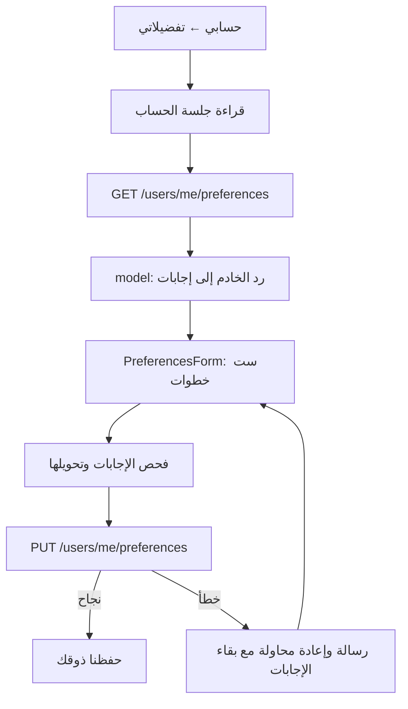

# تفضيلات الحساب: الملفات والحفظ والاختبار

تحديث ٢٨ أكتوبر ٢٠٢٦. يصف هذا الملف تنفيذ الفرونت، ويفصل عنه العمل المطلوب في الباك.

## الحالة

- النموذج ذو ست خطوات موجود: المطابخ، الأكل، الجلسة، الميزانية، المسافة، الحساسية.
- بقيت البطاقات والصحن والرسومات وعبارة «نبدأ بذوقك» كما هي.
- الحساب يقرأ التفضيلات ويرسلها عبر العقد المتفق عليه. النجاح ينتظر رد الحفظ.
- التجربة المحلية تستخدم حسابًا تجريبيًا واحدًا في الذاكرة، وتُمسح بياناته عند إعادة التحميل.
- GET `/users/me/preferences` وGET `/users/me/recommendations?limit=10` أعادا 404 عند فحص الخادم المنشور في ٢٨ أكتوبر. لم يظهر المساران في OpenAPI.
- لم يُختبر حفظ حقيقي في قاعدة البيانات أو تشغيل الواجهة المعدلة على جهاز ضمن هذا التحقق.

## لماذا زر الحفظ كان معطلًا؟

الشرط السابق كان يسمح بالضغط فقط إذا كانت هناك خطوة تالية. في آخر خطوة لا توجد خطوة تالية، فأصبح زر «حفظ تفضيلاتي» معطلًا.
الشرط الآن يفحص صحة الإجابات وحالة الطلب. `handleContinue` يزيد رقم الخطوة، أو يستدعي `onSubmit` إذا كانت الخطوة الأخيرة.

## مسؤولية الملفات

كل المسارات التالية داخل `frontend/src/features/preferences`:

| الملف | المسؤولية |
|---|---|
| `PreferencesForm.tsx` | العرض، الاختيارات، الانتقال بين الخطوات والتحقق قبل الإرسال |
| `AccountPreferencesScreen.tsx` | الجلسة، القراءة الأولية، الحفظ وحالات الطلب |
| `model.ts` | تحويل بيانات النموذج والعقد بالاتجاهين والتحقق منها |
| `api.ts` | GET وPUT عبر عميل فهد والتحقق من شكل الرد |
| `mocks.ts` | ردود محلية صريحة لحساب اختبار واحد |
| `validation.ts` | قواعد الميزانية والمسافة الموجودة |
| `components/AllergyChoices.tsx` | اختيار الحساسية وكتابة الأنواع الأخرى كل نوع في سطر |
| `index.ts` | المدخل العام للنموذج والشاشة وأدوات التجربة |

`application/ApplicationRoot.tsx` يسجل الردود عند تفعيل Mock فقط.
`application/AccountPlaceholderPage.tsx` يضيف زر التفضيلات للحساب المسجل.
`architecture.json` يصرح بـ`preferences -> auth` لقراءة الجلسة من المدخل العام.

## رحلة البيانات



عند فشل القراءة الأولية، لا نعرض نموذجًا فارغًا قد يمسح إجابات موجودة عند حفظه.
النموذج نفسه لا يعرف جلسة المستخدم ولا يرسل HTTP. يمكن لغلاف ضيف مستقبلي أن يستخدمه عبر `initialValue` و`onSubmit` و`onExit`؛ تدفق الضيف غير منفذ في هذه الإضافة.

## العقد

المصدر: [تعليق عاصم في #8](https://github.com/shathaaa1110-arch/Portfolio-Project/issues/8#issuecomment-6440263921).

GET وPUT يستخدمان `/api/v1/users/me/preferences` مع `Authorization: Bearer <token>`.
عميل التطبيق يضيف `/api/v1` من الإعداد، لذلك نمرر إليه `/users/me/preferences` فقط.

مثال جسم PUT:

```json
{
  "liked_cuisines": ["saudi_gulf", "grill", "coffee_tea"],
  "allergies": ["milk", "نوع آخر كتبه المستخدم"],
  "budget_min": 60,
  "budget_max": 120,
  "max_distance_km": 2.5,
  "seating_needs": "عائلات، داخلية"
}
```

GET يعيد الحقول نفسها بالإضافة إلى `is_saved`. PUT يعيد `{ "message": "preferences saved" }`.
لا ترسل الواجهة `user_id` أو `is_saved` في جسم PUT؛ يحدد الباك الحساب من الرمز.

- المطابخ تستخدم مفاتيحها المتفق عليها مثل `saudi_gulf` و`levant`.
- يتحول `grills` إلى `grill` و`sandwiches` إلى `sandwich` و`coffee-tea` إلى `coffee_tea` و`desserts` إلى `sweets` و`juices` إلى `juice`.
- يقبل النموذج الأرقام العربية والفارسية ثم يحولها إلى أرقام عند الإرسال.
- الميزانية عدد صحيح غير سالب، والحد الأدنى لا يتجاوز الأعلى. لا نضيف سقفًا ماليًا تجاريًا؛ يبقى حد التخزين العددي الموجود في التحقق.
- المسافة أكبر من صفر ويمكن أن تكون كسرًا؛ `٢٫٥` تصبح `2.5`.
- «بدون حد» أو الحقل الفارغ يرسل `null`، لا صفرًا.
- `seating_needs` نص حتى ٢٠٠ حرف. يبقى النص المحفوظ الذي لا يطابق البطاقات في حقل قابل للتعديل.
- أنواع الحساسية غير المعروفة تبقى ضمن «أخرى»؛ لا نسقطها عند إعادة الحفظ.

العقد لا يحتوي علامة مستقلة لـ«ما عندي حساسية». لذلك لا نحول `allergies: []` إلى إقرار صريح بعدم وجود حساسية عند القراءة؛ قد تعني القائمة أن المستخدم لم يحدد شيئًا. يلزم حقل متفق عليه مع الباك إذا أردنا حفظ هذا الفرق.
الحساسية تنبيه فقط في العقد الحالي، وليست ضمانًا أو فلترًا لسلامة المطاعم.

## حالات الطلب

- أثناء القراءة: مؤشر تحميل. عند الفشل: رسالة وزر إعادة المحاولة.
- دون جلسة أو عند 401: طلب تسجيل الدخول.
- أثناء الحفظ: شاشة «نحفظ ذوقك» مرتبطة بمدة الطلب، مع منع إرسال طلب مكرر.
- نجاح: «حفظنا ذوقك» مع تعديل التفضيلات أو العودة للتصفح.
- 422: رسالة عربية عن القيم المرفوضة، مع أسماء الحقول إن أرسلها الباك.
- 404: الخدمة غير متاحة. 503: الخدمة غير متاحة مؤقتًا.
- خطأ شبكة: إعادة المحاولة، مع بقاء الإجابات داخل النموذج.
- مغادرة النموذج أو إعادة تحميل التطبيق قبل الحفظ لا تحفظ مسودة دائمة.

لا نعرض «نجهّز مطاعم على ذوقك» هنا؛ هذا يحتاج طلب اقتراحات فعليًا. الرئيسية الحالية ما زالت قائمة عامة.

## التحقق

```sh
npm run check
node --test frontend/scripts/preferences.test.cjs
git diff --check
git diff --cached --check
```

اجتازت النسخة المرشحة فحص TypeScript والمعمارية واختبارات التحويل وعميل الطلب والردود التجريبية. تشمل الاختبارات الأرقام العربية، تحويل المفاتيح، حفظ الحساسية والملاحظات، null، أخطاء القيم، وتمرير أخطاء API. هذه الاختبارات لا تثبت عمل واجهة الجوال أو قاعدة البيانات.

اختبار واجهة يدوي مطلوب بعد تطبيق التعديلات:

- [ ] سجل الخروج ثم فعّل Mock في `.env.local` وأعد تشغيل Expo.
- [ ] ادخل بالرقم التجريبي `0500000001` والرمز `123456`؛ لا تُرسل SMS.
- [ ] افتح حسابي ثم تفضيلاتي، وتنقل بين الخطوات وتأكد من بقاء الاختيارات.
- [ ] جرّب الميزانية `٦٠` و`١٢٠` ثم `١٢٠` و`٦٠`؛ الثانية يجب أن تمنع المتابعة.
- [ ] جرّب المسافة `٢٫٥`، ثم صفرًا؛ الصفر مرفوض.
- [ ] جرّب «أخرى» دون نص؛ الحفظ مرفوض حتى كتابة النص أو إلغاء الخيار.
- [ ] احفظ ثم اخرج وعد إلى تفضيلاتي؛ ترجع البيانات داخل نفس تشغيل التطبيق.
- [ ] اختبر iPhone والويب، ولوحة المفاتيح وأزرار السابق والحفظ.
- [ ] سجل الخروج قبل إعادة Mock إلى false وإعادة تشغيل Expo.
- [ ] بعد نشر #63، كرر التجربة بحساب حقيقي وأعد فتح التطبيق للتحقق من الاسترجاع من الخادم.
- [ ] اختبر فشل الطلب وإعادة المحاولة دون فقد الإجابات.

Mock هنا ذاكرة لحساب اختبار واحد، ولا يدعم اختبار عزل حسابين. في الوضع الحقيقي يجب التحقق من عزل حسابين في الباك.
قد يظهر خطأ المطاعم أثناء وضع Mock لأن رد المطاعم غير مسجل؛ هذا ليس دليلًا على تعطل خادم المطاعم.

## ما ينتظر الباك والتكامل

نشر #63، ثم اختبار GET وPUT حقيقيين، ثم تفعيل `PREFERENCES_READY` في `auth/navigation.ts` وتجربة حساب جديد يعود للتفضيلات وحساب مكتمل يعود للرئيسية.
شاشة تحضير الاقتراحات وعرض نتائج شخصية تتبع اتصال الاقتراحات، ولا تستبدل القائمة العامة بمجرد نجاح حفظ النموذج.
لا تغييرات على SQL أو ERD في هذه الإضافة؛ وهي لا تنفذ خوارزمية الاقتراحات.
