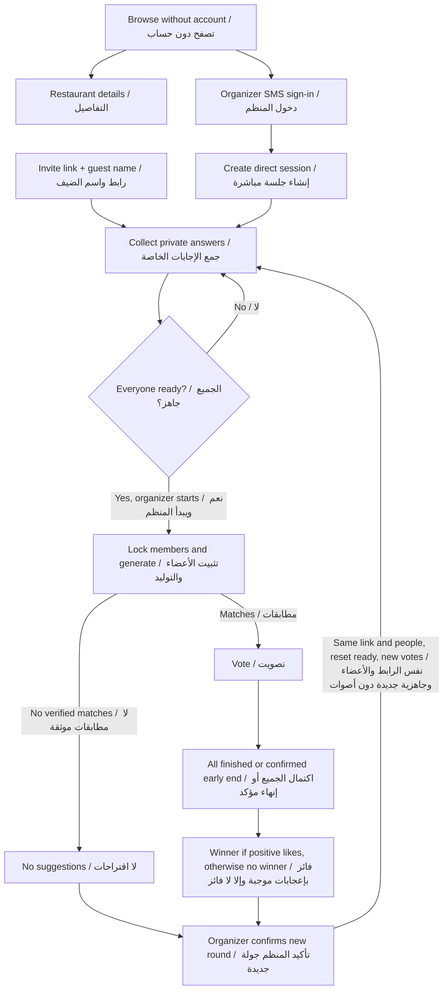

# P-01 · Release scope update / تقرير تحديث نطاق النسخة

**Date / التاريخ: 18 October 2026 · Project / المشروع: Thouq (ذوق) · Task / المهمة: [P-01 #7](https://github.com/shathaaa1110-arch/Portfolio-Project/issues/7).**

This separate report records the already approved decisions. **The original ProjectCharter, TechnicalDoc, README and mockups are unchanged by this report.** When an older requirement conflicts with this report, use the decision below for this release. Section 7 identifies those conflicts without deleting the historical text. These are delivery requirements, not claims that features work today.

هذا تقرير مستقل يسجل القرارات المعتمدة سابقًا. **لم نعدّل وثائق ProjectCharter أو TechnicalDoc أو README أو التصاميم القديمة ضمن هذا التقرير.** عند تعارض نص قديم معه، يُستخدم القرار المحدّث أدناه لهذه النسخة. يوضح القسم ٧ التعارضات دون حذف النصوص القديمة. هذه متطلبات تسليم وليست ادعاءً بأن الميزات تعمل حاليًا.

Source checked / المصدر المراجع: [deployment @ a94d79d](https://github.com/shathaaa1110-arch/Portfolio-Project/tree/a94d79da8d11a80073c95a6eb41eaa407a8c1ae6). Read sections 2–3 for scope, 6 for remaining technical choices, and 7–9 for differences and evidence. / اقرؤوا القسمين ٢–٣ للنطاق، و٦ للخيارات التقنية المتبقية، و٧–٩ للفروق ودليل التحقق.

## 1. Purpose / الهدف

Thouq helps a group choose a restaurant through one direct session: collect private preferences, filter by everyone's essential conditions, then vote. Anyone can browse restaurants first. The organizer has an account; invitees can complete the journey in a browser using only their name.

يساعد ذوق المجموعة على اختيار مطعم في جلسة مباشرة واحدة: يجمع التفضيلات الخاصة، ويستبعد ما لا يحقق الشروط الأساسية للجميع، ثم يتيح التصويت. يمكن لأي شخص تصفح المطاعم أولًا. يحتاج المنظم حسابًا، ويكمل المدعو الرحلة في المتصفح باسمه فقط.

## 2. Approved decisions / القرارات المعتمدة

Each decision below links to the current repository issue numbers. / يرتبط كل قرار بأرقام المهام الحالية في الريبو.

| ID / القرار | Simple English + العربية | Delivery tasks / مهام التنفيذ |
|---|---|---|
| D01 · Accounts الحسابات | The organizer signs in using a real SMS code. Guests join by name and invite link, without an account or installation. يدخل المنظم برمز SMS حقيقي. ينضم الضيف بالاسم ورابط الدعوة دون حساب أو تثبيت. | [BE-04 #16](https://github.com/shathaaa1110-arch/Portfolio-Project/issues/16) · [BE-05 #61](https://github.com/shathaaa1110-arch/Portfolio-Project/issues/61) · [BE-09 #64](https://github.com/shathaaa1110-arch/Portfolio-Project/issues/64) · [OPS-14 #50](https://github.com/shathaaa1110-arch/Portfolio-Project/issues/50) |
| D02 · Included release نطاق النسخة | Direct sessions, restaurant browse/search/details, and native app notifications are required. الجلسات المباشرة وتصفح المطاعم والبحث والتفاصيل وإشعارات التطبيق مطلوبة في النسخة. | [FE-08 #22](https://github.com/shathaaa1110-arch/Portfolio-Project/issues/22) · [FE-24 #47](https://github.com/shathaaa1110-arch/Portfolio-Project/issues/47) · [FE-23 #81](https://github.com/shathaaa1110-arch/Portfolio-Project/issues/81) · [BE-25 #80](https://github.com/shathaaa1110-arch/Portfolio-Project/issues/80) |
| D03 · Deferred features المؤجل | Saved groups, personal Choose for me, and guest browser push are deferred. تؤجل المجموعات المحفوظة و«اختر لي» الشخصي وإشعارات متصفح الضيف. | [E3 #4](https://github.com/shathaaa1110-arch/Portfolio-Project/issues/4) · [BE-28 #48](https://github.com/shathaaa1110-arch/Portfolio-Project/issues/48) · [FE-25 #49](https://github.com/shathaaa1110-arch/Portfolio-Project/issues/49) · [BL-27 #82](https://github.com/shathaaa1110-arch/Portfolio-Project/issues/82) |
| D04 · Hard limits الشروط الأساسية | Exclude a restaurant whenever a required fact cannot be verified, even if no suggestions remain. Never relax a limit automatically. يُستبعد المطعم إذا تعذّر التحقق من حقيقة لازمة لشرط أساسي، حتى لو لم يبق اقتراح. لا تُخفف الشروط تلقائيًا. | [BE-14 #27](https://github.com/shathaaa1110-arch/Portfolio-Project/issues/27) · [DB-06 #60](https://github.com/shathaaa1110-arch/Portfolio-Project/issues/60) · [QA-06 #72](https://github.com/shathaaa1110-arch/Portfolio-Project/issues/72) |
| D05 · Everyone ready جاهزية الجميع | The organizer can generate suggestions and open voting only after everyone is ready. The last Ready action alone does not start generation. يولد المنظم الاقتراحات ويفتح التصويت بعد جاهزية الجميع فقط. جاهزية آخر شخص لا تبدأ التوليد وحدها. | [BE-13 #19](https://github.com/shathaaa1110-arch/Portfolio-Project/issues/19) · [BE-17 #30](https://github.com/shathaaa1110-arch/Portfolio-Project/issues/30) · [FE-10 #24](https://github.com/shathaaa1110-arch/Portfolio-Project/issues/24) · [QA-13 #69](https://github.com/shathaaa1110-arch/Portfolio-Project/issues/69) |
| D06 · Round membership عضوية الجولة | Allow join, leave, and organizer removal before generation. Generation locks the round members; connection loss does not remove a member. يُسمح بالانضمام والمغادرة وإزالة مشارك بواسطة المنظم قبل التوليد. يثبت الأعضاء عند التوليد، ولا يحذف انقطاع الاتصال الشخص. | [BE-09 #64](https://github.com/shathaaa1110-arch/Portfolio-Project/issues/64) · [BE-29 #88](https://github.com/shathaaa1110-arch/Portfolio-Project/issues/88) · [FE-26 #89](https://github.com/shathaaa1110-arch/Portfolio-Project/issues/89) · [QA-14 #92](https://github.com/shathaaa1110-arch/Portfolio-Project/issues/92) |
| D07 · End voting إنهاء التصويت | End automatically when everyone finishes, or after the organizer confirms an early end with the completed count shown. Count saved votes. ينتهي التصويت تلقائيًا عند إكمال الجميع، أو بتأكيد المنظم الإنهاء المبكر بعد عرض عدد من أكملوا. تُحسب الأصوات المحفوظة. | [BE-20 #31](https://github.com/shathaaa1110-arch/Portfolio-Project/issues/31) · [FE-15 #74](https://github.com/shathaaa1110-arch/Portfolio-Project/issues/74) · [QA-07 #35](https://github.com/shathaaa1110-arch/Portfolio-Project/issues/35) |
| D08 · Support percentage نسبة التأييد | Support = restaurant likes ÷ all members of that round. Display completed voters separately. التأييد = إعجابات المطعم ÷ كامل أعضاء الجولة. يُعرض عدد من أكملوا التصويت بشكل منفصل. | [BE-20 #31](https://github.com/shathaaa1110-arch/Portfolio-Project/issues/31) · [FE-17 #34](https://github.com/shathaaa1110-arch/Portfolio-Project/issues/34) · [QA-07 #35](https://github.com/shathaaa1110-arch/Portfolio-Project/issues/35) |
| D09 · Automatic ties الحسم التلقائي | For equal positive likes, use the stored recommendation order, then a stable ID fallback. No extra vote or timer. عند تعادل إعجابات موجبة، يُستخدم ترتيب الترشيح المحفوظ ثم ترتيب ثابت للمعرف. لا تصويت إضافي ولا مؤقت. | [BE-21 #29](https://github.com/shathaaa1110-arch/Portfolio-Project/issues/29) · [BE-15 #28](https://github.com/shathaaa1110-arch/Portfolio-Project/issues/28) · [QA-07 #35](https://github.com/shathaaa1110-arch/Portfolio-Project/issues/35) |
| D10 · No likes دون إعجابات | No likes means no winner. Distinguish no recorded votes from votes that all pass. لا فائز دون إعجابات. تُميّز حالة عدم وجود أصوات عن التصويت بتخطي جميع الخيارات. | [BE-20 #31](https://github.com/shathaaa1110-arch/Portfolio-Project/issues/31) · [FE-17 #34](https://github.com/shathaaa1110-arch/Portfolio-Project/issues/34) · [QA-07 #35](https://github.com/shathaaa1110-arch/Portfolio-Project/issues/35) |
| D11 · Retry إعادة المحاولة | Retry in the same session and invite link. Keep participants and preference values, create a separate round with no votes, reset readiness, and reopen joining before generation. Keep earlier votes under their original round. تتم الإعادة داخل الجلسة والرابط نفسيهما. يبقى المشاركون وقيم التفضيلات، وتُنشأ جولة منفصلة دون أصوات وتُصفّر الجاهزية ويُعاد فتح الانضمام قبل التوليد. تبقى الأصوات السابقة مرتبطة بجولتها الأصلية. | [BE-31 #90](https://github.com/shathaaa1110-arch/Portfolio-Project/issues/90) · [FE-27 #91](https://github.com/shathaaa1110-arch/Portfolio-Project/issues/91) · [DB-07 #14](https://github.com/shathaaa1110-arch/Portfolio-Project/issues/14) · [QA-14 #92](https://github.com/shathaaa1110-arch/Portfolio-Project/issues/92) |
| D12 · Public browsing التصفح العام | Browsing needs no account or session. Private session data requires valid access. لا يحتاج التصفح حسابًا أو جلسة، بينما تحتاج بيانات الجلسة الخاصة وصولًا صالحًا. | [BE-27 #46](https://github.com/shathaaa1110-arch/Portfolio-Project/issues/46) · [FE-24 #47](https://github.com/shathaaa1110-arch/Portfolio-Project/issues/47) · [BE-06 #62](https://github.com/shathaaa1110-arch/Portfolio-Project/issues/62) · [QA-15 #93](https://github.com/shathaaa1110-arch/Portfolio-Project/issues/93) |
| D13 · Native notifications إشعارات التطبيق | Notify on voting start and result, including while the app is closed. Permission denial does not block participation. Guests use in-page updates. تصل إشعارات بدء التصويت والنتيجة ولو كان التطبيق مغلقًا. رفض الإذن لا يمنع المشاركة، ويستخدم الضيف تحديثات داخل الصفحة. | [BE-25 #80](https://github.com/shathaaa1110-arch/Portfolio-Project/issues/80) · [FE-20 #45](https://github.com/shathaaa1110-arch/Portfolio-Project/issues/45) · [OPS-06 #58](https://github.com/shathaaa1110-arch/Portfolio-Project/issues/58) · [QA-15 #93](https://github.com/shathaaa1110-arch/Portfolio-Project/issues/93) |
| D14 · Delivery and effort التسليم والجهد | Target early December 2026. Split estimated effort equally across four people, by hours rather than card count. الهدف بداية ديسمبر ٢٠٢٦، مع توزيع الجهد المقدر بالتساوي على الأربعة حسب الساعات وليس عدد البطاقات. | [OPS-01 #52](https://github.com/shathaaa1110-arch/Portfolio-Project/issues/52) · [OPS-09 #76](https://github.com/shathaaa1110-arch/Portfolio-Project/issues/76) · [QA-11 #39](https://github.com/shathaaa1110-arch/Portfolio-Project/issues/39) · [DOC-06 #40](https://github.com/shathaaa1110-arch/Portfolio-Project/issues/40) |
| D15 · Primary roles الأدوار الرئيسية | Shatha: PM, UI/UX and frontend. Fahad: frontend. Asem: backend/API. Hassan: database/quality. Cross-layer help is allowed. شذى: إدارة المشروع والتصميم والفرونت. فهد: الفرونت. عاصم: الباك وAPI. حسن: القاعدة والجودة. المساعدة بين الطبقات متاحة. | [OPS-01 #52](https://github.com/shathaaa1110-arch/Portfolio-Project/issues/52) · [UX-01 #9](https://github.com/shathaaa1110-arch/Portfolio-Project/issues/9) |
| D16 · Delivery platforms منصات النسخة | The installed release targets iPhone only; retain the guest browser invitation flow. Fahad develops on his non-Mac computer and tests on his iPhone. التطبيق المثبت للآيفون فقط، مع إبقاء رحلة دعوة الضيف في المتصفح. يطور فهد على كمبيوتره غير الماك ويجرب على آيفونه. | [FE-01 #54](https://github.com/shathaaa1110-arch/Portfolio-Project/issues/54) · [OPS-06 #58](https://github.com/shathaaa1110-arch/Portfolio-Project/issues/58) · [FE-21 #67](https://github.com/shathaaa1110-arch/Portfolio-Project/issues/67) · [OPS-07 #23](https://github.com/shathaaa1110-arch/Portfolio-Project/issues/23) |

## 3. Included and deferred / المطلوب والمؤجل

**Required:** organizer account and real SMS, saved account defaults, direct sessions with up to eight people including the organizer, name-only guest invitation, private session answers and readiness, strict filtering and explained ranking, voting and automatic settlement, same-session retry, public browse/search/details, and iPhone app push. Account defaults are optional to save; they never block browsing or replace confirmation of current session answers.

**مطلوب:** حساب المنظم وSMS حقيقي، وتفضيلات الحساب، وجلسة مباشرة حتى ثمانية أشخاص بمن فيهم المنظم، ودعوة الضيف بالاسم، وإجابات الجلسة الخاصة والجاهزية، والفلترة الصارمة والترتيب المفسر، والتصويت والحسم التلقائي، والإعادة داخل الجلسة، والتصفح والبحث والتفاصيل، وإشعارات الآيفون. حفظ تفضيلات الحساب اختياري ولا يوقف التصفح أو يغني عن تأكيد إجابات الجلسة الحالية.

**Deferred:** saved groups and their attendance flow, personal Choose for me, guest browser push, saved restaurant lists, guest-to-account conversion, taste summary, mood, and tourist guide. See [E3 #4](https://github.com/shathaaa1110-arch/Portfolio-Project/issues/4) and [E6 #51](https://github.com/shathaaa1110-arch/Portfolio-Project/issues/51). Existing group tables/images do not bring those features into this release.

**مؤجل:** المجموعات المحفوظة وحضورها و«اختر لي» الشخصي وإشعارات متصفح الضيف والمطاعم المحفوظة وتحويل الضيف لحساب وملخص الذوق والمزاج ودليل السائح. وجود جداول أو صور قديمة لا يدخل الميزة في النسخة.

Reservations, payments, restaurant-side integration and AI personalization remain outside this release. Android is not a delivery target. A working installable iPhone build is required; public App Store publication is not an acceptance condition.

الحجوزات والمدفوعات وتكامل جهة المطعم والتخصيص بالذكاء الاصطناعي خارج النطاق. أندرويد ليس منصة تسليم. المطلوب نسخة آيفون قابلة للتثبيت؛ النشر العام في المتجر ليس شرط اكتمال.

## 4. Journey and privacy / الرحلة والخصوصية

Target flow for implementation, not the current app. / الرحلة المطلوبة للتنفيذ، وليست وصفًا للتطبيق الحالي.

Personal answers, including allergies, stay private. The organizer sees readiness and completion, not another person's conditions or individual vote. Do not publish an anonymous group allergy list or identify whose condition caused no matches. A missing required restaurant fact is unverified; optional display data such as a rating can be absent. Do not invent photos, ratings, travel times or safety guarantees.

تبقى الإجابات والحساسية خاصة. يرى المنظم الجاهزية والاكتمال دون شروط الآخرين أو أصواتهم الفردية. لا تنشر قائمة حساسية جماعية مجهولة ولا تكشف من تسبب شرطه بعدم التطابق. الحقيقة اللازمة الناقصة غير متحقق منها، بينما قد يغيب حقل عرض اختياري مثل التقييم. لا تختلق صورًا أو تقييمات أو أوقات وصول أو ضمان سلامة.

Example: **3 likes / 5 round members = 60% support**. If only 4 completed, show **4 of 5 completed** separately. Do not change the denominator to 4 or count missing votes as dislikes. Positive ties use the stored recommendation order; zero likes produces no winner.

مثال: **٣ إعجابات ÷ ٥ أعضاء للجولة = ٦٠٪ تأييد**. إذا أكمل أربعة فقط، يظهر **٤ من ٥ أكملوا** منفصلًا. لا يتحول المقام إلى أربعة ولا يعد غياب الصوت رفضًا. التعادل الموجب يُحسم بالترتيب المحفوظ، وصفر إعجابات يعني عدم وجود فائز.

## 5. Team, effort and target / الفريق والجهد والموعد

| Person / الشخص | Primary responsibility / المسؤولية الرئيسية | Task hours / ساعات المهام | Reserve / الاحتياط | Total / الإجمالي |
|---|---|---:|---:|---:|
| Shatha / شذى | PM, UI/UX, frontend / إدارة المشروع والتصميم والواجهة | 148 | 37 | 185 |
| Fahad / فهد | Frontend / الواجهة | 148 | 37 | 185 |
| Asem / عاصم | Backend and API / الخادم وAPI | 148 | 37 | 185 |
| Hassan / حسن | Database and QA / القاعدة والجودة | 148 | 37 | 185 |
| Team / الفريق | | **592** | **148** | **740** |

These are the estimates on the [approved GitHub Project](https://github.com/users/shathaaa1110-arch/projects/1), not hours already worked or confirmed availability. The 25% reserve is counted once at project level. Tasks keep one owner; pair work and help across layers are allowed. Rebalance actual effort at sprint reviews without changing the primary roles.

هذه تقديرات اللوحة المعتمدة وليست ساعات منفذة أو تفرغًا مؤكدًا. احتياط ٢٥٪ محسوب مرة واحدة على مستوى المشروع. لكل مهمة مسؤول واحد مع إمكانية التعاون بين الطبقات. يُعاد توازن الجهد الفعلي في مراجعة السبرنت مع الحفاظ على الأدوار الرئيسية.

Target: **early December 2026**. The existing planning assumption is six working weeks, 19 October–29 November, aiming for readiness on 30 November: about 31 hours per person per week including reserve. Review actual availability weekly. Stages express dependencies: setup → invitation/answers → suggestions/browse → vote/retry/push → complete-journey testing and delivery.

الهدف **بداية ديسمبر ٢٠٢٦**. يفترض الجدول الحالي ستة أسابيع من ١٩ أكتوبر إلى ٢٩ نوفمبر واستهداف الجاهزية ٣٠ نوفمبر، أي نحو ٣١ ساعة للشخص أسبوعيًا بالاحتياط. تُراجع القدرة الفعلية أسبوعيًا. المراحل توضح الاعتماديات: تأسيس ثم دعوة وإجابات ثم اقتراح وتصفح ثم تصويت وإعادة وإشعارات ثم فحص الرحلة والتسليم.

## 6. Only technical setup remains open / المتبقي للحسم تقني فقط

| Technical item / العنصر التقني | Owner / المسؤول | Task / المهمة |
|---|---|---|
| SMS provider, coverage, verification owner, code length/expiry/resend limits and sender approval / مزود SMS والتغطية وجهة التحقق وطول الرمز وصلاحيته ومهلة الإرسال واعتماد المرسل | Asem, with Shatha for account access / عاصم وشذى لصلاحيات الحساب | [OPS-14 #50](https://github.com/shathaaa1110-arch/Portfolio-Project/issues/50), [DB-08 #15](https://github.com/shathaaa1110-arch/Portfolio-Project/issues/15) |
| Exact fields, paths, tokens, round/error codes, polling and invite format / الحقول والمسارات والرموز وأخطاء الجولة والتحديث وصيغة الدعوة | Asem + frontend / عاصم مع الواجهة | [P-02 #8](https://github.com/shathaaa1110-arch/Portfolio-Project/issues/8) |
| Verified restaurant facts, allowed data use, area centres, ranking/list-size constants and missing-data representation / البيانات الموثقة وحق استخدامها ومراكز الأحياء وثوابت الترتيب وحجم القائمة وتمثيل النقص | Hassan + Asem; Shatha for usage permission / حسن وعاصم وشذى للإذن | [DB-09 #13](https://github.com/shathaaa1110-arch/Portfolio-Project/issues/13), [DB-06 #60](https://github.com/shathaaa1110-arch/Portfolio-Project/issues/60), [BE-15 #28](https://github.com/shathaaa1110-arch/Portfolio-Project/issues/28) |
| iOS signing/build method, device installation, app links and push delivery setup / توقيع وبناء الآيفون والتثبيت وروابط التطبيق وتجهيز الإشعارات | Shatha + Fahad / شذى وفهد | [OPS-06 #58](https://github.com/shathaaa1110-arch/Portfolio-Project/issues/58) |
| API/guest hosting, reachable test URL, HTTPS and browser-origin configuration / استضافة الخادم والضيف وعنوان التجربة وHTTPS وسماح المتصفح | Asem + Fahad / عاصم وفهد | [OPS-13 #57](https://github.com/shathaaa1110-arch/Portfolio-Project/issues/57), [OPS-07 #23](https://github.com/shathaaa1110-arch/Portfolio-Project/issues/23) |

These items choose how to implement the fixed scope. They cannot reopen account requirements, defer app push, allow incomplete readiness, relax hard limits, or add saved groups. Unknown required data can legitimately mean no suggestion. Real provider delivery is required for release; a test double is only a development aid.

تحدد هذه البنود طريقة التنفيذ داخل النطاق الثابت. لا تعيد حسم الحسابات أو تؤجل إشعارات التطبيق أو تسمح بجاهزية ناقصة أو تخفف الشروط أو تضيف مجموعات محفوظة. قد تعني البيانات الأساسية غير المتوفرة عدم وجود اقتراح. التسليم الفعلي من المزود مطلوب للإصدار؛ البديل التجريبي أداة تطوير فقط.

## 7. What changed from the old documents / ما الذي تغيّر عن الوثائق القديمة؟

The links below point to the reviewed source revision. Old text, API examples and diagrams stay available as historical references. Implement the approved rules in this report; do not copy conflicting examples into the app.

تفتح الروابط أدناه نسخة المصدر التي تمت مراجعتها. تبقى النصوص والأمثلة والرسوم القديمة مراجع تاريخية. عند التنفيذ اتبعوا قواعد التقرير، ولا تنقلوا الأمثلة المتعارضة إلى التطبيق.

| Old reference / المرجع القديم | Updated rule for this release / القاعدة المحدّثة لهذه النسخة |
|---|---|
| [Charter: no accounts](https://github.com/shathaaa1110-arch/Portfolio-Project/blob/a94d79da8d11a80073c95a6eb41eaa407a8c1ae6/Docs/ProjectCharter.md#L37) — lines 37, 102 / دون حسابات | D01, D12: only browsing and guest participation need no account; the organizer uses real SMS sign-in. التصفح ومشاركة الضيف دون حساب؛ المنظم يدخل برمز SMS حقيقي. |
| [TechnicalDoc: groups and attendance](https://github.com/shathaaa1110-arch/Portfolio-Project/blob/a94d79da8d11a80073c95a6eb41eaa407a8c1ae6/Docs/TechnicalDoc.md#L43) — lines 43–47 / المجموعات والحضور | D02–D03: direct sessions are required; saved groups and their attendance screens are deferred. الجلسات المباشرة مطلوبة؛ المجموعات المحفوظة وشاشات حضورها مؤجلة. |
| TechnicalDoc — lines 53, 130, 516, 598 / الحساسية | D04 and section 4: required conditions are private hard limits. No combined allergy banner. Unknown required facts exclude the restaurant. الشروط الأساسية قيود خاصة ملزمة، دون شريط حساسية جماعي. نقص الحقيقة الأساسية يستبعد المطعم. |
| Charter — lines 112, 162; TechnicalDoc — lines 59, 84, 287–289 / الجاهزية | D05: wait for everyone, then let the organizer generate. No partial group generation or automatic generation on the last Ready. انتظار الجميع ثم يبدأ المنظم التوليد؛ لا توليد بإجابات بعض المجموعة أو بمجرد جاهزية آخر شخص. |
| Charter — lines 40, 106 / ثلاثة اقتراحات دائمًا | D04: show only verified matches, including fewer than three or zero. List-size constants remain in BE-15. اعرض المطابقات المتحقق منها فقط، حتى لو أقل من ثلاثة أو صفر. ثوابت حجم القائمة في BE-15. |
| TechnicalDoc — lines 61, 370, 426, 573, 594 / التعادل والتأييد | D07–D10: no tie vote/timer; support uses all round members; show completion separately; no likes means no winner. لا تصويت تعادل أو مؤقت؛ مقام التأييد كل أعضاء الجولة، والاكتمال منفصل، ولا فائز دون إعجابات. |
| TechnicalDoc — original outing model, lines 476–504 / نموذج الجلسة السابق | D06, D11: lock members when generating; keep separate rounds and preserve previous votes on retry. Prior-round writes must not change the current round. تثبت العضوية عند التوليد، وتنفصل الجولات وتبقى الأصوات السابقة محفوظة. لا تعدّل طلبات الجولة السابقة الجولة الحالية. |
| TechnicalDoc — lines 1016 onward / SMS التجريبي | D01: a mock sender helps development only. Real delivery and verification on target phones are required; OPS-14 chooses verification ownership. المرسل الوهمي للتطوير فقط. يلزم إيصال وتحقق حقيقيان على الهواتف؛ تحدد OPS-14 جهة التحقق. |
| TechnicalDoc — lines 210, 267, 277 / المنصات والإشعارات | D13, D16: installed iPhone app plus guest browser; push for voting start/result; no required Android delivery or saved-group attendance push. تطبيق آيفون ومتصفح للضيف؛ إشعارات بدء التصويت والنتيجة. تسليم أندرويد وإشعارات حضور المجموعات غير مطلوبين. |
| Charter timeline; TechnicalDoc — lines 1789, 1938, 2481–2483 / الجدول السابق | D14–D15 and section 5: early December 2026, balanced hours, primary roles retained. Old week numbers are historical. بداية ديسمبر ٢٠٢٦ وساعات متوازنة مع الحفاظ على الأدوار؛ أرقام الأسابيع القديمة تاريخية. |

## 8. Existing work and implementation impact / الموجود وأثر القرارات على التنفيذ

The following is a source inspection at `a94d79d`, not a new runtime test. The report changes no application code, database schema, API contract or previous documentation.

هذه مراجعة للمصدر عند `a94d79d` وليست اختبار تشغيل جديدًا. لا يغير التقرير كود التطبيق أو مخطط القاعدة أو عقد API أو الوثائق السابقة.

| Layer / الطبقة | Existing source / الموجود | Remaining work / المتبقي |
|---|---|---|
| Frontend / الواجهة | [Sign-up screen](../frontend/src/app/index.tsx) and RTL setup exist. Submit shows an alert. توجد شاشة تسجيل وتجهيز اتجاه العربية؛ زر الإرسال يعرض تنبيهًا. | Complete real account, browse and session flows. Keep the guest path usable in a browser. Reuse the existing images through [UX-01 #9](https://github.com/shathaaa1110-arch/Portfolio-Project/issues/9). أكمل الحساب والتصفح والجلسات الفعلية ورحلة الضيف، وأعد استخدام الصور عبر UX-01. |
| Backend / الخادم | [API router](../backend/app/api/v1/router.py) mounts health and five service routers. Health is implemented; auth, outings, preferences, plan and voting routers are placeholders. يوجد فحص صحة وخمسة مسارات خدمات هيكلية؛ وجودها لا يثبت اكتمال الخدمات. | [P-02 #8](https://github.com/shathaaa1110-arch/Portfolio-Project/issues/8) defines exact requests, replies, permissions and errors. Implement the agreed rules in the existing services. تحدد P-02 الطلبات والردود والصلاحيات والأخطاء، ثم تنفذ القواعد داخل الخدمات الموجودة. |
| Database / القاعدة | [schema.sql](../database/schema.sql) is a nine-table draft with group and tie fields, but no separate round model. مسودة من تسعة جداول تحتوي حقول مجموعات وتعادل دون نموذج جولات منفصلة. | [DB-07 #14](https://github.com/shathaaa1110-arch/Portfolio-Project/issues/14) adds round separation, locked members, saved recommendation order and unique votes. Schema repair stays in its DB tasks. تضيف DB-07 فصل الجولات وتثبيت الأعضاء والترتيب ومنع تكرار الأصوات؛ إصلاح المخطط في مهام القاعدة. |
| Providers and data / المزودون والبيانات | Repository structure and mockups do not demonstrate real SMS, push or usable licensed restaurant data. الهيكل والصور لا يثبتان SMS أو إشعارات فعلية أو بيانات مطاعم مرخصة قابلة للاستخدام. | OPS-14, OPS-06 and DB-09 require delivery/device/data evidence. Keep the restricted dataset private; use synthetic fixtures in Git. يلزم دليل إيصال وأجهزة وبيانات. تبقى البيانات المقيدة خاصة، وتستخدم بيانات وهمية في Git. |

**Required design, not an applied migration:** one session can have several rounds. Each round owns its member snapshot, plan order, votes and result. A retry creates one new active round with no inherited votes; the session/link and current participants remain. Authentication and permissions must reject stale-round writes. Exact SQL and endpoint names belong to DB-07 and P-02.

**تصميم مطلوب وليس تغيير قاعدة منفذًا:** تضم الجلسة عدة جولات. لكل جولة أعضاؤها الثابتون وترتيب اقتراحاتها وأصواتها ونتيجتها. تنشئ الإعادة جولة نشطة واحدة دون أصوات موروثة، مع بقاء الجلسة والرابط والمشاركين الحاليين. تُرفض الكتابة للجولة القديمة. أسماء SQL ومسارات API النهائية في DB-07 وP-02.

**Repository workflow:** use the current `deployment` branch as the integration base, with small task branches and PRs. The old `develop` workflow is not present in the reviewed repository. Current GitHub rules require one approving review before merging; do not bypass them. See [OPS-01 #52](https://github.com/shathaaa1110-arch/Portfolio-Project/issues/52). This report is on `docs/approved-release-scope`.

**طريقة العمل:** يُستخدم `deployment` الحالي أساسًا للدمج، مع فروع صغيرة للمهام وطلبات دمج. مسار `develop` القديم غير موجود في الريبو المراجع. تتطلب حماية GitHub الحالية موافقة مراجع قبل الدمج وتبقى مطبقة. هذا التقرير في فرع `docs/approved-release-scope`.

## 9. Validation and meaning of completion / التحقق ومعنى الاكتمال

| Check / الفحص | Evidence / الدليل |
|---|---|
| Approved scope / النطاق المعتمد | All 16 approved decisions appear as D01–D16 with current task links. Only technical setup choices remain in section 6. القرارات الـ١٦ موجودة مع روابط مهامها، والمتبقي للحسم تقني في القسم ٦. |
| Old documents preserved / حفظ الوثائق القديمة | The Git change contains only this new report. No edits to ProjectCharter, TechnicalDoc, README, mockups or application source. تغيير Git يضيف هذا التقرير وحده؛ لا تعديل على الوثائق والصور والكود السابق. |
| Conflict coverage / تغطية التعارضات | Section 7 maps old requirements to approved decisions. Section 4 replaces the conflicting journey for planning; section 8 states the required round design without claiming it is built. يربط القسم ٧ التعارضات بالقرارات، ويعرض القسم ٤ الرحلة المحدّثة للتخطيط، ويشرح القسم ٨ نموذج الجولات المطلوب دون ادعاء تنفيذه. |
| Links and effort / الروابط والجهد | All 73 issue links match current task IDs; all three local file links exist. The live board has 73 core tasks and 148 task hours per owner (22 Shatha, 16 Fahad, 16 Asem, 19 Hassan cards). 4 × 148 = 592 task hours; 25% = 148 reserve; total 740, or 185 per person. تطابق روابط المهام الـ٧٣ المعرفات الحالية، وروابط الملفات الثلاثة موجودة. اللوحة الحالية فيها ٧٣ مهمة أساسية و١٤٨ ساعة مهام لكل مسؤول: شذى ٢٢ بطاقة، فهد ١٦، عاصم ١٦، حسن ١٩. الحساب: ٥٩٢ ساعة مهام + ١٤٨ احتياط = ٧٤٠، أي ١٨٥ لكل شخص. |
| Limits of validation / حدود التحقق | Documentation-only verification. No new app, SMS, push, database or end-to-end runtime tests were run for this report. التحقق خاص بالتوثيق؛ لم ينفذ التقرير اختبارًا جديدًا للتطبيق أو المزودين أو القاعدة أو الرحلة الكاملة. |

Closing P-01 means the approved scope is recorded and reviewed. It does not close the implementation tasks. Attach this report's PR as delivery evidence; keep P-01 in review until the required review and merge are complete.

إغلاق P-01 يعني توثيق النطاق المعتمد ومراجعته، ولا يعني اكتمال مهام البرمجة. يُربط طلب دمج التقرير دليلًا للتسليم، وتبقى P-01 قيد المراجعة حتى اكتمال الموافقة والدمج.
