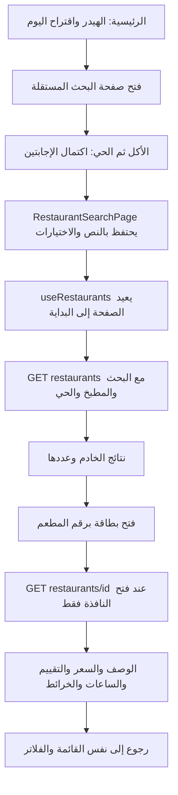

# البحث والفلاتر وتفاصيل المطعم | Search and restaurant details

تحديث بتاريخ ١٧ نوفمبر ٢٠٢٦، لمهام #47 و#81 مع إصلاح اتجاه النص. توفر التغيير في البرانش لا يعني دمجه أو نشره.

## ماذا يرى المستخدم؟

تبقى الرئيسية بهيدر «ذوق يدلّك» وقسم «اليوم؟ جرّب هذا!» وقائمة المطاعم. زر «ابحث مع هيلة عن مطعم» يفتح صفحة مستقلة على `/search`. بعد فتحها تسأل هيلة عن الأكل، ثم الحي، وتعرض النتائج بعد الإجابتين. يختار المستخدم من الأزرار أو يكتب اسم مطعم/نوع أكل. يستطيع تعديل أي إجابة من فقاعتها أو بدء بحث جديد. «مطابخ أخرى» يفتح التصنيفات الثمانية عشر، والأحياء تأتي من الخادم.

اختيار الحي فلتر بحث فقط؛ لا يطلب الموقع ولا يغيّر تفضيلات الحساب. النص يبحث في الأسماء والمطابخ، ولا يُفسّر كتعليمات ميزانية أو حساسية. التوصيات واقتراح اليوم يبقيان في الرئيسية.

### تفاصيل المطعم | Restaurant details

الضغط على بطاقة يفتح التفاصيل بشاشة كاملة. العنوان وزر الرجوع ثابتان أسفل منطقة الساعة، وزر الخرائط ثابت أسفل الشاشة؛ يمرّر المستخدم المعلومات بينهما. الصورة أصغر لتظهر المعلومات الأساسية مبكرًا، وتظهر عليها «صورة توضيحية» إذا استُخدمت صورة التصنيف.

تحت الاسم والتصنيف يظهر التقييم وعدد المراجعات، ثم التكلفة التقريبية للشخص. يليها الوصف والساعات والحي. في الشاشة الضيقة أو عند تكبير الخط، تُرتب بطاقتا التقييم والسعر عموديًا. سبب الترشيح والمسافة يظهران فقط إذا جاءت البطاقة من توصية تحمل هذه البيانات؛ لا يُنسب تخصيص للمطاعم العامة.

كل المعلومات ورابط الخرائط تأتي من رد التفاصيل الجديد. أثناء التحميل أو الخطأ لا نعرض أسعارًا أو رابطًا قديمًا من البطاقة. المعلومات الناقصة موضحة، وزر الخرائط يُعطل إن لم يتوفر رابط صالح. الرجوع يعيد القائمة واختيارات البحث نفسها، والفتح التالي يجلب التفاصيل من جديد.

## كيف تنتقل البيانات؟



النتائج تُفلتر في الخادم قبل تقسيمها إلى صفحات، ولا نبحث داخل أول ٢٠ مطعمًا فقط. الطلب الذي يصل متأخرًا بعد تغيير المطبخ أو الحي لا يستبدل النتائج الجديدة. إذا فشل الانتقال لصفحة أخرى، تبقى آخر صفحة ناجحة مع زر إعادة المحاولة.

## أين أعدّل؟ | File map

المسارات من `frontend/src/`:

| الملف | مسؤوليته |
|---|---|
| `application/HomePage.tsx` | يجمع الهيدر واقتراح اليوم والقائمة والتوصيات وزر فتح البحث. |
| `app/search.tsx` | مسار صفحة البحث المستقلة؛ يعرض صفحة التركيب فقط. |
| `application/RestaurantSearchPage.tsx` | يحتفظ بالنص والفلاتر ويجمع واجهة المحادثة والنتائج. يمرر قراءة الأحياء من الواجهة العامة لميزة `personalSuggestions`. |
| `features/restaurants/components/RestaurantSearch.tsx` | أسئلة المحادثة ومسودة النص والمطبخ والحي؛ الإرسال بعد إجابة الحي، وتعديل الإجابات. |
| `features/restaurants/filterOptions.ts` | رموز المطابخ المقبولة في العقد والبحث المحلي داخل أسماء الأحياء. |
| `features/restaurants/useRestaurants.ts` | حالة الطلب والصفحات. هوية البحث تشمل النص والمطبخ والحي، لمنع عرض نتائج قديمة. |
| `features/restaurants/api.ts` | طلب القائمة والتفاصيل والتحقق من شكل رد الخادم. |
| `features/restaurants/useRestaurantDetails.ts` | التحميل والخطأ وإعادة المحاولة و404، وتجاهل رد مطعم أُغلق أو تبدّل. |
| `features/restaurants/components/RestaurantDetails.tsx` | نافذة التفاصيل الكاملة: هيدر آمن وزر خرائط ثابتان، ومحتوى قابل للتمرير. تبقى القائمة مركّبة، لذلك لا تضيع الفلاتر عند الرجوع. |
| `features/restaurants/components/RestaurantMapLink.tsx` | يتحقق من رابط HTTPS ويفتح الخرائط، أو يعرض عدم توفر الموقع/فشل الفتح. |
| `features/restaurants/presentation.ts` | تنسيق الساعات والسعر والتقييم. لا يخمّن ساعات أو أسعارًا مفقودة. |
| `shared/components/Conversation.tsx` | فقاعات هيلة وردود المستخدم وأزرار الاختيار الخاصة بعرض محادثة البحث. |
| `shared/components/AppText.tsx` | المحاذاة الافتراضية العربية إلى اليمين. التنسيقات الصريحة للوسط والأرقام ورمز الدعوة تبقى قابلة للتجاوز. |

كل بطاقات الرئيسية والتوصيات والمحفوظة والتصويت تمرر `restaurantId`. لا يطلب التطبيق تفاصيل كل بطاقة أثناء عرض القائمة؛ يطلب المطعم المفتوح فقط. لا توجد شاشة تفاصيل مكررة أو اعتماديات جديدة بين الميزات، لذا يبقى `architecture.json` كما هو.

## العقد المستخدم | API contract

كل هذه القراءات عامة، دون رمز دخول:

```http
GET /api/v1/districts
GET /api/v1/restaurants?limit=20&offset=0&search=بيتزا&cuisine=italian&district_id=00100001141
GET /api/v1/restaurants/3216
```

- `search`: النص المرسل، حتى ٥٠ حرفًا. ترمّز أداة الطلب المعاملات قبل الإرسال.
- `cuisine`: مفتاح تصنيف مثل `italian` أو `grill`؛ تسمح الواجهة باختيار تصنيف واحد. يدعم الباك أيضًا عدة مفاتيح، لكن الواجهة الحالية لا تعرض اختيارًا متعددًا.
- `district_id`: المعرف الفعلي من `/districts`، وليس اسم الحي.
- `limit=20` و`offset`: صفحات النتائج. `total` عدد المطاعم بعد تطبيق كل الشروط معًا.
- التفاصيل تقرأ `summary` و`opening_hours` و`spend_low/high` و`rating` و`rating_count` و`maps_url` والصورة إن توفرت.
- ساعات العمل معلومة عامة، وليست حكمًا بأن المطعم مفتوح الآن. إذا لم تكن الأيام محددة يظهر ذلك صراحة؛ لا نستنتج أسماء أيام من عددها.
- `RESTAURANT_NOT_FOUND` يعرض رسالة مستقلة. فشل الشبكة يعرض إعادة المحاولة. البيانات الناقصة تظهر «غير متوفر».
- سبب الترشيح والمسافة يظلان من تدفق التوصية الأصلي. لا ترسل نافذة التفاصيل رمز جلسة أو `outing_id` لقراءة البيانات العامة.

لم تتغير مسارات الباك أو الجداول أو المعاملات أو مخطط ERD أو الخوارزمية. هذا التغيير يربط الواجهة بالعقد الموجود من #168.

## المعاينة والاختبار | Validation

من مجلد `frontend`:

```sh
npm run check
```

نجحت فحوصات TypeScript وحدود المعمارية و١٣٤ اختبارًا. تشمل الحالات الجديدة بقاء الهيدر واقتراح اليوم في الرئيسية، فتح صفحة البحث والرجوع، عدم طلب نتائج قبل اكتمال الإجابتين، وجمع الفلاتر مع البحث، إعادة الصفحة، تجاهل الردود القديمة، إعادة المحاولة، فتح التفاصيل عند الطلب فقط، الرد 404، والساعات المفقودة. اختبار عرض التفاصيل يتحقق من استخدام الرد الجديد بدل حقائق البطاقة القديمة، وثبات زر الخرائط خارج التمرير، وإخفاء البيانات القديمة في الخطأ، وغياب التخصيص حين لا يوجد سبب ترشيح.

في المتصفح: جُرّب فتح صفحة البحث من الرئيسية، وفتح `/search` مباشرة والرجوع للرئيسية، واختيار المطبخ والحي، النتائج الفارغة، مسح الفلاتر، إرسال البحث، وفتح التفاصيل والرجوع مع بقاء الاختيارات. جُرّب عرض ٣٢٠ بكسل دون امتداد أفقي. البيانات التجريبية موسومة للمعاينة ولا تمثل نتائج الخوارزمية.

على محاكي iPhone 17 بنظام iOS 26.4: عُوين الهيدر الأصلي واقتراح اليوم في الرئيسية، ثم فُتحت صفحة البحث واختير المطبخ الإيطالي، وظهرت ١٧٤٩ نتيجة فعلية، ثم جُرّب الرجوع للرئيسية. لا يتضمن هذا التحقق تثبيت تحديث على هاتف فعلي.

قراءات عامة من الخدمة المنشورة تحققت من فلتر `italian` وبيانات المطعم 3216 وقائمة الأحياء؛ لم تُرسل أي عملية كتابة للخدمة.

أُعيد فحص التفاصيل بعد ترتيب الواجهة، في متصفح بعرض ٣٩٠ بكسل مع API الحقيقي: فلتر إيطالي + حي التعاون أعاد ١١ مطعمًا. فُتح المطعم 3216، وظهرت بياناته الفعلية، وحُفظت الفلاتر بعد إغلاق التفاصيل. الرجوع من البحث أعاد الرئيسية وقسم اقتراح اليوم دون حقول المحادثة. فُحص استدعاء رابط الخرائط الصحيح، ثم فشل اتصال مصطنع وإعادة المحاولة ورد 404 مصطنع. جميع الطلبات الثمانية كانت GET دون Authorization، ولم تظهر أخطاء تشغيل في المتصفح. اختبار رابط الخرائط يتحقق من الرابط المرسل؛ لا يثبت الملاحة داخل تطبيق خرائط على هاتف فعلي.

بعرض ٣٢٠ بكسل، جُرّب اسم طويل وبيانات تفاصيل ناقصة برد اختبار معزول: ظهر غياب الوصف والسعر والساعات والحي بوضوح، وتعطل زر الخرائط، وبقي الهيدر والزر ثابتين أثناء التمرير. على محاكي iPhone 17 فُتحت التفاصيل الفعلية للمطعم 3216، وعُوين موضع الرجوع الآمن والتمرير، ثم أُغلقت النافذة وعادت نتائج البحث السابقة، وأُعيد فتح المطعم.

## حدود هذا التعديل

يشمل البحث وتفاصيل المطعم وصيغة مخاطبة محايدة وإصلاح محاذاة النص العربي. لا يشمل تحويل إنشاء الطلعة إلى محادثة ولا تغيير سجل الدخول أو إيماءات التنقّل. مكونات `Conversation` للعرض فقط؛ تستخدمها صفحة البحث هنا، دون تغيير الرحلة الحالية. مخطط قاعدة البيانات والعقد والخوارزمية لم تتغير.
