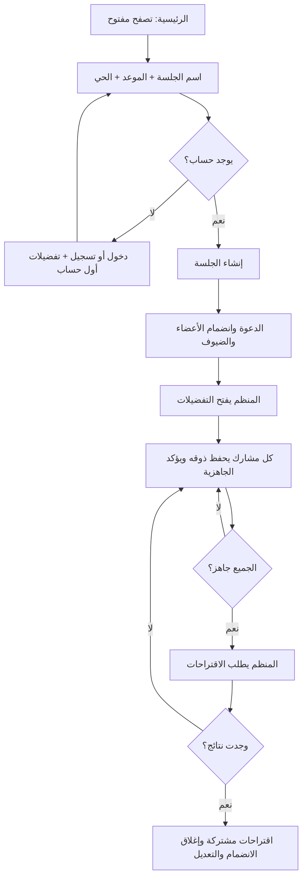

# رحلة الجلسة: من الدعوة إلى الاقتراحات

تحديث ٦ نوفمبر ٢٠٢٦. هذا الدليل يشرح الكود المنفذ في الفرونت والمطابق لمسارات الباك في `deployment` عند المراجعة `ebf9f8e`. نجاح المعاينة والاختبارات المحلية لا يثبت نشر هذه المسارات على الخادم الحي.

## ماذا يرى المستخدم؟

1. يتصفح الرئيسية دون حساب. زر إنشاء الجلسة يفتح نموذج الاسم والموعد ومنطقة اللقاء.
2. يختار الحي من قائمة الخادم، ويحدد موعدًا قادمًا خلال ٦٠ يومًا بتوقيت الرياض. لا تطلب هذه الرحلة GPS.
3. الإنشاء يحتاج حسابًا. إن لم يسجل الدخول، تبقى مسودة النموذج أثناء الانتقال للدخول. الحساب الجديد يكمل تفضيلاته الأساسية أولًا ثم يعود للنموذج. المسودة مؤقتة في الذاكرة؛ تحديث المتصفح أو إغلاق التطبيق يمسحها.
4. بعد نجاح الإنشاء تظهر الدعوة ورمزها. يمكن نسخها على الويب أو مشاركتها على الجوال. الضيف ينضم باسمه دون حساب؛ العضو ينضم بحسابه. حد السعة ٨ أشخاص يفرضه الخادم.
5. المنظّم يفتح مرحلة التفضيلات. يراجع كل شخص نسخته الخاصة: المطابخ، «وش مشتهي اليوم؟» والصحن، أجواء الجلسة، الميزانية، المسافة والحساسية.
6. «حفظ وأنا جاهز» يحفظ **كل حقول تفضيلات الجلسة** ثم يؤكد الجاهزية. من لديه نسخة محفوظة يستطيع اعتمادها مباشرة. لا تتغير تفضيلات حسابه العامة.
7. عندما يجهز الجميع، يستطيع المنظّم ضغط «اعرض اقتراحاتنا». الجاهزية الأخيرة لا تولّد النتائج تلقائيًا.
8. تظهر اقتراحات الخادم وأسبابها للجميع. لا يظهر زر تصويت أو مطعم فائز؛ تنفيذ التصويت والنتيجة النهائية غير متوفر في الباك الذي راجعناه.

## لماذا توجد منطقة لقاء؟

الباك الحالي يحسب المسافات من **مركز الحي المختار**. لا يستقبل مواقع جميع المشاركين ولا يحسب نقطة وسط بينهم. لذلك الواجهة تعرض الحي وتشرح أساس المسافة؛ لا تعد المستخدم بمكان وسط آلي غير منفذ. خيار حساب منتصف مواقع المشاركين يحتاج تغييرًا منفصلًا في عقد الباك والخوارزمية.

الميزانية والمسافة تستخدمان في شروط النتائج. الحساسية تظهر كتحذير ولا تمثل ضمانًا غذائيًا؛ يظهر تنبيه بإبلاغ المطعم قبل الطلب. أجواء الجلسة تُحفظ في `seating_needs` لكن المحرك الحالي لا يفلتر المطاعم بها. لم نغيّر أي حد شخصي تلقائيًا عند عدم وجود نتائج.

## أين نشتغل أنا وفهد؟

المسارات هنا من جذر المستودع:

| الملف | وظيفته ومن يبدأ به |
|---|---|
| `frontend/src/features/sessions/CreateSessionScreen.tsx` | شذى: شاشة الإنشاء، الورقة والرسمة والنموذج |
| `frontend/src/features/sessions/components/SessionEditors.tsx` | شذى: تحرير الاسم والتاريخ والوقت والحي |
| `frontend/src/features/sessions/model.ts` و`api/create.ts` | التحقق من النموذج وطلب الإنشاء؛ تنسيق تغييرات العقد مع عاصم |
| `frontend/src/features/sessions/JoinSessionScreen.tsx` | فهد: معاينة الدعوة والانضمام وفتح الجلسة |
| `frontend/src/features/sessions/SessionScreen.tsx` | فهد: المشاركون والتحديث والجاهزية والتفضيلات والاقتراحات |
| `frontend/src/features/sessions/api/outing.ts` | فهد: أغلفة طلبات حالة الجلسة والتفضيلات والاقتراحات |
| `frontend/src/features/sessions/components/SessionVisuals.tsx` | مكونات الشكل المشتركة: الورقة والرسمة ومراحل الرحلة وهيلة؛ نسّقوا تعديلها بينكم |
| `frontend/src/features/sessions/components/SessionChrome.tsx` | الترويسة والأيقونات ونافذة التحرير المشتركة |
| `frontend/src/features/sessions/identity.ts` و`guestPass.ts` | اختيار رمز الحساب أو الضيف وحفظ عودة الضيف |
| `frontend/src/features/preferences/PreferencesForm.tsx` | نموذج التفضيلات المشترك؛ `context="outing"` يغير العناوين فقط، والشاشة المستدعية تختار API |
| `frontend/src/app/sessions/new.tsx` و`[id].tsx` | ملفات مسار صغيرة تستدعي الشاشة من مدخل الميزة |
| `frontend/src/app/join.tsx` و`join/[code].tsx` | يدعمان `/join?code=ABCD` و`/join/ABCD` |
| `frontend/src/application/HomePage.tsx` | تركيب الرئيسية وربط زر إنشاء الجلسة |
| `frontend/assets/images/sessions/` | رسمة المطعم والورقة والخط الذهبي واقتراح شخصية هيلة |

هذه النسخة تنفذ الملفات المبينة فوق؛ تقسيم المسؤولية يساعدكم في المتابعة ولا يعني أن أسماء الملفات مجرد خطة مستقبلية. استيراد ميزات أخرى يتم عبر `index.ts`؛ تعتمد `sessions` على `auth` و`preferences` و`personalSuggestions` و`restaurants` فقط، والتصريح في `architecture.json`.

## شكل الواجهات

واجهة الإنشاء مبنية على الصورة المختارة. بقية الرحلة تستخدم الخط نفسه والأخضر الداكن والخلفية الكريمية ورسمة المطعم والورقة: الدعوة والانضمام وحالة الجلسة والاقتراحات. هيلة رسم مقترح جديد كحبّة هيل بالألوان المائية، تظهر بجانب إرشادات قصيرة ولا تحجب الأزرار. نموذج التفضيلات يحتفظ بالصور والصحن وخطواته الست الحالية؛ لا نكرر قواعده في ميزة الجلسات.

## كيف تتصل الواجهة بالباك؟

جميع المسارات أدناه نسبية إلى `EXPO_PUBLIC_API_URL` (عادة ينتهي بـ`/api/v1`). نستخدم العميل المشترك، ولا نستدعي `fetch` من الشاشة.

| الإجراء | الطلب | ملاحظة العقد |
|---|---|---|
| قائمة الأحياء | `GET /districts` | معرف الحي من الخادم، دون توكن |
| إنشاء | `POST /outings/session` | توكن حساب + `{name, starts_at, district}`؛ الرد `outing_id, invite_code, invite_url, status` |
| معاينة الدعوة | `GET /outings/by-code/{code}` | دون توكن؛ الخادم يحدد `can_join` وسبب الإغلاق |
| انضمام عضو / ضيف | `POST /outings/{code}/join` أو `/join-guest` | العضو بالتوكن؛ الضيف باسمه ويحصل على `guest_token` |
| حالة الجلسة | `GET /outings/{id}` | هوية المشارك، `actions`، `participants` و`readiness` من الخادم |
| فتح التفضيلات | `POST /outings/{id}/start-preferences` | المنظم فقط |
| نسختي للجلسة | `GET /outings/{id}/preferences` | تخص صاحب التوكن وحده |
| حفظ النسخة | `PUT /outings/{id}/preferences` | استبدال كامل؛ الحقول المتروكة تُمسح؛ يعيد `preferences_done:false` |
| تأكيد الجاهزية | `POST /outings/{id}/preferences/ready` | بعد الحفظ؛ يعيد `preferences_done:true` |
| توليد الاقتراحات | `POST /outings/{id}/start-voting` | اسم المسار الحالي؛ المنظم فقط وبعد جاهزية الجميع |
| قراءة الاقتراحات | `GET /outings/{id}/plan` | نفس القائمة لجميع المشاركين؛ لا تصويت في هذه الواجهة |

رمز الحساب ورمز الضيف كلاهما `Authorization: Bearer ...`. لا توكن في الرابط أو مسودة الإنشاء. عندما تكون `invite_url` فارغة، يبني الويب رابط `/join?code=...` من أصل التطبيق، والجوال يشارك الرمز. عند نشر الويب يلزم إعداد الاستضافة لفتح المسارات الديناميكية `/sessions/{id}` و`/join/{code}` مباشرة؛ نجاح التصدير المحلي لا يختبر إعدادات الاستضافة. لروابط الخادم عيّن `INVITE_BASE_URL` إلى عنوان واجهة الدعوة المنتهي بـ`/join`؛ الباك يضيف `/CODE`.

تتحدث الحالة كل ٥ ثوانٍ أثناء فتح الشاشة فقط. نتجاهل الردود القديمة، ونمنع الإجراءات عند قدم الحالة حتى تنجح إعادة القراءة. تغيير الحساب لا يسمح بحفظ مسودة شخص آخر. فقد الاتصال يبقي البيانات مع إعادة محاولة؛ لا نحول الطلب الحقيقي إلى Mock تلقائيًا. عند فشل التخزين يستطيع الضيف المتابعة في الذاكرة؛ إعادة تحميل التطبيق في هذه الحالة تحتاج العودة للدعوة.

## حدود التغيير وقاعدة البيانات

لا تغيير في جداول SQL أو ERD أو خوارزمية الباك. استخدمنا جداول ومسارات الباك الموجودة بالفعل: outings/participants ونسخ التفضيلات وعناصر الخطة. لم نضف مجموعات دائمة، مواقع مشاركين، تصويتًا، إزالة مشاركين أو فائزًا. تحديث الرسم أعلاه يخص رحلة الفرونت فقط؛ مخطط البيانات لا يحتاج إعادة رسم لهذا التغيير.

## التحقق والتجربة

شغّل من جذر المستودع `npm run check`. اختبارات الجلسة في `frontend/scripts/session-flow.test.cjs` و`join-flow.test.cjs` تفحص العقد، التواريخ، منع الإنشاء المكرر، العودة من الدخول، صلاحيات المنظم، عدم توليد النتائج تلقائيًا، حفظ الحقول كاملة، عزل الحساب، رموز الضيوف وقفل التعديل بعد الاقتراحات.

للمعاينة المعزولة استخدم `EXPO_PUBLIC_USE_MOCK=true` و`EXPO_PUBLIC_API_URL=http://127.0.0.1:1/api/v1` في ملف `.env.local` المهمل بواسطة Git. رقم الحساب التجريبي `0500000001` ورمزه `123456`؛ لا يُرسل SMS. أنشئ جلسة جديدة من الواجهة، وافتح التفضيلات واحفظها ثم اعرض الاقتراحات. البيانات الجديدة في الذاكرة وتزول عند إعادة تحميل المتصفح. رموز `TEST/MAXX/SHUT` القديمة مخصصة لاختبار معاينة الانضمام فقط؛ لتجربة الرحلة الكاملة أنشئ جلسة جديدة.

راجع `design-qa.md` في جذر المشروع ولقطات `Docs/mockups/session-creation/` لدليل المعاينة. يلزم اختبار لاحق بالباك المنشور وبمشاركين على جهازين، وعلى iOS وAndroid، قبل إغلاق مهام التسليم النهائي.
