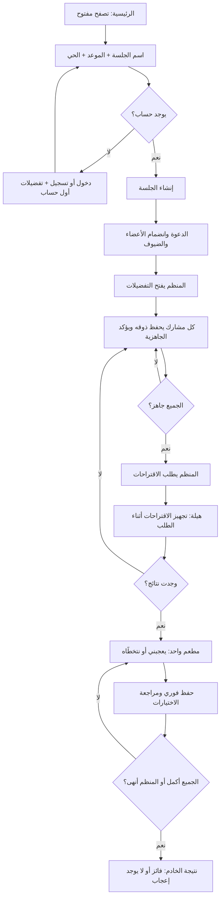
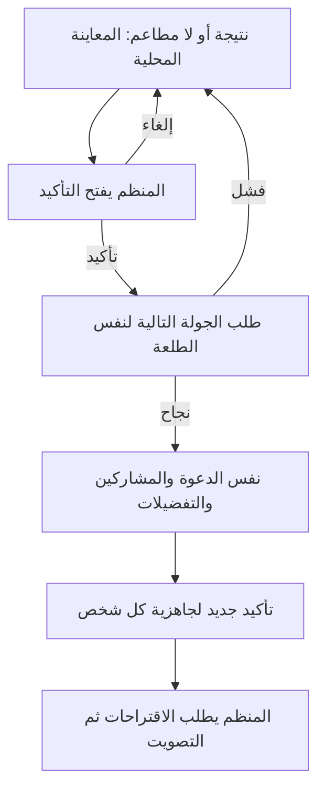

# رحلة الجلسة: من الدعوة إلى التصويت والنتيجة

تحديث ١١ نوفمبر ٢٠٢٦. هذا الدليل يشرح الفرونت المتصل بعقد الباك في `deployment` بعد ضم تحديثاته حتى `b75b17c`، بما فيه التصويت المدمج في #158. وجود مسارات التصويت في OpenAPI الحي تحقق بالقراءة فقط؛ لم نرسل أصواتًا حقيقية أو SMS خلال المعاينة.

## ماذا يرى المستخدم؟

1. يتصفح الرئيسية دون حساب. زر إنشاء الجلسة يفتح نموذج الاسم والموعد ومنطقة اللقاء.
2. يختار الحي من قائمة الخادم، ويحدد موعدًا قادمًا خلال ٦٠ يومًا بتوقيت الرياض. لا تطلب هذه الرحلة GPS.
3. الإنشاء يحتاج حسابًا. إن لم يسجل الدخول، تبقى مسودة النموذج أثناء الانتقال للدخول. الحساب الجديد يكمل تفضيلاته الأساسية أولًا ثم يعود للنموذج. المسودة مؤقتة في الذاكرة؛ تحديث المتصفح أو إغلاق التطبيق يمسحها.
4. بعد نجاح الإنشاء تظهر الدعوة ورمزها. يمكن نسخها على الويب أو مشاركتها على الجوال. الضيف ينضم باسمه دون حساب؛ العضو ينضم بحسابه. حد السعة ٨ أشخاص يفرضه الخادم.
5. المنظّم يفتح مرحلة التفضيلات. يراجع كل شخص نسخته الخاصة: المطابخ، «وش مشتهي اليوم؟» والصحن، أجواء الجلسة، الميزانية، المسافة والحساسية.
6. «حفظ وأنا جاهز» يحفظ **كل حقول تفضيلات الجلسة** ثم يؤكد الجاهزية. من لديه نسخة محفوظة يستطيع اعتمادها مباشرة. لا تتغير تفضيلات حسابه العامة.
7. عندما يجهز الجميع، يستطيع المنظّم ضغط «نبدأ التصويت». الجاهزية الأخيرة لا تولّد النتائج تلقائيًا.
8. تظهر شاشة مستقلة «هيلة تجمع أذواقكم» أثناء طلب الاقتراحات وإعادة قراءة الحالة. الحركة بسيطة وتحترم إعداد تقليل الحركة. لا مؤقت وهمي أو نسبة تقدم مختلقة. عند فشل الطلب ترجع الجاهزية مع إجراء تحديث؛ وإن لم توجد مطاعم تبقى حدود الجميع محفوظة.
9. تظهر بطاقة مطعم واحدة مع «يعجبني» و«نتخطّاه». كل إجابة تحفظ فورًا؛ يمكن مراجعة الإجابات وتعديلها ما دام التصويت مفتوحًا. الأصوات الفردية خاصة؛ الظاهر للجميع عدد من أكملوا فقط.
10. بعد إجابة الجميع على كل المطاعم ينهي الخادم الجولة تلقائيًا. المنظم يستطيع الإنهاء مبكرًا بعد تأكيد داخل الواجهة، بشرط عدم وجود أصوات محلية تنتظر الحفظ.
11. تعرض الواجهة فائز الخادم وتأييده والنتائج المجمعة وعدد من أكملوا. يمكن مشاركة النتيجة ورابط المطعم المتوفر، دون رموز الدخول أو أصوات الأشخاص. التعادل يُحسم بترتيب التوصية ثم معرف العنصر؛ لا جولة تعادل أو عداد. إذا لا يوجد إعجاب، تفرق بين عدم التصويت ووجود إجابات تخطٍّ؛ لا تختلق فائزًا.

## إعادة الجولة: ماذا نفذت الواجهة؟

إضافة #91 تعمل حاليًا في المعاينة المحلية؛ تشغيلها مع الباك ينتظر #90. بعد النتيجة أو عدم وجود مطاعم، يضغط المنظم «نجرّب جولة ثانية». تظهر هيلة مع شرح قصير: الدعوة والمشاركون والتفضيلات يبقون، لكن الجاهزية والأصوات تبدأ من جديد. «نكمّل على هالجولة» يلغي العملية دون طلب.

بعد «نبدأ جولة جديدة» تنتظر الواجهة نجاح الخادم، ثم تعود إلى ذوق الجلسة وتعرض رقم الجولة. كل شخص يراجع تفضيلاته أو يعتمدها بـ«اعتماد تفضيلاتي · أنا جاهز». لا يبدأ التصويت حتى يجهز الجميع ويطلبه المنظم. لم نغيّر الحساسية أو الميزانية أو المسافة لتجاوز عدم وجود نتائج. الأعضاء والضيوف ينتقلون عبر تحديث حالة الجلسة؛ لا يملكون زر إنشاء الجولة.

إذا فشل الطلب، تبقى النتيجة الحالية مع تحديث الحالة. الطلبات والردود تحمل معرف الجولة عند تفعيل دعم الجولات وتوفر المعرف؛ وصول صوت أو نتيجة قديمة لا يعيد بيانات الجولة السابقة. على الباك الحالي نخفي قسم إعادة الجولة بالكامل للمنظم والضيف، بما فيه النصوص التي تعد بجولة أخرى. لا نضيف `round_id` لطلبات التصويت أو غيرها لمجرد أن الخادم أرسله؛ لازم يكون دعم الجولات مفعّلًا أولًا. تفاصيل الربط في [العقد المبدئي](Session-Retry-Contract.md)؛ ليس توثيقًا لخدمة منشورة.

للتعديل: الشكل والنص في `components/SessionRetry.tsx`؛ الانتقال والقفل في `SessionScreen.tsx`؛ الطلب والتحقق في `api/round.ts` داخل `frontend/src/features/sessions/`. حماية أصوات الجولة السابقة في `frontend/src/features/voting/useVoting.ts` بالتنسيق مع فهد.

## لماذا توجد منطقة لقاء؟

الباك الحالي يحسب المسافات من **مركز الحي المختار**. لا يستقبل مواقع جميع المشاركين ولا يحسب نقطة وسط بينهم. لذلك الواجهة تعرض الحي وتشرح أساس المسافة؛ لا تعد المستخدم بمكان وسط آلي غير منفذ. خيار حساب منتصف مواقع المشاركين يحتاج تغييرًا منفصلًا في عقد الباك والخوارزمية.

الميزانية والمسافة تستخدمان في شروط النتائج. الحساسية تظهر كتحذير ولا تمثل ضمانًا غذائيًا؛ يظهر تنبيه بإبلاغ المطعم قبل الطلب. أجواء الجلسة تُحفظ في `seating_needs` لكن المحرك الحالي لا يفلتر المطاعم بها. لم نغيّر أي حد شخصي تلقائيًا عند عدم وجود نتائج.

## شاشة واحدة للجلسة

المسار المستخدم في #159 هو `/sessions/[id]` ويستدعي `SessionScreen.tsx`. يشمل الدعوة والجاهزية والتفضيلات ثم التصويت والنتيجة. عند توحيد #157 نكمل في هذه الشاشة وننقل أي سلوك ناقص إليها بعد مراجعته؛ لا نضيف شاشة جاهزية ثانية أو رابطًا إلى `/session-preferences` غير الموجود. هذه نقطة تسليم للتنسيق مع فهد، وليست اتفاقًا تم معه.

## أين نشتغل أنا وفهد؟

المسارات هنا من جذر المستودع:

| الملف | وظيفته ومن يبدأ به |
|---|---|
| `frontend/src/features/sessions/CreateSessionScreen.tsx` | شذى: شاشة الإنشاء، الورقة والرسمة والنموذج |
| `frontend/src/features/sessions/components/SessionEditors.tsx` | شذى: تحرير الاسم والتاريخ والوقت والحي |
| `frontend/src/features/sessions/model.ts` و`api/create.ts` | التحقق من النموذج وطلب الإنشاء؛ تنسيق تغييرات العقد مع عاصم |
| `frontend/src/features/sessions/JoinSessionScreen.tsx` | فهد: معاينة الدعوة والانضمام وفتح الجلسة |
| `frontend/src/features/sessions/SessionScreen.tsx` | فهد: المشاركون والتحديث والجاهزية والتفضيلات والاقتراحات |
| `frontend/src/features/sessions/SessionGenerating.tsx` | شذى: شاشة انتظار الاقتراحات وحركة هيلة؛ تظهر فقط أثناء الطلب |
| `frontend/src/features/sessions/SessionVoting.tsx` | شذى وفهد: بطاقة واحدة، مراجعة الاختيارات، الإنهاء والنتيجة |
| `frontend/src/features/voting/api.ts` و`useVoting.ts` | فهد: طلبات الأصوات وطابور الحفظ والاستعادة؛ أُدرجت تغييرات #161 مع الحفاظ على كوميتاته |
| `frontend/src/features/voting/result.ts` | قراءة النتيجة وإنهاء المنظم، والتحقق من شكل الرد |
| `frontend/src/features/sessions/components/SessionLayout.tsx` | التلخيص والزر السفلي الثابت والأنماط المشتركة؛ نسقوا تعديلها بينكم |
| `frontend/src/features/sessions/api/outing.ts` | فهد: أغلفة طلبات حالة الجلسة والتفضيلات والاقتراحات |
| `frontend/src/features/sessions/components/SessionVisuals.tsx` | مكونات الشكل المشتركة: الورقة والرسمة ومراحل الرحلة وهيلة؛ نسّقوا تعديلها بينكم |
| `frontend/src/features/sessions/components/SessionChrome.tsx` | الترويسة والأيقونات ونافذة التحرير المشتركة |
| `frontend/src/features/sessions/identity.ts` و`guestPass.ts` | اختيار رمز الحساب أو الضيف وحفظ عودة الضيف |
| `frontend/src/features/preferences/PreferencesForm.tsx` | نموذج التفضيلات المشترك؛ `context="outing"` يغير العناوين فقط، والشاشة المستدعية تختار API |
| `frontend/src/app/sessions/new.tsx` و`[id].tsx` | ملفات مسار صغيرة تستدعي الشاشة من مدخل الميزة |
| `frontend/src/app/join.tsx` و`join/[code].tsx` | يدعمان `/join?code=ABCD` و`/join/ABCD` |
| `frontend/src/application/HomePage.tsx` | تركيب الرئيسية وربط زر إنشاء الجلسة |
| `frontend/assets/images/sessions/` | رسمة المطعم والورقة والخط الذهبي واقتراح شخصية هيلة |

هذه النسخة تنفذ الملفات المبينة فوق؛ تقسيم المسؤولية يساعدكم في المتابعة ولا يعني أن أسماء الملفات مجرد خطة مستقبلية. استيراد ميزات أخرى يتم عبر `index.ts`؛ تعتمد `sessions` على `auth` و`preferences` و`personalSuggestions` و`restaurants` و`voting` فقط، والتصريح في `architecture.json`.

## شكل الواجهات

واجهة الإنشاء مبنية على الصورة المختارة. بقية الرحلة تستخدم الخط نفسه والأخضر الداكن والخلفية الكريمية ورسمة المطعم والورقة: الدعوة والانضمام وحالة الجلسة والاقتراحات. هيلة حبّة هيل بالألوان المائية، تظهر بوضوح في انتظار الاقتراحات وانتظار الأصوات. الترويسة وخطوات الرحلة ثابتة، والزر الأساسي ثابت أسفل الشاشة. أسماء المشاركين والموعد تفتح عند الحاجة؛ لا تتكرر الرسمة الكبيرة في كل مرحلة. نموذج التفضيلات يحتفظ بالصور والصحن وخطواته الست الحالية؛ لا نكرر قواعده في ميزة الجلسات.

## تحديث صفحة «هيلة تجمع أذواقكم»

هيلة الآن تجمع ملامح المرجعين: العيون المعبرة والخريطة الصغيرة، مع الوشاح الذهبي وملمس الألوان المائية. الصورة بخلفية شفافة حتى تندمج مع خلفية التطبيق. نستخدم الشكل نفسه في تلميحات هيلة الصغيرة، وتبقى الصورة السابقة في سجل Git؛ حُذفت من ملفات التطبيق لأنها غير مستخدمة.

للتعديل لاحقًا: ترتيب الصفحة والنص والحركة في `frontend/src/features/sessions/SessionGenerating.tsx`، والصورة في `frontend/assets/images/sessions/haila-gathering.webp`، وأيقونات الذوق والميزانية في `components/SessionChrome.tsx`. حجم الرسمة يتقلص على الشاشة القصيرة؛ النص يتمدد ويظل قابلًا للتمرير. عند تفعيل تقليل الحركة تبقى الشخصية ثابتة وتظل رسالة «نجهّز اقتراحاتكم» ظاهرة.

اسم الجلسة يوضح لأي طلعة نجهّز الاقتراحات. الإشارات الثلاث تشرح ما نراعيه: الأذواق والميزانية والمسافة؛ ليست أزرارًا ولا خطوات مكتملة. بعد انتهاء الطلب تظهر بطاقة المطعم ويبدأ التصويت تلقائيًا، دون زر إضافي أو مؤقت مصطنع. لم تتغير حقول الطلب أو عقد الاستجابة أو قواعد الحساسية أو جداول البيانات.

رُوجعت الشاشة بحجمي ٣٢٠×٧٤٠ و٣٩٠×٨٤٤. جُرّبت الرحلة المحلية من الإنشاء وحفظ التفضيلات إلى ظهور هيلة ثم الانتقال التلقائي لبطاقات التصويت. صور قبل/بعد ودليل المقارنة في `Docs/mockups/haila-generation/`؛ تجربة الجهاز الفعلي ليست ضمن هذا التحديث.

## ماذا تغير بعد المراجعة؟

إذا ضغطت تحديث الأصوات أثناء حفظ إجابة، تنتظر الواجهة اكتمال الحفظ ثم تقرأ ما حفظه الخادم قبل استقبال إجابة جديدة. هذا يمنع وصول الإجابة القديمة بعد الجديدة.

صور الجلسة أصبحت WebP: نفس الرسوم والألوان بمجموع ٢١٢ كيلوبايت تقريبًا بدل ٧٫٢ ميغابايت. حجم الرسوم قريب من ثلاثة أضعاف عرضها على الجوال، مع الحفاظ على نسبها وشفافية هيلة. لا تغيير على قاعدة البيانات أو الخوارزمية في هذه الإصلاحات. نجح `npm run check` مع ١٠٦ اختبارات وتصدير الويب بإعدادات الإنتاج. فُتحت شاشة الإنشاء على iPhone 17 Simulator؛ لم تُختبر رحلة متعددة الأجهزة أو SMS حقيقي.

## كيف تتصل الواجهة بالباك؟

جميع المسارات أدناه نسبية إلى `EXPO_PUBLIC_API_URL` (عادة ينتهي بـ`/api/v1`). نستخدم العميل المشترك، ولا نستدعي `fetch` من الشاشة.

| الإجراء | الطلب | ملاحظة العقد |
|---|---|---|
| قائمة الأحياء | `GET /districts` | معرف الحي من الخادم، دون توكن |
| إنشاء | `POST /outings/session` | توكن حساب + `{name, starts_at, district}`؛ الرد `outing_id, invite_code, invite_url, status` |
| معاينة الدعوة | `GET /outings/by-code/{code}` | دون توكن؛ الخادم يحدد `can_join` وسبب الإغلاق |
| انضمام عضو / ضيف | `POST /outings/{code}/join` أو `/join-guest` | العضو بالتوكن؛ الضيف باسمه ويحصل على `guest_token` |
| حالة الجلسة | `GET /outings/{id}` | هوية المشارك، `actions`، `participants` و`readiness` من الخادم |
| فتح التفضيلات | `POST /outings/{id}/start-preferences` | المنظم فقط |
| نسختي للجلسة | `GET /outings/{id}/preferences` | تخص صاحب التوكن وحده |
| حفظ النسخة | `PUT /outings/{id}/preferences` | استبدال كامل؛ الحقول المتروكة تُمسح؛ يعيد `preferences_done:false` |
| تأكيد الجاهزية | `POST /outings/{id}/preferences/ready` | بعد الحفظ؛ يعيد `preferences_done:true` |
| توليد الاقتراحات | `POST /outings/{id}/start-voting` | اسم المسار الحالي؛ المنظم فقط وبعد جاهزية الجميع |
| قراءة الاقتراحات | `GET /outings/{id}/plan` | نفس القائمة لجميع المشاركين |
| استعادة الأصوات والتقدم | `GET /outings/{id}/votes` | إجابات صاحب الرمز وعدد من أكملوا |
| إعجاب أو تخطٍّ | `POST /outings/{id}/votes` | `{plan_item_id, liked}` فقط؛ تكرار نفس العنصر يعدّل صوته |
| إنهاء مبكر | `POST /outings/{id}/end-voting` | المنظم فقط عندما تعرض `actions` الإجراء؛ يعيد النتيجة |
| النتيجة | `GET /outings/{id}/result` | فائز الخادم أو سبب عدم وجوده؛ لا حساب محلي للفائز |

عند وجود رمز ضيف يخص الجلسة يُستخدم قبل رمز الحساب، حتى لو سجّل الضيف دخولًا لاحقًا. رمز الحساب ورمز الضيف كلاهما `Authorization: Bearer ...`. لا توكن في الرابط أو مسودة الإنشاء. عندما تكون `invite_url` فارغة، يبني الويب رابط `/join?code=...` من أصل التطبيق، والجوال يشارك الرمز. عند نشر الويب يلزم إعداد الاستضافة لفتح المسارات الديناميكية `/sessions/{id}` و`/join/{code}` مباشرة؛ نجاح التصدير المحلي لا يختبر إعدادات الاستضافة. لروابط الخادم عيّن `INVITE_BASE_URL` إلى عنوان واجهة الدعوة المنتهي بـ`/join`؛ الباك يضيف `/CODE`.

تتحدث الحالة كل ٥ ثوانٍ أثناء فتح الشاشة، وتتوقف بعد النتيجة في النسخة الحالية ذات الجولة الواحدة. مع تفعيل دعم الجولات تستمر قراءة الحالة ليعرف الضيف أن المنظم بدأ جولة جديدة. الخطة تُقرأ مرة للجولة والتوكن الحاليين، وتُقرأ مجددًا عند العودة للشاشة أو تبدل الجولة؛ لا ننزلها كل ٥ ثوانٍ. نتجاهل الردود القديمة، ونمنع الإجراءات عند قدم الحالة حتى تنجح إعادة القراءة. تغيير الحساب لا يسمح بحفظ مسودة شخص آخر. فقد الاتصال يبقي البيانات مع إعادة محاولة؛ لا نحول الطلب الحقيقي إلى Mock تلقائيًا. عند فشل التخزين يستطيع الضيف المتابعة في الذاكرة؛ إعادة تحميل التطبيق في هذه الحالة تحتاج العودة للدعوة.

## حدود التغيير وقاعدة البيانات

لا تغيير في جداول SQL أو ERD أو خوارزمية الباك في هذا التحديث. استخدمنا outings/participants ونسخ التفضيلات وplan_items وvotes الموجودة بالفعل. قيد votes الفريد يحفظ إجابة واحدة لكل مشارك وعنصر، والخادم يكتب is_winner ويغيّر الحالة ضمن معاملته. لم نضف مجموعات دائمة أو مواقع مشاركين أو إزالة أشخاص. تحديث الرسم أعلاه يخص رحلة الفرونت فقط؛ مخطط البيانات لا يحتاج إعادة رسم لهذا التغيير.

## اختبارات إعادة الجولة

نجح `npm run check` مع ١٠٦ اختبارات. أُضيف `frontend/scripts/session-retry.test.cjs` لفحص التأكيد والإلغاء وتكرار الضغط والفشل وصلاحية المنظم وبقاء الدعوة والمشاركين والحدود، مع جاهزية وأصوات جديدة. اختبارات `voting.test.cjs` تفحص إهمال حفظ واستعادة أصوات الجولة القديمة. معاينة الويب ودليلها موثقان في `design-qa.md`؛ هذه الأدلة لا تثبت تشغيل #90 أو حفظ تاريخ الجولات على الخادم.

## التحقق والتجربة

شغّل من جذر المستودع `npm run check`. اختبارات الجلسة في `frontend/scripts/session-flow.test.cjs` و`join-flow.test.cjs` تفحص العقد، التواريخ، منع الإنشاء المكرر، العودة من الدخول، صلاحيات المنظم، عدم توليد النتائج تلقائيًا، حفظ الحقول كاملة، عزل الحساب، رموز الضيوف وقفل التعديل بعد الاقتراحات.

للمعاينة المعزولة استخدم `EXPO_PUBLIC_USE_MOCK=true` و`EXPO_PUBLIC_API_URL=http://127.0.0.1:1/api/v1` في ملف `.env.local` المهمل بواسطة Git. رقم الحساب التجريبي `0500000001` ورمزه `123456`؛ لا يُرسل SMS. أنشئ جلسة جديدة من الواجهة، وافتح التفضيلات واحفظها ثم اعرض الاقتراحات. البيانات الجديدة في الذاكرة وتزول عند إعادة تحميل المتصفح. رموز `TEST/MAXX/SHUT` القديمة مخصصة لاختبار معاينة الانضمام فقط؛ لتجربة الرحلة الكاملة أنشئ جلسة جديدة.

اختبارات `voting.test.cjs` و`session-voting.test.cjs` تتحقق من الاستعادة، ترتيب الحفظ، تغيير الإجابة، إعادة المحاولة، إقفال الجولة، صلاحية المنظم، عدم فقدان الأصوات بسبب الإنهاء المبكر، والتعادل وعدم وجود فائز. نموذج التصويت المحلي فيه ثلاثة مطاعم وتأخير طلب مقداره ٣ ثوانٍ لمعاينة هيلة فقط في Mock؛ النسخة الحقيقية لا تضيف أي انتظار مصطنع.

راجع `design-qa.md` في جذر المشروع ولقطات `Docs/mockups/session-refresh/` لدليل المعاينة. يلزم اختبار لاحق بالباك المنشور وبمشاركين على جهازين، وعلى iOS وAndroid، قبل إغلاق مهام التسليم النهائي.

## شكل الواجهة المعتمد وحدود سبرنت ٢ و٣

أُعيد اعتماد تصميم الورقة والرسمة القديم في الإنشاء والدعوة والتفضيلات. التحسينات: زر أساسي ثابت أسفل الشاشة، أربع مراحل واضحة، والمشاركون في نافذة مستقلة بدل إطالة الصفحة. التصويت يعرض بطاقة واحدة؛ شاشة هيلة تظهر أثناء تجهيز الاقتراحات، والنتيجة تأتي من الخادم.

راجع [جدول التسليم](Sprint-2-3-Frontend.ar.md) قبل إغلاق مهمة: فرونت #91 منفذ ومجرّب محليًا، والقبول الحقيقي ينتظر #90. إنشاء جلسة جديدة ليس بديلًا عن شرط الدعوة نفسها.
