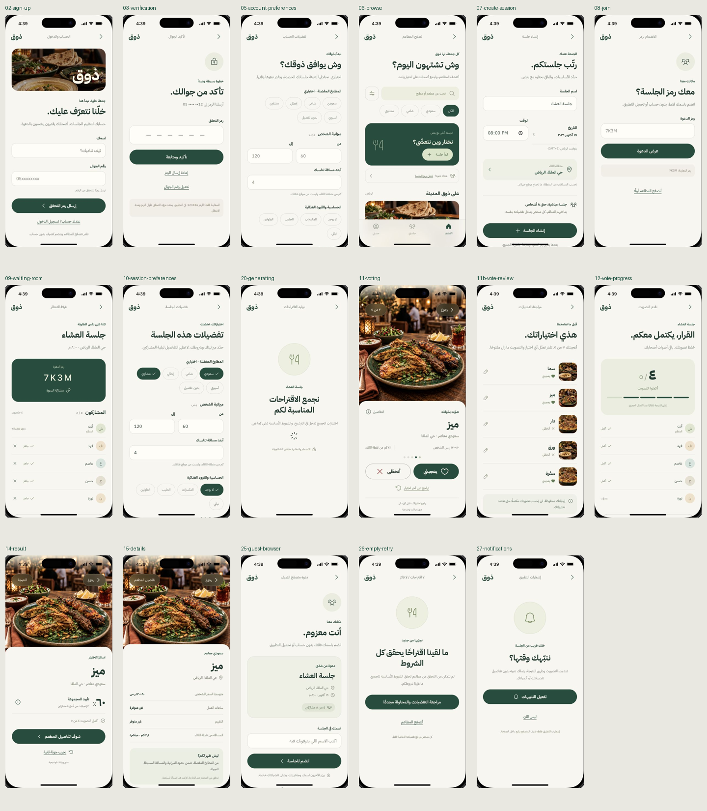

# ذوق — الواجهات المحدّثة / Updated UI handoff

**17 شاشة و52 صورة للشاشات والحالات، مع دليل تنفيذ باللغتين.**

**17 screens and 52 screen/state images, with a bilingual frontend guide.**

هذا هو التصميم الثاني المعتمد: صورة ممتدة ومعلومات أسفلها، مع مراجعة التصويت والرجوع والتراجع. هذا تسليم تصميم مستقل لمهمة [UX-01 #9](https://github.com/shathaaa1110-arch/Portfolio-Project/issues/9). الصور الأصلية والتسليم السابق محفوظان دون تغيير.

This applies the selected second direction: an immersive photo with information below, plus vote review, back and undo. This separate design handoff preserves the original mockups and previous delivery.

## ابدأ هنا / Start here

- [التقرير الجديد / New report](docs/UI-Refresh-2026-10-18.md)
- [الحقول والأزرار والحالات لكل شاشة / Fields, actions and states](docs/Screen-Checklist.ar-en.md)
- [دليل بناء الفرونت / Frontend implementation guide](docs/Frontend-Handoff.ar-en.md)
- [كل الصور المصدّرة / All 52 exported images](source/public/exports/)
- [دليل التحقق وحدوده / QA evidence and limits](docs/design-qa.md)
- [الألوان والمقاسات / Design tokens](docs/design-tokens.json)
- [التسليم السابق للمقارنة / Previous handoff](https://github.com/shathaaa1110-arch/Portfolio-Project/blob/ff0dab7/Docs/mockups/ux-01/README.md)



## فهرس الشاشات / Screen index

افتح رابط كل شاشة لعرض صورتها في GitHub، ثم اقرأ تفاصيلها في دليل الحقول والأزرار. يتضمن مجلد الصور أيضًا الأخطاء والتأكيدات والأجزاء السفلية للشاشات الطويلة.

Open a screen link to view its image in GitHub, then read its fields and actions in the checklist. The exports folder also includes errors, confirmation sheets and lower sections of long screens.

| الصورة / Image | الشاشة | Screen |
|---|---|---|
| [02-sign-up](source/public/exports/02-sign-up.png) | حساب المنظم | Organizer account |
| [03-verification](source/public/exports/03-verification.png) | تأكيد رقم الجوال | Verify phone |
| [05-account-preferences](source/public/exports/05-account-preferences.png) | تفضيلات الحساب | Saved account preferences |
| [06-browse](source/public/exports/06-browse.png) | تصفح المطاعم | Public restaurant browsing |
| [07-create-session](source/public/exports/07-create-session.png) | إنشاء جلسة مباشرة | Create a direct session |
| [08-join](source/public/exports/08-join.png) | الانضمام إلى جلسة | Join a session |
| [09-waiting-room](source/public/exports/09-waiting-room.png) | المشاركون والجاهزية | Participants and readiness |
| [10-session-preferences](source/public/exports/10-session-preferences.png) | تفضيلات الجلسة الخاصة | Private session preferences |
| [20-generating](source/public/exports/20-generating.png) | توليد الاقتراحات | Generate suggestions |
| [11-voting](source/public/exports/11-voting.png) | التصويت على الاقتراحات | Vote on suggestions |
| [11b-vote-review](source/public/exports/11b-vote-review.png) | مراجعة واعتماد الاختيارات | Review and confirm votes |
| [12-vote-progress](source/public/exports/12-vote-progress.png) | تقدم التصويت | Voting progress |
| [14-result](source/public/exports/14-result.png) | النتيجة وإعادة المحاولة | Result and retry |
| [15-details](source/public/exports/15-details.png) | تفاصيل المطعم | Restaurant details |
| [25-guest-browser](source/public/exports/25-guest-browser.png) | تخطيط متصفح الضيف | Guest browser layout |
| [26-empty-retry](source/public/exports/26-empty-retry.png) | لا اقتراحات / لا فائز | No match / no winner |
| [27-notifications](source/public/exports/27-notifications.png) | إشعارات التطبيق | App notifications |

## تشغيل المعاينة / Run the preview

من جذر الريبو / From the repository root:

```sh
cd Docs/mockups/ux-01-visual-refresh/source
npm ci
npm run dev -- --port 8770
```

ثم افتح / Then open:

- `http://127.0.0.1:8770/handoff.html` — الدليل المرئي / visual guide.
- `http://127.0.0.1:8770/?screen=vote` — نموذج الهاتف / mobile prototype.
- `http://127.0.0.1:8770/guest-preview.html?code=7K3M` — ضيف المتصفح / guest browser.

هذه عناوين محلية بعد التشغيل. ملفات HTML لا تعمل كمعاينة تفاعلية داخل GitHub. افحص البناء باستخدام `npm run build`، أو شغّل الناتج باستخدام `npm run preview`.

These are local addresses after starting the server. GitHub does not run the HTML as an interactive preview. Use `npm run build` to check the build, or `npm run preview` to serve it.

## نطاق التسليم / Delivery scope

هذه واجهات ونموذج React للمتصفح ببيانات تجريبية، وليست تطبيق Expo متصلًا بالخادم. استخدمها مرجعًا لنقل المكونات إلى React Native. لا تثبت اكتمال SMS أو API أو الحفظ أو الإشعارات الفعلية.

This is a React browser design prototype with demo data, ready to guide React Native implementation. It does not prove real SMS, API, persistence or notification integration.

السبرنت العاجل ومتطلبات الربط ومواعيده تبقى حسب إيشيو UX-01 والبطاقات المرتبطة. نشر هذه الواجهات لا يغيّر حالة اكتمالها.

The urgent sprint scope, integration requirements and deadlines remain in UX-01 and its linked cards. Publishing this design does not change their completion status.
