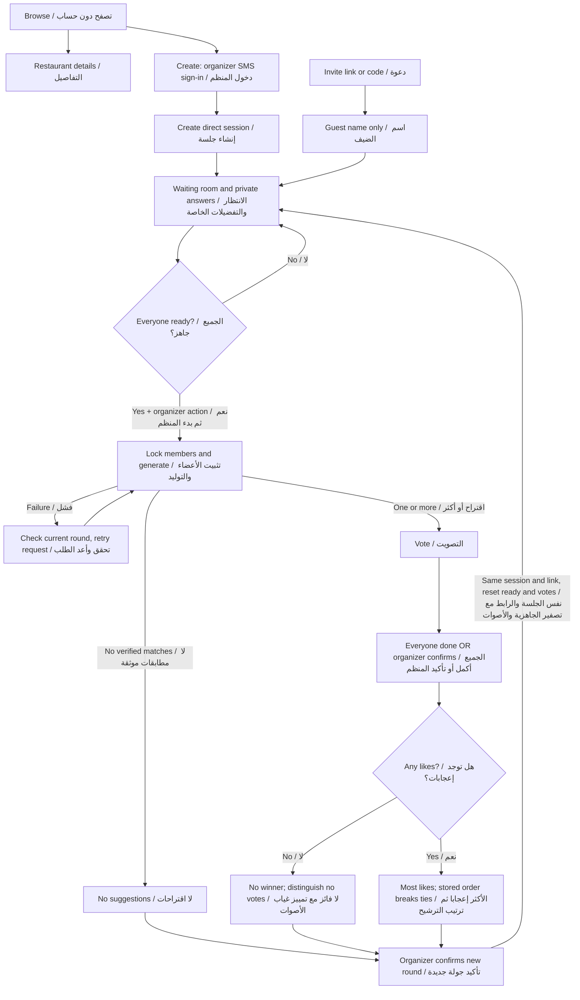

# UX-01 · Core screen handoff / تسليم الشاشات الأساسية

**Ready for design review — implementation specification, not shipped behavior.**

**جاهز لمراجعة التصميم — هذا وصف للتنفيذ، وليس إثباتًا أن التطبيق يعمل.**

- Task / المهمة: [UX-01 #9](https://github.com/shathaaa1110-arch/Portfolio-Project/issues/9).
- Decisions / القرارات: [P-01 #7](https://github.com/shathaaa1110-arch/Portfolio-Project/issues/7), approved in the planning discussion. The P-01 documentation task is still open; this handoff uses its already-approved decisions. / مهمة توثيق P-01 ما زالت مفتوحة؛ يعتمد هذا التسليم قراراتها المعتمدة بالفعل.
- Reviewed / تمت المراجعة: **18 October 2026**, source [`deployment @ a94d79d`](https://github.com/shathaaa1110-arch/Portfolio-Project/tree/a94d79da8d11a80073c95a6eb41eaa407a8c1ae6).
- Output / المخرج: 16 annotated screen boards, state variants, bilingual field/action notes, and a flow diagram. / ١٦ لوحة شاشة مشروحة وحالات بديلة وشرح للحقول والأزرار باللغتين ورسم للرحلة.

## Open and use / الفتح والاستخدام

Start at [index.html](index.html). GitHub displays HTML source; download/clone the repository and open this file in a browser, or run from the repository root:

ابدأ بملف العرض. غيتهب يعرض مصدر HTML؛ نزّل الريبو وافتح الملف في المتصفح، أو شغّل من جذر الريبو:

```sh
python3 -m http.server 8766 --bind 127.0.0.1 --directory Docs/mockups
```

Then visit `http://127.0.0.1:8766/ux-01/`. Select **Screen / الشاشة**, then **State / الحالة**. Only these viewer controls work; the app fields and buttons are static illustrations.

ثم افتح الرابط المحلي واختر الشاشة والحالة. أزرار العارض تعمل؛ الحقول والأزرار داخل تصميم التطبيق رسومات توضيحية ثابتة.

Each board has the original reference on the left, revised layout in the middle, and bilingual fields/actions/states/rules on the right. In desktop guest mode and on a narrow viewer the original is hidden to leave room for the revised screen. The original PNG remains linked below.

كل لوحة تعرض الأصل يسارًا، والتخطيط المحدّث في الوسط، والشرح باللغتين يمينًا. في وضع ضيف الكمبيوتر وعند تضييق العارض تختفي المقارنة الأصلية لتوضيح الشاشة الجديدة، ويمكن فتح الصورة الأصلية من الروابط.

**Read the middle frame and notes together.** Names, prices, counts, date, code, and OTP countdown are illustrative. Do not turn them into fixed requirements or real restaurant claims. The controls and copy are the specification; backend validation remains authoritative.

**اقرأ التخطيط والملاحظات معًا.** الأسماء والأسعار والأعداد والتاريخ والرمز وعدّاد SMS أمثلة؛ لا تثبّتها في الكود ولا تعتبرها حقائق عن مطعم. الحقول والنصوص هي مواصفات التنفيذ، والخادم مرجع التحقق.

## Screen review / مراجعة الشاشات

Health describes the **original design**, not working app quality. Every row has a revised, reviewed handoff. / التقييم يصف **التصميم الأصلي** وليس جودة تطبيق عامل. لكل صف تصميم محدّث تمت مراجعته.

| Step | Screen / الشاشة | Original health / حالة الأصل | Exact change / التعديل | Export |
|---|---|---|---|---|
| 1 | Organizer account / حساب المنظم | Needs changes / يحتاج تعديل | Correct the name label. The current React Native form already says Name; retain that fix.<br>صحح اسم الحقل في الصورة. نموذج React Native الحالي يعرض «الاسم» بالفعل؛ حافظ على التصحيح. | [JPG](exports/02-sign-up.jpg) |
| 2 | Verify phone / تأكيد رقم الجوال | Needs changes / يحتاج تعديل | Keep the code screen; add edit-phone, failure and retry states.<br>أبق شاشة الرمز وأضف تعديل الرقم وحالات الخطأ وإعادة الإرسال. | [JPG](exports/03-verification.jpg) |
| 3 | Saved account preferences / تفضيلات الحساب | Needs changes / يحتاج تعديل | Reuse cuisine chips; replace mandatory three choices with clear optional preferences.<br>أعد استخدام خيارات المطابخ، واستبدل اشتراط ثلاثة اختيارات بتفضيلات اختيارية واضحة. | [JPG](exports/05-account-preferences.jpg) |
| 4 | Public restaurant browsing / تصفح المطاعم | Needs changes / يحتاج تعديل | Reuse the green session card and restaurant list. Remove personal recommendations, saved tabs, dish search, and unverified ratings/photos.<br>أعد استخدام بطاقة الجلسة الخضراء وقائمة المطاعم. احذف الترشيح الشخصي وتبويب المحفوظات والبحث بالأطباق والصور والتقييمات غير الموثقة. | [JPG](exports/06-browse.jpg) |
| 5 | Create a direct session / إنشاء جلسة مباشرة | Needs changes / يحتاج تعديل | Keep the session form; split time and meeting area into explicit fields.<br>أبق نموذج الجلسة وافصل الوقت ومنطقة اللقاء إلى حقول واضحة. | [JPG](exports/07-create-session.jpg) |
| 6 | Join a session / الانضمام إلى جلسة | Needs changes / يحتاج تعديل | Replace Group with Session. Add a guest display-name field and explicit join errors.<br>استبدل «القروب» بـ«الجلسة»، وأضف اسم الضيف وأخطاء الانضمام الواضحة. | [JPG](exports/08-join.jpg) |
| 7 | Participants and readiness / المشاركون والجاهزية | Needs changes / يحتاج تعديل | Keep participant rows and share code. Add organizer removal, participant leave, readiness count, and a gated Generate action.<br>أبق صفوف المشاركين ورمز المشاركة. أضف إزالة المنظم ومغادرة المشارك وعدد الجاهزين وزر توليد مشروطًا. | [JPG](exports/09-waiting-room.jpg) |
| 8 | Private session preferences / تفضيلات الجلسة الخاصة | Needs changes / يحتاج تعديل | Keep cuisine, budget and distance. Add seating needs, explicit private constraints, and save/ready/error states.<br>أبق المطبخ والميزانية والمسافة وأضف احتياجات الجلسة وخصوصية القيود وحالات الحفظ والجاهزية والخطأ. | [JPG](exports/10-session-preferences.jpg) |
| 9 | Generate suggestions / توليد الاقتراحات | Needs changes / يحتاج تعديل | Reuse the calm loading treatment. Remove personal mood, fake restaurant counts, travel time and fabricated progress.<br>أعد استخدام أسلوب التحميل الهادئ. احذف المزاج الشخصي وعدد المطاعم الوهمي ووقت الوصول والتقدم المختلق. | [JPG](exports/20-generating.jpg) |
| 10 | Vote on suggestions / التصويت على الاقتراحات | Needs changes / يحتاج تعديل | Keep one-card voting and green/saffron styling. Use labelled buttons and truthful restaurant facts.<br>أبق التصويت ببطاقة واحدة والأخضر والأصفر. استخدم أزرارًا مسماة وحقائق مطعم صادقة. | [JPG](exports/11-voting.jpg) |
| 11 | Voting progress / تقدم التصويت | Needs changes / يحتاج تعديل | Replace the unexplained live percentage with completed count. Add organizer early-end confirmation.<br>استبدل النسبة المباشرة غير المفسرة بعدد من أكملوا، وأضف تأكيد الإنهاء المبكر للمنظم. | [JPG](exports/12-vote-progress.jpg) |
| 12 | Result and retry / النتيجة وإعادة المحاولة | Needs changes / يحتاج تعديل | Keep the winner card. Show explainable support and completion counts instead of an unexplained percentage.<br>أبق بطاقة الفائز واعرض تأييدًا محسوبًا وعدد من أكملوا بدل نسبة بلا تفسير. | [JPG](exports/14-result.jpg) |
| 13 | Restaurant details / تفاصيل المطعم | Needs changes / يحتاج تعديل | Keep the information hierarchy. Remove unsupported gallery, saved button and travel-time claim.<br>أبق ترتيب المعلومات واحذف المعرض والحفظ وادعاء وقت الوصول غير المدعوم. | [JPG](exports/15-details.jpg) |
| 14 | Guest browser layout / تخطيط متصفح الضيف | Missing / ناقص | Add the missing guest-name form and desktop layout, using the same session vocabulary and components.<br>أضف نموذج اسم الضيف وتخطيط الكمبيوتر الناقصين، باستخدام مصطلحات الجلسة والمكونات نفسها. | [JPG](exports/25-guest-browser.jpg) |
| 15 | No match / no winner / لا اقتراحات / لا فائز | Missing / ناقص | Add three distinct empty results and one safe recovery path.<br>أضف ثلاث نتائج فارغة مختلفة ومسار استعادة آمنًا واحدًا. | [JPG](exports/26-empty-retry.jpg) |
| 16 | App notifications / إشعارات التطبيق | Missing / ناقص | Add a contextual permission explanation and closed-app routing notes.<br>أضف شرح إذن في سياقه وملاحظات فتح التطبيق المغلق. | [JPG](exports/27-notifications.jpg) |

Additional exported states / صور الحالات الإضافية:

- [Preference save failure / فشل حفظ التفضيلات](exports/10-session-preferences--error.jpg).
- [Early close confirmation / تأكيد الإنهاء المبكر](exports/12-vote-progress--confirm.jpg).
- [Missing restaurant facts / بيانات المطعم الناقصة](exports/15-details--missing.jpg).
- [No likes / دون إعجابات](exports/26-empty-retry--no-likes.jpg).
- [Retry confirmation / تأكيد الإعادة](exports/26-empty-retry--retry.jpg).

The viewer contains further states: invalid phone, expired code, no search results, failed loading, full/closed/removed invitation, organizer/participant differences, all-ready, locked answers, vote save failure, last answered card, tie explanation, public details, no recorded votes, and denied/stale notifications.

يتضمن العارض أيضًا: رقمًا خاطئًا ورمزًا منتهيًا وبحثًا فارغًا وفشل تحميل ودعوة ممتلئة/مغلقة/ملغاة واختلاف صلاحيات المنظم والمشارك وجاهزية الجميع وقفل الإجابات وفشل حفظ الصوت وآخر بطاقة وشرح التعادل وتفاصيل عامة وعدم وجود أصوات ورفض الإشعارات والإشعار القديم.

## Approved journey / الرحلة المعتمدة



Joining, leaving, and removal stop at generation. The locked round membership is the support denominator. A lost connection does not remove a person. Only a new round reopens joining; each person reviews their own retained answers.

يتوقف الانضمام والمغادرة والإزالة عند التوليد. عدد أعضاء الجولة المثبت هو مقام نسبة التأييد، وانقطاع الاتصال لا يحذف الشخص. الجولة الجديدة تعيد فتح الانضمام، ويراجع كل شخص إجاباته المحفوظة بنفسه.

## Fields and controls / الحقول والأزرار

| Control / العنصر | Implementation guidance / توجيه التنفيذ |
|---|---|
| Name / الاسم | Required, trim spaces; use **الاسم** for account and **اسمك الظاهر للمشاركين** for guest. Never call an account name اسم الجلسة. / مطلوب مع إزالة الفراغات الطرفية وتسمية واضحة. |
| Phone / الجوال | One telephone input, Saudi 10-digit example; normalize Arabic digits and country prefix before validation. Show an inline error and preserve input. / حقل واحد مع توحيد الأرقام ورمز الدولة وحفظ المدخل عند الخطأ. |
| OTP / رمز SMS | One numeric input with paste/autofill. Provider/API defines length, expiry, and resend delay; announce server errors. / حقل رقمي واحد يقبل اللصق والتعبئة؛ الطول والصلاحية والمهلة من العقد التقني. |
| Invite / الدعوة | LTR code; uppercase normalization; link prefills it. Four characters are a visual example until P-02 confirms format. / الرمز من اليسار لليمين، والرابط يملؤه؛ الصيغة النهائية من P-02. |
| Session / الجلسة | Separate name, date, time, meeting-area picker. Use Riyadh timezone; show the selected area before creation. / حقول مستقلة للاسم والتاريخ والوقت ومنطقة اللقاء وتوقيت الرياض. |
| Cuisine / المطبخ | Multi-select chips. “لا أفضل مطبخًا معينًا” clears specific choices; choosing a cuisine clears that option. / اختيار متعدد مع خيار واضح لعدم التفضيل. |
| Budget / الميزانية | Two numeric fields: minimum and maximum SAR/person; non-negative and minimum ≤ maximum. Do not submit a formatted text range. / حقلان رقميان بالريال للشخص؛ الأدنى لا يتجاوز الأعلى ولا يقبل قيمة سالبة. |
| Distance / المسافة | Positive number in km from the meeting area; no personal GPS required. / رقم موجب بالكيلومتر من منطقة اللقاء دون اشتراط GPS الشخصي. |
| Constraints / القيود | Labelled multi-select list from the API's supported values, with explicit **لا يوجد**. Blank is unanswered. “None” excludes other values. Do not accept unsupported free text as a verified constraint. / قائمة بقيم يدعمها الخادم وخيار صريح للا شيء؛ الفراغ ليس إجابة ولا يُدّعى التحقق من نص حر غير مدعوم. |
| Seating / احتياجات الجلسة | Labelled multi-select supported needs, or **لا اشتراط**. An unsupported requirement must not silently disappear. / اختيارات يدعمها الخادم أو لا اشتراط، ولا يسقط شرط غير مدعوم بصمت. |
| Readiness / الجاهزية | Save answers and mark Ready only after server success. Editing cancels Ready. Do not claim automatic save succeeded before its response. / الجاهزية بعد نجاح الحفظ؛ التعديل يلغيها. |
| Voting / التصويت | Like/Pass buttons, Details, Previous, then Done when all actual cards are answered. Save before advancing. / إعجاب وتخطي وتفاصيل وسابق ثم إنهاء عند إجابة كل البطاقات الفعلية؛ الحفظ قبل الانتقال. |
| Back / الرجوع | Navigate back without implicitly leaving the session. Leaving/removal/retry/early close need explicit confirmation. / الرجوع لا يعني مغادرة الجلسة؛ المغادرة والإزالة والإعادة والإنهاء المبكر لها تأكيد مستقل. |

If the server rejects a field, show its message beside that field, keep other answers, and focus the first error. During a request disable repeat submission. After reconnect fetch the current session/round before applying actions. Browser guests keep unsent form values only in the active page memory; do not write private constraints to URLs, logs, or shared storage.

عند رفض حقل، ضع رسالته بجواره واحتفظ ببقية الإجابات وانقل التركيز لأول خطأ. عطّل الإرسال المتكرر أثناء الطلب. بعد الاتصال حمّل الجولة الحالية قبل تنفيذ إجراء. يحتفظ متصفح الضيف بالقيم غير المرسلة في ذاكرة الصفحة الحالية فقط؛ لا تكتب القيود الخاصة في الروابط أو السجلات أو تخزين مشترك.

## Arabic, iPhone and browser / العربية والآيفون والمتصفح

- Product copy is Arabic; handoff notes are Arabic and simple English. RTL reading order runs from the top-right through the fields to the primary action. The step sequence starts with **دعوة** on the right. Phone/code values remain LTR using direction isolation. / نص المنتج عربي، والشرح باللغتين. تبدأ القراءة والمراحل من اليمين؛ الأرقام والرموز معزولة باتجاه يسار إلى يمين.
- Base app frame: 390 logical px wide; 22px internal sides; 48px primary controls. These are handoff design choices. All interactive hit areas in implementation, including chips, Back, remove and tabs, must reach 44×44 logical points/pixels with spacing. / عرض التصميم الأساسي ٣٩٠ وهوامش داخلية ٢٢ وزر أساسي ٤٨؛ اجعل مساحة لمس جميع العناصر ٤٤×٤٤ على الأقل مع تباعد.
- Long forms scroll vertically. Screenshots expand to show the entire form; they do not require a taller phone. Respect iOS safe areas and keyboard; keep the focused field and primary action reachable. Use actual platform status bars, not the illustrated header. / النماذج الطويلة تتمرر عموديًا؛ امتداد الصورة لإظهار المحتوى لا يعني هاتفًا أطول. راعِ المناطق الآمنة ولوحة المفاتيح واستخدم شريط النظام الحقيقي.
- Browser guest layout: full available phone width with about 20px sides; from 768px center a form up to 480px. The design viewer adds annotations outside this form. / متصفح الضيف بعرض الهاتف وهوامش نحو ٢٠؛ من ٧٦٨ فأكثر يتوسط نموذج بحد ٤٨٠. ملاحظات العارض خارج النموذج.
- Labels remain above inputs; placeholders never replace them. Focus and validation order follow the visual reading order. Controls need semantic labels/roles and screen-reader announcements in the app. / عنوان الحقل يبقى أعلاه، وترتيب التركيز يطابق القراءة؛ يلزم توصيف العناصر وإعلان الأخطاء لقارئ الشاشة عند التنفيذ.
- Green `#184e3c`, deep green `#123b2e`, cream `#faf8f0`, saffron `#e9a210`; use text as well as color for status. Bundled IBM Plex Sans Arabic is a handoff typography choice, not a claim about the original design file. / ألوان المرجع محفوظة مع وصف نصي للحالة. خط التسليم اختيار موثّق وليس ادعاءً بمعرفة خط الملف الأصلي.

## Privacy and truthful results / الخصوصية وصدق النتائج

The privacy explanation appears before entering session constraints. Other participants and the organizer see names/readiness/completion only, never named allergies, an anonymous group allergen list, individual votes, or who prevented a match. The organizer cannot edit someone else's conditions. The backend must enforce this; hiding UI is insufficient.

شرح الخصوصية يظهر قبل إدخال قيود الجلسة. يرى المشاركون والمنظم الاسم والجاهزية والاكتمال فقط؛ لا تُعرض حساسية شخص أو قائمة حساسية جماعية مجهولة أو تصويت فردي أو من تسبب بعدم التطابق. لا يعدل المنظم شروط شخص آخر. يلزم فرض ذلك في الخادم، فإخفاء الواجهة وحده لا يكفي.

Unknown facts required to satisfy a hard constraint exclude a restaurant. Unknown optional rating/hours display **غير متوفر**. Public listings may have incomplete data, but must not imply personal suitability. No fake photographs, travel times, ratings, progress, or support percentages.

نقص حقيقة لازمة لشرط أساسي يستبعد المطعم. نقص التقييم أو الساعات الاختيارية يظهر «غير متوفر». قد يعرض التصفح بيانات ناقصة دون ادعاء ملاءمة شخصية. لا صور منسوبة بلا دليل ولا أوقات وصول أو تقييمات أو تقدم أو نسب تأييد مختلقة.

For the result example, **3 likes ÷ 5 round members = 60%**. **4 of 5 completed** is a different measure. Zero likes never produces a winner; zero votes gets separate wording. Retry retains the same session/link/people/preferences, creates a separate round, resets readiness/votes, and does not weaken conditions.

في المثال: **٣ إعجابات ÷ ٥ أعضاء = ٦٠٪**، بينما **٤ من ٥ أكملوا** مقياس آخر. لا فائز دون إعجابات، وغياب الأصوات له نص مستقل. الإعادة تحفظ الجلسة والرابط والأشخاص والتفضيلات وتفصل الجولة وتصفّر الجاهزية والأصوات دون تخفيف الشروط.

## Existing work and deferred references / الموجود والمراجع المؤجلة

The 24 source PNGs are unchanged. Thirteen source frames support the revised boards; three newly specified surfaces reuse their relevant originals for comparison. The sign-up name label is already **الاسم** in `frontend/src/app/index.tsx` at the reviewed revision. Do not reimplement that label change; the old PNG is what needs correction. That screen's alert-only submit does not prove authentication is implemented.

بقيت الصور الأصلية الـ٢٤ دون تعديل. استندت اللوحات إلى ١٣ صورة أصلية، واستُخدمت بعض الأصول لمقارنة ثلاث شاشات/حالات مضافة. عنوان الاسم مصحح بالفعل في كود التسجيل؛ لا تعِد العمل عليه. وجود إرسال يعرض تنبيهًا فقط لا يثبت تنفيذ المصادقة.

| Original files / الملفات الأصلية | Treatment / التعامل |
|---|---|
| 02, 03, 05–12, 14, 15, 20 | Revised boards above / اللوحات المحدّثة أعلاه. |
| 01 splash | Brand reference only; unsupported “50K” usage claim is not carried forward. / مرجع الهوية فقط، دون نقل ادعاء عدد المستخدمين غير المثبت. |
| 04 location | Historical reference; compulsory personal-location onboarding is not required for direct sessions. / مرجع تاريخي؛ لا يشترط إعداد الموقع الشخصي للجلسات المباشرة. |
| 13 tie-breaker | Retired flow; positive ties are resolved automatically. / مسار ملغى؛ التعادل يحسم تلقائيًا. |
| 16–18 groups/attendance | Deferred saved-group flow; no implementation from these screens in this release. / المجموعات المحفوظة وحضورها مؤجلة. |
| 19 personal recommendation | Deferred Choose for me / «اختر لي» الشخصي مؤجل. |
| 21 saved/profile | Keep as reference; saved lists deferred. Account defaults use screen 05, not a saved-list tab. / مرجع؛ المحفوظات مؤجلة وتفضيلات الحساب في ٠٥. |
| 22–24 tourist | Deferred tourist flow / مسار السياحة مؤجل. |

## Handoff to the team / تسليم الفريق

| Person / المسؤول | Use this handoff for / يستخدم التسليم في |
|---|---|
| Shatha / شذى | Own UX review and shared visual components; coordinate screen split and iOS build. / مراجعة التصميم والمكونات المشتركة وتنسيق تقسيم الشاشات وبناء الآيفون. |
| Fahad / فهد | Implement assigned frontend screens and guest layouts; check them on his iPhone. / تنفيذ شاشات الفرونت المسندة وتخطيط الضيف وتجربتها على آيفونه. |
| Asem / عاصم | Match fields, errors, authorization, readiness, round transitions and notification events to the API. / مطابقة الحقول والأخطاء والصلاحيات والجاهزية والجولات وأحداث الإشعارات مع API. |
| Hassan / حسن | Check round membership, private data exposure, result arithmetic and state scenarios against DB/API. / فحص عضوية الجولة وخصوصية البيانات وحساب النتيجة والحالات مع القاعدة وAPI. |

This handoff does not reassign existing issue owners or change estimates. Shatha and Fahad should share the same field, error, restaurant-card and primary-button components. Follow existing frontend tasks when choosing who implements each screen. Native notification delivery requires real iPhone build evidence; this static document proves neither delivery nor SMS operation.

لا يغيّر التسليم أصحاب المهام أو الساعات. يتشارك شذى وفهد مكونات الحقول والخطأ وبطاقة المطعم والزر الأساسي، ويستخدمان المهام القائمة لتوزيع التنفيذ. إثبات الإشعارات يحتاج نسخة فعلية على الآيفون؛ هذا المستند لا يثبت عمل الإشعارات أو SMS.

## Files and maintenance / الملفات والتحديث

- `screens.json`: bilingual source annotations and source-image mapping. / مصدر الشرح باللغتين وربط الأصل.
- `template.html`: viewer and static layout source. / مصدر العارض والتخطيطات الثابتة.
- `build.py` → `index.html`: validates all 24 source mappings and produces the viewer; standard-library Python only. / يتحقق من ربط الأصول وينتج العارض دون حزم إضافية.
- `exports/`: screenshots of changed/new annotated boards only. / صور اللوحات المعدّلة والمضافة فقط.
- `evidence/` + [VALIDATION.md](VALIDATION.md): captured review evidence and limits. / دليل المراجعة وحدودها.
- `assets/`: bundled font files and [OFL license](assets/OFL.txt), sourced from [Google Fonts / IBM Plex Sans Arabic](https://github.com/google/fonts/tree/main/ofl/ibmplexsansarabic). No remote fonts are needed. / ملفات الخط ورخصته محليًا.

After editing JSON or template, run `python3 Docs/mockups/ux-01/build.py`. Open the changed screen/state and export with `?screen=<id>&state=<state>&export=1`; capture the full page, inspect it, and replace only affected JPGs. Update validation evidence when the behavior notes change.

بعد تعديل JSON أو القالب شغّل أمر البناء، وافتح الشاشة والحالة المعدّلة بمعامل التصدير والتقط الصفحة كاملة وافحصها واستبدل الصور المتأثرة فقط. حدّث دليل التحقق عند تعديل القواعد.

The flow diagram is updated here. No app behavior, SQL schema, API endpoint, or module boundary was implemented in UX-01, so architecture/ERD/API diagrams are not represented as newly implemented. Their historical scope conflicts remain P-01/P-02 work; the handoff links are added to the old documents to prevent accidental use of outdated screens.

حُدّث رسم الرحلة هنا. لم تنفّذ UX-01 سلوكًا في التطبيق أو مخطط قاعدة أو نقطة API أو حدود وحدات؛ لذلك لا ندّعي تنفيذ رسوم المعمارية/ERD/API. توحيد النطاق التاريخي فيها يظل ضمن P-01/P-02، وأضيفت روابط واضحة تمنع استخدام التصميم القديم بالخطأ.


<details>
<summary>All 24 original references / جميع المراجع الأصلية</summary>

| Original / الأصل | Used by / الاستخدام |
|---|---|
| [01-splash.png](../01-splash.png) | Reference only / مرجع فقط |
| [02-sign-up.png](../02-sign-up.png) | 02-sign-up |
| [03-verification-code.png](../03-verification-code.png) | 03-verification |
| [04-location.png](../04-location.png) | Reference only / مرجع فقط |
| [05-taste-preferences.png](../05-taste-preferences.png) | 05-account-preferences |
| [06-home.png](../06-home.png) | 06-browse |
| [07-create-session.png](../07-create-session.png) | 07-create-session |
| [08-join-with-code.png](../08-join-with-code.png) | 08-join, 25-guest-browser |
| [09-waiting-room.png](../09-waiting-room.png) | 09-waiting-room |
| [10-preference-collection.png](../10-preference-collection.png) | 10-session-preferences |
| [11-vote.png](../11-vote.png) | 11-voting |
| [12-live-consensus.png](../12-live-consensus.png) | 12-vote-progress, 27-notifications |
| [13-tie-breaker.png](../13-tie-breaker.png) | Reference only / مرجع فقط |
| [14-winner.png](../14-winner.png) | 14-result, 26-empty-retry |
| [15-restaurant-details.png](../15-restaurant-details.png) | 15-details |
| [16-my-groups.png](../16-my-groups.png) | Reference only / مرجع فقط |
| [17-group-details.png](../17-group-details.png) | Reference only / مرجع فقط |
| [18-attendance-request.png](../18-attendance-request.png) | Reference only / مرجع فقط |
| [19-personal-recommendation.png](../19-personal-recommendation.png) | Reference only / مرجع فقط |
| [20-finding-matches.png](../20-finding-matches.png) | 20-generating |
| [21-saved-and-profile.png](../21-saved-and-profile.png) | Reference only / مرجع فقط |
| [22-tourist-explore.png](../22-tourist-explore.png) | Reference only / مرجع فقط |
| [23-tourist-dish-guide.png](../23-tourist-dish-guide.png) | Reference only / مرجع فقط |
| [24-tourist-restaurant.png](../24-tourist-restaurant.png) | Reference only / مرجع فقط |

</details>
