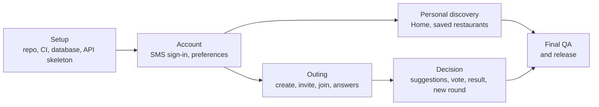

# Thouq (ذوق) — Stage 4: MVP Development and Execution

Thouq is an Arabic app that helps people find restaurants and choose one together with their companions.
This document shows how the team built the MVP: the sprint plan, the work done, how we tracked progress,
the sprint reviews and retrospectives, and the final testing.

**Team:** Shatha Alanazi, Asim Alhubaishi, Hassan Alhuzali, Fahad Almidaj

## Deliverables (Task 5)

| Deliverable | Link |
|---|---|
| Sprint planning | [Section 2](#2-sprint-planning-task-0) · [Project board](https://github.com/users/shathaaa1110-arch/projects/1) · [Milestones](https://github.com/shathaaa1110-arch/Portfolio-Project/milestones) |
| Sprint reviews | [Section 5](#5-sprint-reviews-task-3) |
| Retrospectives | [Section 6](#6-retrospectives-task-3) |
| Source repository | <https://github.com/shathaaa1110-arch/Portfolio-Project> |
| Bug tracking | [Defect register #78](https://github.com/shathaaa1110-arch/Portfolio-Project/issues/78) · [Issues labelled `bug`](https://github.com/shathaaa1110-arch/Portfolio-Project/issues?q=is%3Aissue+label%3Abug) · [Section 7.4](#74-bugs-found-and-fixed) |
| Testing evidence and results | [Section 7](#7-final-integration-and-qa-testing-task-4) · [CI run on `9a574c7`](https://github.com/shathaaa1110-arch/Portfolio-Project/actions/runs/44918019949) |
| Production environment | Web app: <https://thouq.onrender.com> · API: <https://thouq-api.onrender.com/api/v1/health> |

## Contents

1. [MVP scope and team roles](#1-mvp-scope-and-team-roles)
2. [Sprint planning (Task 0)](#2-sprint-planning-task-0)
3. [Development (Task 1)](#3-development-task-1)
4. [Progress and adjustments (Task 2)](#4-progress-and-adjustments-task-2)
5. [Sprint reviews (Task 3)](#5-sprint-reviews-task-3)
6. [Retrospectives (Task 3)](#6-retrospectives-task-3)
7. [Final integration and QA testing (Task 4)](#7-final-integration-and-qa-testing-task-4)
8. [Remaining work](#8-remaining-work)

---

## 1. MVP scope and team roles

### What the MVP includes

| In the MVP | Not in the MVP |
|---|---|
| Public restaurant list, search, filters and details (no account needed) | Push notifications on iPhone (deferred) |
| Account with SMS code, saved preferences, location, saved restaurants | Saved groups and attendance |
| Create an outing, share the invite, join as a member or a guest | Reservations, payments, restaurant-side integration |
| Private answers and "ready" status | Taste summary, mood, tourist guide |
| Suggestions with a reason, voting, automatic result, new round in the same outing | Android build, App Store publication |

**Stack:** React Native (Expo SDK 58), FastAPI, PostgreSQL. The API and the web app are deployed on Render.

### Roles

| Member | Role | Main responsibilities |
|---|---|---|
| **Shatha Alanazi** | Project Manager · UI/UX · Front-end | Sprint planning, the board, progress tracking, screen design, session and restaurant screens, release coordination |
| **Asim Alhubaishi** | Back-end and API | Endpoints, session logic, recommendation engine, API journey tests |
| **Hassan Alhuzali** | Database · QA | Schema and migrations, restaurant data, integration tests, defect register and retests |
| **Fahad Almidaj** | Front-end | Auth, join and voting screens, guest invitation, device testing |

**SCM (source control)** is shared by the four members. Everyone works in branches, opens pull requests into `deployment`,
and each pull request is reviewed by a member from a different area.
Example: [Hassan's review of PR #179](https://github.com/shathaaa1110-arch/Portfolio-Project/pull/179).

---

## 2. Sprint planning (Task 0)

### 2.1 From user stories to tasks

- The Stage 3 user stories were grouped into epics. Each epic was split into small tasks.
- Each task is a GitHub issue with an ID for its area: `FE` front-end, `BE` back-end, `DB` database, `QA` testing, `OPS` setup and release, `DOC` documentation.
- Each task has one owner, a sprint, an estimate in hours and a status on the [project board](https://github.com/users/shathaaa1110-arch/projects/1).

### 2.2 Priorities

We used labels on every issue. They work like MoSCoW:

| Our label | MoSCoW meaning | Tasks |
|---|---|---:|
| `scope:core` + `priority:P0` | Must Have — critical or blocking, done first | 93 (P0 and P1 together) |
| `scope:core` + `priority:P1` | Should Have — planned by capacity and dependencies | |
| Scope "Deferred" | Could Have — only after the core is done | 5 |
| Scope "Future idea" | Won't Have in this release | 5 |

### 2.3 Dependencies

- Front-end screens depend on the API contract ([P-02 #8](https://github.com/shathaaa1110-arch/Portfolio-Project/issues/8)), so it was agreed first.
- Each endpoint depends on its database migration, so the `DB` task is merged before the `BE` task.
- QA tasks depend on the feature they test. The release tasks ([#71](https://github.com/shathaaa1110-arch/Portfolio-Project/issues/71), [#76](https://github.com/shathaaa1110-arch/Portfolio-Project/issues/76)) depend on QA and are marked "Blocked" until it passes.

### 2.4 Sprint plan

| Sprint | Dates (2026) | Length | Goal | Core tasks | Tasks per owner |
|---|---|---|---|---:|---|
| **Sprint 0** — Auth, preferences and Home | 18 – 20 Oct | 3 days | The project runs on every laptop. Sign-in works. CI is active. | 15 | Shatha 5 · Fahad 5 · Asem 3 · Hassan 2 |
| **Sprint 1** — Personal discovery and account | 21 Oct – 1 Nov | 12 days | A user gets personal suggestions, saves restaurants and sees a real account page. | 28 | Asem 9 · Hassan 8 · Fahad 6 · Shatha 5 |
| **Sprint 2** — Outings and group decisions | 2 – 15 Nov | 14 days | An organizer creates an outing, people join, answer and vote. | 27 | Asem 10 · Fahad 7 · Shatha 6 · Hassan 4 |
| **Sprint 3** — Results and delivery | 16 – 29 Nov | 14 days | Result, new round, search and details, final QA and a stable build. | 23 | Shatha 9 · Asem 5 · Fahad 5 · Hassan 4 |

Main tasks in each sprint:

| Sprint | Main tasks |
|---|---|
| 0 | Release scope (P-01) · design handoff (UX-01) · run on every laptop (OPS-02) · CI on every pull request (OPS-04) · SMS provider (OPS-14) · API health check (BE-01) · account and login code (BE-04, BE-05) · repeatable database (DB-02) · API client (FE-02) · login screens (FE-05) · account defaults (FE-03) |
| 1 | API contract (P-02) · filtering and ranking engine (BE-14, BE-15) · personal suggestions (BE-28) · account preferences and profile (BE-07, BE-34) · saved restaurants (DB-15, BE-33, FE-30) · restaurant data (DB-06, DB-13) · Home and public browsing (FE-25, FE-28, FE-29) · account page (FE-31) · test helpers (QA-01) |
| 2 | Create and join an outing (BE-08, BE-09, FE-08, FE-09) · state, answers and ready (BE-11, BE-13, FE-10, FE-11) · plan and voting (BE-17, BE-19, FE-13, FE-14) · rounds storage (DB-07) · guest invitation (FE-21) · leave and remove (BE-29, FE-26) · permissions (BE-06) · session tests (QA-02, QA-13) |
| 3 | Close voting, result and ties (BE-20, BE-21, FE-15, FE-17) · new round (BE-31, FE-27) · search and details (BE-27, FE-23, FE-24) · full-journey tests (QA-07, QA-09, QA-14) · defect register (QA-12) · stable build (OPS-10) · documentation (DOC-05) |

Every task with its owner, hours and target date is on the board:
[Sprint 0](https://github.com/users/shathaaa1110-arch/projects/1/views/36) ·
[Sprint 1](https://github.com/users/shathaaa1110-arch/projects/1/views/33) ·
[Sprint 2](https://github.com/users/shathaaa1110-arch/projects/1/views/34) ·
[Sprint 3](https://github.com/users/shathaaa1110-arch/projects/1/views/35).

---

## 3. Development (Task 1)

### 3.1 Workflow

1. Take a task from the board and create a branch: `feature/<task>`, `fix/<bug>`, `docs/<topic>` or `chore/<topic>`.
2. Open a pull request into `deployment` with the [PR template](https://github.com/shathaaa1110-arch/Portfolio-Project/blob/deployment/.github/pull_request_template.md). The pull request links its issue.
3. [CI](https://github.com/shathaaa1110-arch/Portfolio-Project/blob/deployment/.github/workflows/ci.yml) runs three jobs: front-end checks, back-end unit tests, and PostgreSQL integration tests.
4. A member from another area reviews and approves.
5. After the merge, Render deploys the `deployment` branch automatically.

Stage 3 planned two branches, `main` and `develop`. We use one integration branch, `deployment`, because it is connected to automatic deployment.

### 3.2 What was built

| Area | Delivered | Pull requests |
|---|---|---|
| Accounts | Sign-up and login with an SMS code, logout, account page | [#110](https://github.com/shathaaa1110-arch/Portfolio-Project/pull/110), [#117](https://github.com/shathaaa1110-arch/Portfolio-Project/pull/117), [#134](https://github.com/shathaaa1110-arch/Portfolio-Project/pull/134), [#138](https://github.com/shathaaa1110-arch/Portfolio-Project/pull/138) |
| Preferences | Account preferences and private outing answers | [#142](https://github.com/shathaaa1110-arch/Portfolio-Project/pull/142), [#151](https://github.com/shathaaa1110-arch/Portfolio-Project/pull/151), [#144](https://github.com/shathaaa1110-arch/Portfolio-Project/pull/144) |
| Restaurants | Public list, search, filters by cuisine and district, details | [#111](https://github.com/shathaaa1110-arch/Portfolio-Project/pull/111), [#168](https://github.com/shathaaa1110-arch/Portfolio-Project/pull/168), [#176](https://github.com/shathaaa1110-arch/Portfolio-Project/pull/176) |
| Personal discovery | Personal suggestions, saved restaurants | [#154](https://github.com/shathaaa1110-arch/Portfolio-Project/pull/154), [#163](https://github.com/shathaaa1110-arch/Portfolio-Project/pull/163), [#135](https://github.com/shathaaa1110-arch/Portfolio-Project/pull/135) |
| Outings | Create, invite link, join by code, guest join, lobby, leave and remove | [#146](https://github.com/shathaaa1110-arch/Portfolio-Project/pull/146), [#147](https://github.com/shathaaa1110-arch/Portfolio-Project/pull/147), [#157](https://github.com/shathaaa1110-arch/Portfolio-Project/pull/157), [#160](https://github.com/shathaaa1110-arch/Portfolio-Project/pull/160), [#174](https://github.com/shathaaa1110-arch/Portfolio-Project/pull/174) |
| Decision | Suggestions engine, voting, automatic result, new round | [#141](https://github.com/shathaaa1110-arch/Portfolio-Project/pull/141), [#152](https://github.com/shathaaa1110-arch/Portfolio-Project/pull/152), [#158](https://github.com/shathaaa1110-arch/Portfolio-Project/pull/158), [#159](https://github.com/shathaaa1110-arch/Portfolio-Project/pull/159), [#170](https://github.com/shathaaa1110-arch/Portfolio-Project/pull/170) |
| Setup | CI, deployment, Expo SDK 58, repeatable database | [#115](https://github.com/shathaaa1110-arch/Portfolio-Project/pull/115), [#123](https://github.com/shathaaa1110-arch/Portfolio-Project/pull/123), [#124](https://github.com/shathaaa1110-arch/Portfolio-Project/pull/124), [#112](https://github.com/shathaaa1110-arch/Portfolio-Project/pull/112) |

On 21 November the repository has 70 pull requests: 63 merged (61 into `deployment`), 5 closed without merging, and 2 open ([#178](https://github.com/shathaaa1110-arch/Portfolio-Project/pull/178), a fix in the plan engine, and [#180](https://github.com/shathaaa1110-arch/Portfolio-Project/pull/180), this document). It has 13 database migrations.
The API journey tests were merged on 21 November in [#177](https://github.com/shathaaa1110-arch/Portfolio-Project/pull/177).

Setup guides: [front-end](https://github.com/shathaaa1110-arch/Portfolio-Project/blob/deployment/frontend/README.md) ·
[back-end](https://github.com/shathaaa1110-arch/Portfolio-Project/blob/deployment/backend/README.md) ·
[database](https://github.com/shathaaa1110-arch/Portfolio-Project/blob/deployment/database/README.md).

---

## 4. Progress and adjustments (Task 2)

### 4.1 How we tracked progress

- **Board:** every task moves through Backlog → Ready → In Progress → Done (or Blocked). There is a view for each sprint, each member and each layer.
- **Status updates:** each task card has a dated update with what works now, the next steps and the blocker. Example: [#78](https://github.com/shathaaa1110-arch/Portfolio-Project/issues/78).
- **Check-ins:** the team held short check-ins to share finished work and blockers. We did not keep written minutes of the daily check-ins; the written record is on the board and in the issues.
- **Weekly review:** the Project Manager compares planned and finished tasks and moves work when someone is blocked. Example: the [recovery plan for meeting 6, 18 November](https://github.com/shathaaa1110-arch/Portfolio-Project/issues/172).

### 4.2 Metrics

Task numbers are the state of the board on 21 November. A few tasks were closed after their sprint ended.

| Metric | Sprint 0 | Sprint 1 | Sprint 2 | Sprint 3 (in progress) | Total |
|---|---:|---:|---:|---:|---:|
| Core tasks planned | 15 | 28 | 27 | 23 | 93 |
| Core tasks completed (velocity) | 14 | 26 | 24 | 13 | 77 |
| Completed vs. planned | 93% | 93% | 89% | 57% | 83% |
| Sprint time used on 21 Nov | 100% | 100% | 100% | 43% (day 6 of 14) | |
| Pull requests merged into `deployment`| 11 | 16 | 29 | 5 | 61 |
| Bug-fix pull requests merged | 0 | 2 | 3 | 3 | 8 |

Sprint 3 is ahead of schedule: 57% of its tasks are done at 43% of its time. 11 of its 12 development tasks are done; the other one is deferred push (FE-20). The rest of its open tasks are testing, release and documentation, which are the work of the second week.

Progress by type of work (all sprints):

| Type of work | Planned | Done | Done % |
|---|---:|---:|---:|
| Back-end (`BE`) | 23 | 23 | 100% |
| Front-end (`FE`) | 24 | 23 | 96% |
| Database (`DB`) | 10 | 9 | 90% |
| **Development total** | **57** | **55** | **96%** |
| QA and acceptance (`QA`) | 19 | 12 | 63% |
| Setup and release (`OPS`) | 10 | 5 | 50% |
| Planning, design, docs and other | 7 | 5 | 71% |

The two open development tasks are push notifications in the app (FE-20, deferred) and the restaurant data report (DB-09).
The full journey was tested on real devices and passed ([section 7.3](#73-integration-checks-on-the-live-environment)). The API journey tests are merged. The open `QA` tasks are mostly database edge cases. The automated tests for these features all pass ([section 7.2](#72-automated-test-results)).
Three of the open tasks (#39, #40, #77) belong to Stage 5. Without them and without deferred push, 77 of 89 MVP tasks are done (87%).

**Bugs:** 10 recorded. 9 are fixed and 1 fix ([#178](https://github.com/shathaaa1110-arch/Portfolio-Project/pull/178)) is in review. Resolution rate: 90%. Details in [section 7.4](#74-bugs-found-and-fixed).

### 4.3 Adjustments

| When | What changed | Why |
|---|---|---|
| 18 Oct | The scope was updated and approved again: organizer accounts with real SMS, same-outing retry, guests in the browser. Saved groups moved out. ([Release scope update](https://github.com/shathaaa1110-arch/Portfolio-Project/blob/deployment/Docs/ReleaseScopeUpdate-2026-10-18.md)) | The first charter was too small in some parts and too large in others. |
| 18 Oct | The plan changed from 2 sprints to 4 sprints (Sprint 0 to Sprint 3). | The approved scope needed about six weeks of work. |
| Sprint 1 | Saved restaurants and personal suggestions were added to the core scope. | Team decision during Sprint 1. |
| Sprint 2 → 3 | The API journey tests ([#70](https://github.com/shathaaa1110-arch/Portfolio-Project/issues/70), [#72](https://github.com/shathaaa1110-arch/Portfolio-Project/issues/72)) and invitation sharing ([#23](https://github.com/shathaaa1110-arch/Portfolio-Project/issues/23)) continued into Sprint 3. The tests were merged on 21 November. | Features were merged late in the sprint, so their tests started late. |
| 18 Nov | Recovery plan: work focused on the core journey and its tests ([#172](https://github.com/shathaaa1110-arch/Portfolio-Project/issues/172)). | Sprint 3 had many open tasks. |
| Sprint 3 | Push notifications on iPhone were deferred. The API part is done ([#167](https://github.com/shathaaa1110-arch/Portfolio-Project/pull/167)); the app part ([#45](https://github.com/shathaaa1110-arch/Portfolio-Project/issues/45)) is not. | The iPhone build ([#58](https://github.com/shathaaa1110-arch/Portfolio-Project/issues/58)) is not ready, and the core journey has priority. |
| Sprint 3 | The five-group user study and the final presentation ([#39](https://github.com/shathaaa1110-arch/Portfolio-Project/issues/39), [#77](https://github.com/shathaaa1110-arch/Portfolio-Project/issues/77), [#40](https://github.com/shathaaa1110-arch/Portfolio-Project/issues/40)) move to Stage 5. | They are closure work, not MVP features. |

Sprint 3 ends on 29 November. The plan for its second week is in [section 8](#8-remaining-work).

---

## 5. Sprint reviews (Task 3)

Each review covers the features finished in the sprint, shown on the `deployment` build.

| Sprint | What was shown | Not finished in the sprint |
|---|---|---|
| **0** | The app runs on the team's machines. Sign-up and login with a real SMS code. CI runs on every pull request. Front-end structure ([#104](https://github.com/shathaaa1110-arch/Portfolio-Project/pull/104)). | Shared iPhone development build ([#58](https://github.com/shathaaa1110-arch/Portfolio-Project/issues/58)). |
| **1** | Home with a public restaurant list. Account preferences. Personal suggestions. Saved restaurants. Real account page. | Restaurant data report ([#13](https://github.com/shathaaa1110-arch/Portfolio-Project/issues/13)) and the constraint-boundary check ([#131](https://github.com/shathaaa1110-arch/Portfolio-Project/issues/131)). |
| **2** | The outing journey: create → invite → join → answers → ready → suggestions → vote. A guest joins from a browser with a name only. On iPhones, one full attempt reached voting and the result. | Invite sharing from every screen ([#23](https://github.com/shathaaa1110-arch/Portfolio-Project/issues/23)). The API journey tests ([#70](https://github.com/shathaaa1110-arch/Portfolio-Project/issues/70), [#72](https://github.com/shathaaa1110-arch/Portfolio-Project/issues/72)) were finished in Sprint 3. |
| **3** (to 21 Nov) | Result and automatic tie settlement. New round in the same outing. Restaurant search and details. Leave and remove controls. Invite link fix for AirDrop. API journey tests in CI. | Final QA tasks, stable build and documentation (see [section 8](#8-remaining-work)). |

**Feedback that changed the plan**

- Sprint 2: a guest who opened the invite saw "Unmatched Route" → logged as a defect, fixed and retested.
- Sprint 3: buttons and small text were unclear on the session screens → fixed in [#175](https://github.com/shathaaa1110-arch/Portfolio-Project/pull/175).

---

## 6. Retrospectives (Task 3)

| Sprint | What worked well | What was difficult | What we change next |
|---|---|---|---|
| **0** | Clear owners for front-end, back-end and database. CI was ready from the first week. | Three days were too short to also finish the iPhone build. | Keep setup tasks small, and move device work to a later sprint. |
| **1** | Small pull requests, each linked to one task. Reviews from another area caught problems early. | QA tasks started after the features, so some QA tasks stayed open after the sprint. | Start the QA task when the feature pull request opens, not after the merge. |
| **2** | Testing on real iPhones found a joining bug that automated tests did not find. The back-end finished its tasks early. | Many pull requests were merged in the last days (11 November). The device test did not record the build version. | Merge earlier in the sprint. For every defect, record the device, the version, the steps and the retest. |
| **3** | Integration tests on PostgreSQL run twice in CI and protect the full flow. The recovery plan made priorities clear. | Too much work was planned: features, final QA, release and presentation in one sprint. | Keep MVP acceptance separate from Stage 5 work. Finish QA before starting new features. |

**Action for the next sprint:** Hassan collects all QA results in the defect register ([#78](https://github.com/shathaaa1110-arch/Portfolio-Project/issues/78)).
Every tester writes the build version and the result right after testing.

---

## 7. Final integration and QA testing (Task 4)

### 7.1 Test levels

| Level | What it checks | Tool | When it runs |
|---|---|---|---|
| Unit | One function or class | `pytest`, Node test runner | Every pull request (CI) |
| Integration | The API with a real PostgreSQL database and all migrations | `pytest -m integration` | Every pull request (CI), run twice on the same database |
| Front-end checks | TypeScript, architecture rules, screen behaviour | `npm run check` | Every pull request (CI) |
| End-to-end (manual) | The full journey for an organizer and a guest | iPhone, Safari, Chrome | Before a sprint review |

Test plan: [Technical documentation, section 6](https://github.com/shathaaa1110-arch/Portfolio-Project/blob/deployment/Docs/TechnicalDoc.md#6-quality-assurance).

### 7.2 Automated test results

[CI run of 21 November](https://github.com/shathaaa1110-arch/Portfolio-Project/actions/runs/44918019949) on commit `9a574c7`, after the merge of #177: **all three jobs passed**.

| Suite | Result |
|---|---|
| Back-end unit tests | 139 passed, 0 failed |
| Back-end integration tests on PostgreSQL | 338 passed, 0 failed (and passed again in the second run) |
| Front-end tests (`npm run check`) | 146 passed, 0 failed |
| Front-end auth tests | 4 passed |
| TypeScript and architecture rules | Passed |

### 7.3 Integration checks on the live environment

| Check | Result |
|---|---|
| API health (`/api/v1/health`) on 21 Nov | `status: ok`, `database: ok`, `environment: production` |
| Public restaurant search on the live API (11 Nov) | 33,784 restaurants without a search term; 3,730 for `search=سعودي`; 0 for a term with no match |
| Public restaurant API, checked for [QA-21 #133](https://github.com/shathaaa1110-arch/Portfolio-Project/issues/133#issuecomment-7064954138) (21 Nov) | 20 records with 20 unique IDs; a page size of 51 is rejected with 422; required fields present |
| Front-end with the live API (17 Nov) | Search and restaurant details checked in the browser against the live API, and on the iPhone simulator |

Manual device test in November 2026 (exact days not recorded) by Shatha, Fahad and Asem (iPhones with Expo and the installed app, Safari and Chrome):

| Case | Result |
|---|---|
| Login, preferences, location, create an outing | Done, no defect reported |
| Full outing: join → answers → vote → result | Passed |
| Guest joins from the invite link | **Failed** the first time: "Unmatched Route — Page could not be found" |
| Guest joins from the invite link, after the fix | Passed |

The test record of each closed QA task is published as a comment on its issue:

| Case | Result |
|---|---|
| Full journey on phone and guest browser ([QA-09 #36](https://github.com/shathaaa1110-arch/Portfolio-Project/issues/36#issuecomment-7064391825)) | Passed |
| Invitation and preferences with one real group ([QA-05 #26](https://github.com/shathaaa1110-arch/Portfolio-Project/issues/26#issuecomment-7064465954)) | Passed |
| Personal discovery, saved restaurants and profile ([QA-18 #129](https://github.com/shathaaa1110-arch/Portfolio-Project/issues/129#issuecomment-7064466432)) | Passed |
| Final check of all screens ([FE-22 #75](https://github.com/shathaaa1110-arch/Portfolio-Project/issues/75#issuecomment-7064466887)) | Passed |

### 7.4 Bugs found and fixed

| # | Bug | Area | Fix | Status |
|---|---|---|---|---|
| 1 | CI test database was not set up correctly | CI | [#120](https://github.com/shathaaa1110-arch/Portfolio-Project/pull/120) | Fixed |
| 2 | Login session was not kept on the web | Front-end | [#122](https://github.com/shathaaa1110-arch/Portfolio-Project/pull/122) | Fixed |
| 3 | Chosen location was lost after editing preferences ([issue #155](https://github.com/shathaaa1110-arch/Portfolio-Project/issues/155)) | Front-end | [#162](https://github.com/shathaaa1110-arch/Portfolio-Project/pull/162) | Fixed |
| 4 | Restaurants without coordinates entered the suggestions | Back-end | [#165](https://github.com/shathaaa1110-arch/Portfolio-Project/pull/165) | Fixed |
| 5 | The lobby did not receive the invite link | Back-end | [#169](https://github.com/shathaaa1110-arch/Portfolio-Project/pull/169) | Fixed |
| 6 | Logout did not end all login tokens | Back-end | [#171](https://github.com/shathaaa1110-arch/Portfolio-Project/pull/171) | Fixed |
| 7 | Unclear buttons, small text, header under the status bar | Front-end | [#175](https://github.com/shathaaa1110-arch/Portfolio-Project/pull/175) | Fixed |
| 8 | Invite link shared by AirDrop did not open in Safari | Front-end | [#179](https://github.com/shathaaa1110-arch/Portfolio-Project/pull/179) | Fixed |
| 9 | Guest saw "Unmatched Route" when joining | Front-end | Found in the device test | Fixed, retest passed |
| 10 | Plan engine did not handle optional location and price fields | Back-end | [#178](https://github.com/shathaaa1110-arch/Portfolio-Project/pull/178) | In review |

### 7.5 Known limits

- Push notifications are not in the iPhone app yet.
- The API runs on a free Render instance. The first request after a quiet period can take up to a minute.
- Restaurant cards use an illustration for each cuisine, because the dataset has no photos.

---

## 8. Remaining work

The features of the main journey are built, merged and deployed. The full journey passed on real devices. The second week of Sprint 3 (22 – 29 November) is for database edge-case tests, the release build and documentation.

| Area | Open tasks | Owner |
|---|---|---|
| Invitation flow | Share the invite from every screen ([#23](https://github.com/shathaaa1110-arch/Portfolio-Project/issues/23)) | Fahad |
| Database QA | Vote counting and round races ([#35](https://github.com/shathaaa1110-arch/Portfolio-Project/issues/35), [#92](https://github.com/shathaaa1110-arch/Portfolio-Project/issues/92)); hard-constraint boundaries ([#131](https://github.com/shathaaa1110-arch/Portfolio-Project/issues/131)) | Hassan |
| Public browsing QA | Signed-out browsing and guest browser updates ([#93](https://github.com/shathaaa1110-arch/Portfolio-Project/issues/93)) | Fahad |
| Restaurant data | Source, version and import report ([#13](https://github.com/shathaaa1110-arch/Portfolio-Project/issues/13)) | Hassan |
| Build and release | iPhone build ([#58](https://github.com/shathaaa1110-arch/Portfolio-Project/issues/58)); stable demo build ([#38](https://github.com/shathaaa1110-arch/Portfolio-Project/issues/38)); release tasks ([#71](https://github.com/shathaaa1110-arch/Portfolio-Project/issues/71), [#76](https://github.com/shathaaa1110-arch/Portfolio-Project/issues/76)) | Shatha |
| Documentation and defects | Guide matches the code ([#37](https://github.com/shathaaa1110-arch/Portfolio-Project/issues/37)); defect register ([#78](https://github.com/shathaaa1110-arch/Portfolio-Project/issues/78)) | Shatha, Hassan |
| Deferred | Push notifications in the app ([#45](https://github.com/shathaaa1110-arch/Portfolio-Project/issues/45)) | Fahad |
| Stage 5 | Five-group study ([#39](https://github.com/shathaaa1110-arch/Portfolio-Project/issues/39), [#77](https://github.com/shathaaa1110-arch/Portfolio-Project/issues/77)); final presentation and demo ([#40](https://github.com/shathaaa1110-arch/Portfolio-Project/issues/40)) | Hassan, Shatha |

Live list: [MVP remaining work](https://github.com/users/shathaaa1110-arch/projects/1/views/37).
