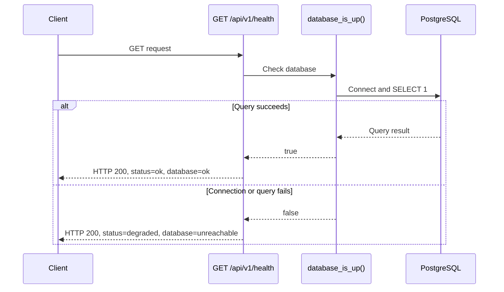

# Thouq API (backend)

FastAPI + PostgreSQL. Every endpoint lives under `/api/v1`.

## Run it locally

Needs Python 3.12 and PostgreSQL 18 for local development. Follow the
[database setup guide](../database/README.md) first to create the local roles,
configure connections, and apply migrations. Hosted deployments use their own DATABASE_URL.

```bash
cd backend
uv venv --python 3.12 .venv  # skip if the setup guide already created it
source .venv/bin/activate
uv pip install -r requirements.txt
# Configure .env using the database guide; preserve an existing .env.
uvicorn app.main:app --reload
```

Check it: http://127.0.0.1:8000/api/v1/health

- `"database": "ok"` → the API reaches the database.
- `"database": "unreachable"` → the API runs but `DATABASE_URL` is wrong or the database is down.

Interactive docs for every endpoint: http://127.0.0.1:8000/docs

## Health check contract

`GET /api/v1/health` opens a real database connection and executes `SELECT 1`
through the existing database helper. Both outcomes return HTTP **200**, so
inspect the JSON body:

| Database state | `status` | `database` |
| --- | --- | --- |
| Query succeeds | `ok` | `ok` |
| Connection or query fails | `degraded` | `unreachable` |

The `environment` field reports the configured environment. This checks database
connectivity, not application tables or migration completeness. Keep the API
running when checking database shutdown and recovery.



See [BE-01 validation evidence](VALIDATION.md) for the real running, stopped,
and recovered database results.

## Shared endpoint errors

Endpoint authors should raise `ApiError` from `app.core.errors`; its handler is
already registered in `app/main.py`. For example, the existing invalid-phone
contract uses HTTP **422**:

```python
from app.core.errors import ApiError

raise ApiError(
    status_code=422,
    code="INVALID_PHONE",
    message="Phone number must be in the format 05XXXXXXXX.",
)
```

```json
{
  "error": {
    "code": "INVALID_PHONE",
    "message": "Phone number must be in the format 05XXXXXXXX."
  }
}
```

Clients can branch on the stable `error.code` and display `error.message`.
Additional named arguments, such as `retry_after_seconds=60`, become fields
inside `error`; do not use extras to replace `code` or `message`.

Missing or invalid request fields also return HTTP **422** through the shared
validation handler. For example, posting `{}` to `/api/v1/auth/request-code`:

```json
{
  "error": {
    "code": "VALIDATION_ERROR",
    "message": "Some fields are missing or invalid.",
    "fields": ["phone"]
  }
}
```

These handlers cover `ApiError` and request validation. Framework errors such
as unmatched routes, and unexpected exceptions, are not normalized by these
handlers. Health degradation uses the health response above.

## Tests

From `backend/`, with `.env` configured:

```bash
python -m pytest -m "not integration"
```

For real PostgreSQL checks, from the repository root with the virtual environment active:

```bash
python database/reset_test_db.py
cd backend
ENVIRONMENT=test python -m pytest -m integration
```

All pytest runs select test mode before importing the API. `TEST_DATABASE_URL`
is required and validated; unit tests do not connect to PostgreSQL. Running
`python -m pytest` includes integration checks and requires a migrated test database.
See [database validation](../database/VALIDATION.md) for recorded evidence.

## Layout

```
backend/
├── app/
│   ├── main.py              # entry point: creates the app, mounts /api/v1
│   ├── core/
│   │   ├── config.py        # settings from environment variables / .env
│   │   └── database.py      # engine, get_db session, Base for models
│   ├── api/v1/
│   │   ├── router.py        # joins every service router under /api/v1
│   │   └── health.py        # GET /api/v1/health
│   └── services/            # one module per service (TechnicalDoc 4.11)
│       ├── auth/            # sign up, verification code, tokens
│       ├── outings/         # groups and outings, join, guests
│       ├── preferences/     # participant preferences
│       ├── plan/            # recommendation engine and the plan
│       └── voting/          # votes, result, tie-break
├── tests/
├── requirements.txt
└── .env.example
```

A new endpoint goes in its service's `router.py`; the service is already mounted.

## Environment variables

| Name | What it is |
| --- | --- |
| `DATABASE_URL` | PostgreSQL URL. `postgres://` and `postgresql://` URLs from Neon or Render work as they are. |
| `TEST_DATABASE_URL` | Required for tests: only local `127.0.0.1:5432`, database/user `thouq_test`, and no URL query parameters are accepted. |
| `ENVIRONMENT` | `development`, `test`, `staging` or `production`; test mode selects only `TEST_DATABASE_URL`. |
| `CORS_ORIGINS` | Comma-separated origins allowed to call the API from a browser (`*` in development) |

Never commit `.env`: the repository is public.
