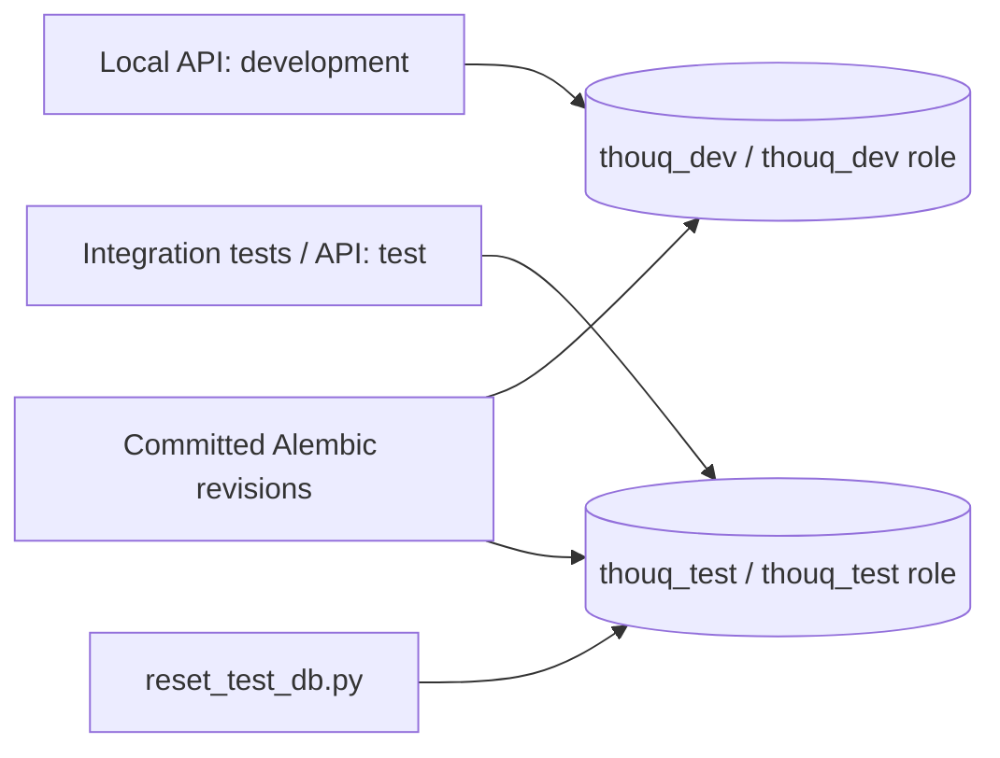

# Thouq database setup (DB-02 / DB-03 / DB-14 / DB-15)

This workflow uses installed PostgreSQL 18, Python 3.12, SQLAlchemy/Psycopg,
and Alembic 1.20.0. It provides separate local development and disposable test
databases. DB-02 establishes migration tracking; DB-03 creates `users` with a
single UUID primary key and a unique, required text `phone_number`. DB-14 adds account preferences; 0005 adds outings and districts. DB-15 adds saved
restaurants and creates the existing restaurant schema when absent. Other tables
in `schema.sql` remain drafts; Alembic is the migration source of truth.
The account diagram and column definitions are in
[TechnicalDoc.md](../Docs/TechnicalDoc.md#users).

## 1. Install the backend environment

From the repository root (with [uv](https://docs.astral.sh/uv/) installed):

```bash
uv python install 3.12
uv venv --python 3.12 backend/.venv
source backend/.venv/bin/activate
uv pip install -r backend/requirements.txt
```

Alternatively, use Python 3.12's `venv` and `pip`. Check `python --version` and
`alembic --version`. Run the remaining commands with this environment activated.

## 2. Start local PostgreSQL

Use PostgreSQL **18** for development and integration tests. On Linux:

```bash
sudo systemctl status postgresql
sudo -u postgres test -f /var/lib/postgres/data/PG_VERSION
```

Only if there is no existing cluster and the data directory is uninitialized:

```bash
sudo -u postgres initdb -D /var/lib/postgres/data --encoding=UTF8 --locale=C \
  --auth-local=peer --auth-host=scram-sha-256
```

Never initialize over existing data. Start the service and verify TCP access:

```bash
sudo systemctl enable --now postgresql
pg_isready -h 127.0.0.1 -p 5432
```

On other operating systems, install/start PostgreSQL 18 using that platform's
service manager; the database SQL and project commands below are identical.
If startup fails, inspect `sudo journalctl -u postgresql -n 50 --no-pager`.
If an existing cluster uses an older major version, follow PostgreSQL's upgrade
procedure instead of replacing its data directory.

## 3. Create local roles and the development database (once)

Connect as a local PostgreSQL administrator:

```bash
sudo -u postgres psql -d postgres
```

If your own local account is already a PostgreSQL administrator, use
`psql -d postgres` instead. On a fresh setup, run:

```sql
CREATE ROLE thouq_dev LOGIN NOSUPERUSER NOCREATEDB NOCREATEROLE;
\password thouq_dev
CREATE ROLE thouq_test LOGIN NOSUPERUSER CREATEDB NOCREATEROLE;
\password thouq_test
CREATE DATABASE thouq_dev OWNER thouq_dev TEMPLATE template0;
REVOKE CONNECT ON DATABASE thouq_dev FROM PUBLIC;
GRANT CONNECT ON DATABASE thouq_dev TO thouq_dev;
\q
```

Supply separate local passwords at the prompts. The test role owns only the test
database and needs CREATEDB to recreate it. Do not grant it membership in the
development role or access to live resources. If these names already exist,
inspect their ownership and permissions rather than overwriting credentials.

## 4. Configure the backend

Copy `backend/.env.example` to `backend/.env` only if the latter does not exist.
Replace the password placeholders locally; URL-encode special password characters.
Never commit `.env` or paste connection passwords into validation evidence.

| Setting | Local value |
| --- | --- |
| `ENVIRONMENT` | `development` (use `test` for test API/migrations) |
| `DATABASE_URL` | `postgresql+psycopg://thouq_dev:<password>@127.0.0.1:5432/thouq_dev` |
| `TEST_DATABASE_URL` | `postgresql+psycopg://thouq_test:<password>@127.0.0.1:5432/thouq_test` |

The backend always loads this same `.env` regardless of the working directory.
Process environment variables override file values. `postgres://` and
`postgresql://` aliases are normalized to Psycopg.

Test mode requires the explicit test URL. It permits only `127.0.0.1:5432`, user
and database `thouq_test`, a nonempty password, and no query parameters. Missing
or unapproved configuration fails before connection; it never falls back to the
development URL. Test connections explicitly pin the loopback address so ambient
libpq settings cannot redirect the validated host. These restrictions deliberately limit the helper to a disposable
local database. Hosted environments require a separately reviewed workflow.

## 5. Apply development migrations

From the repository root:

```bash
alembic -c database/alembic.ini upgrade head
alembic -c database/alembic.ini current
```

Expected revision: `0006_saved_restaurants (head)`. The migrations create
`alembic_version`, accounts/preferences, outing/district tables, restaurants, and
`saved_restaurants`. `upgrade head` can be rerun without recreating the database. Migration files live in `database/migrations/versions/`.

DB-03 starts from DB-02's empty baseline; it does not convert a database manually
populated from the draft SQL. Its downgrade drops `users` and its account data,
so use downgrade checks only on the disposable test database. Existing draft
group foreign keys continue to reference `users(id)` without a phone column;
DB-03 does not create group tables or implement group features.

For a later schema task, create a revision, implement its upgrade/downgrade, review
it, and apply it:

```bash
alembic -c database/alembic.ini revision -m "describe the schema change"
alembic -c database/alembic.ini upgrade head
```

Automatic model comparison is intentionally not configured; migrations are explicit.
Do not use `schema.sql` or `Base.metadata.create_all()` as a parallel migration path.

## 6. Create or reset the test database with one command

From the repository root:

```bash
python database/reset_test_db.py
```

Expected output:

```text
Ready: thouq_test on 127.0.0.1:5432; user thouq_test; revision 0006_saved_restaurants
```

This command always selects test mode, verifies the URL and local role attributes,
refuses a database owned by another role, recreates only `thouq_test` from
`template0`, applies all migrations, and checks the resulting identity/revision.
It terminates connections to that disposable database during reset. Stop test API
processes before resetting to avoid reconnecting while it is being recreated.
It never resets the development database. PostgreSQL must already be running;
normal resets do not need sudo. Failures return a nonzero exit code without
printing credentials. Do not run concurrent resets/test suites on this shared
local test database.

## 7. Run checks

Unit tests require valid test configuration but no running PostgreSQL service.
They use SQLite/mocks and include target validation tests. Pytest selects test
mode before importing the API, including when `.env` selects development.

```bash
cd backend
python -m pytest -m "not integration"
```

For integration tests, reset first from the repository root, then run:

```bash
python database/reset_test_db.py
cd backend
ENVIRONMENT=test python -m pytest -m integration
```

`python -m pytest` runs both groups and therefore needs the migrated test database.
The integration health test requires a real `database: ok` result; the ordinary
health unit tests mock both reachable and unreachable results.

Shared test helpers live in `backend/tests/conftest.py` (QA-01, #56).
`db_connection` runs each integration test in one transaction that is rolled back
afterwards. `db_session` and `api_client` keep commits and rollbacks from the code
under test inside a savepoint, so nothing is left behind. CI runs the integration
suite twice on the same database to prove it. `synthetic_restaurants` loads
`backend/tests/data/synthetic_restaurants.json`: fake names, `example.com` links
and gaps in every optional column. It follows `database/schema.sql` until the
restaurants migration exists.

To inspect a real test API, from `backend/`:

```bash
ENVIRONMENT=test uvicorn app.main:app --reload
```

In another terminal:

```bash
curl --fail http://127.0.0.1:8000/api/v1/health
```

Expect `{"status":"ok","database":"ok","environment":"test"}`.
The migrated tables support account preference storage. Complete authentication,
preference API endpoints (#63), and restaurant queries require their own tasks.

## Troubleshooting

- Connection refused: check `pg_isready -h 127.0.0.1 -p 5432` and the service logs.
- Authentication failure: verify local role passwords and TCP authentication in
  PostgreSQL's `pg_hba.conf`; use password authentication such as scram-sha-256.
- Unsafe/missing test URL: match the exact local values above; do not add URL query
  options or substitute production credentials.
- Reset role/ownership rejection: inspect the local roles as an administrator;
  never solve this by running the helper with a superuser connection URL.
- Health reports unreachable: inspect the JSON body, database availability, and
  selected environment. HTTP 200 alone does not prove database connectivity.
- Migration failure: inspect the migration and local setup, correct the problem,
  then rerun the test reset. Error output intentionally hides connection details.

## Environment separation



Record runtime evidence in `database/VALIDATION.md`.

The restaurant dataset is not committed because its terms do not allow republishing.

Keep your local copy in `database/private/`, which Git ignores.


## DB-14 account preferences

Migration `0003_account_preferences` reuses `users.id` and `preferences`; it does
not create sessions, invitations, participants, or API routes. A clean database
gets a required unique account owner. Existing shared tables keep their participant
rows and keys, with exactly one owner per row. New numeric checks apply only to
account rows in shared tables. Account deletion is blocked while preferences refer
to it (no cascading data deletion).

Optional budgets are INTEGER whole SAR ≥ 0, minimum ≤ maximum when both exist.
There is no business maximum (PostgreSQL INTEGER still has its storage limit).
Distance is unrestricted NUMERIC, finite and > 0 when supplied, including fractions.
Both list columns are nullable `text[]`; NULL and an empty list remain distinct.
Legacy TEXT must be a JSON array of strings or a PostgreSQL one-dimensional text-array
literal with string elements. Scalar text, malformed values, nested lists, and null
elements abort conversion. There is no comma-splitting or guessed cuisine mapping.
Failed upgrades roll back; duplicate/orphan owners and invalid account numbers must
be resolved by the data owner before retry. Never delete rows to make migration pass.
Downgrade is deliberately refused to prevent data loss; use a reviewed forward fix.
Offline SQL generation is unsupported: this migration inspects actual schema/data.

### Existing unversioned draft database

Use the database owner's migration connection, with a backup, not a restricted
runtime role. The checked-in application credentials may inspect columns without
being able to read or alter rows. Do not reset the development database.

From the root, with the backend environment activated:

```bash
python database/adopt_existing_schema.py
python database/adopt_existing_schema.py --stamp
alembic -c database/alembic.ini upgrade head
alembic -c database/alembic.ini current
```

The first command only checks that `users` has the DB-03 columns/types, primary key,
phone uniqueness and read access. `--stamp` repeats those checks and records
`0002_account_keys_and_phone`; it never recreates application tables. Versioned or
incompatible account schemas are refused. DB-14 then checks/converts preferences
transactionally. If DB-14 fails, its changes roll back and the baseline remains at
0002; fix the reported data issue and rerun upgrade. A normally versioned database
uses `upgrade head` directly. Fresh databases also use `upgrade head`, without adoption.

### Handoff to #63

Use `app.services.preferences.models.Preference` with the shared SQLAlchemy Base.
Set/query `user_id` only from the authenticated account. Save through a transaction;
repeated saves update that account's single row. Do not use `create_all` for migrations.
The model intentionally maps account fields only; a legacy participant row is not
an account default. Lists are Python string lists and distance is `Decimal`.
Derive `is_saved` from row existence; no row is a valid new-account state. Request
validation and endpoints remain #63. Public browsing remains unauthenticated.

[Arabic learning guide](../Docs/Database-Learning.ar.md) ·
[DB-14 issue](https://github.com/shathaaa1110-arch/Portfolio-Project/issues/125)


## DB-15 saved restaurants

Migration `0006_saved_restaurants` follows `0005_outings_and_districts`. The storage
contract is `saved_restaurants(user_id UUID, restaurant_id INTEGER)`, with both
columns required and the pair as its primary key. The foreign keys reference
`users(id)` and `restaurants(id)`. An account can save multiple restaurants; multiple
accounts can save the same restaurant, but the same pair cannot occur twice.
The primary-key index supports account lookups; a separate restaurant index supports
reference checks from restaurants.

Both foreign keys use **ON DELETE RESTRICT**. Explicitly delete saved links before
deleting an account or restaurant; no saved links are cascaded away. Removing a
saved link does not delete either parent. Other tables' foreign keys still apply.

Existing account and restaurant rows and schemas are preserved. If restaurants is
absent, the migration creates its established schema without importing any dataset,
plus the search column/indexes skipped by 0004 on a fresh database. Existing parent
IDs must be UUID/integer primary keys respectively. An incompatible parent or an
unexpected existing saved-restaurants table stops the migration; inspect and resolve
the mismatch before retrying. Failed DDL rolls back, with no automatic data repair.
Downgrade is refused to protect saved data; use a reviewed forward migration.

Use the normal `upgrade head` and disposable test reset commands above. Do not apply
`schema.sql` as an alternative migration path. No remote database upgrade is included
in this task. The database owner applies the migration through the normal deployment
workflow. Offline SQL generation remains unsupported by the migration chain.

### Handoff to #126

The SQL relation is the interface; endpoints and authentication belong to
[#126](https://github.com/shathaaa1110-arch/Portfolio-Project/issues/126).
Always derive `user_id` from the authenticated account. A plain duplicate insert
fails with unique violation `23505`; an idempotent save can use:

```sql
INSERT INTO saved_restaurants (user_id, restaurant_id)
VALUES (:user_id, :restaurant_id)
ON CONFLICT (user_id, restaurant_id) DO NOTHING;
```

Read with `WHERE user_id = :user_id` and join `restaurants.id = restaurant_id`.
Unsave with both keys in the delete predicate. Use bound parameters and a transaction.
Invalid references (`23503`), restricted parent deletes (`23001` on PostgreSQL 18),
and null keys (`23502`) are rejected by PostgreSQL.
No saved-restaurant routes or authentication changes are supplied here; public
browsing remains unauthenticated.

Verification: `backend/tests/test_saved_restaurant_schema_integration.py`, the
normal database migration/health integration tests, and the existing backend suite.
Actual run evidence belongs in [VALIDATION.md](VALIDATION.md).
