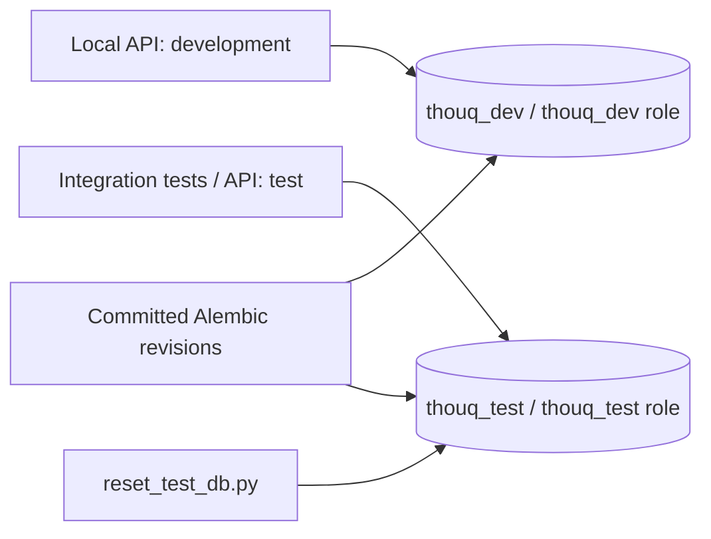

# Thouq database setup (DB-02)

This workflow uses installed PostgreSQL 18, Python 3.12, SQLAlchemy/Psycopg,
and Alembic 1.20.0. It provides separate local development and disposable test
databases. `schema.sql` remains a draft: the initial migration only establishes
migration tracking. Table corrections and application tables follow in DB-03/DB-04.

## 1. Install the backend environment

From the repository root (with [uv](https://docs.astral.sh/uv/) installed):

```bash
uv python install 3.12
uv venv --python 3.12 backend/.venv
source backend/.venv/bin/activate
uv pip install -r backend/requirements.txt
```

Alternatively, use Python 3.12's `venv` and `pip`. Check `python --version` and
`alembic --version`. Run the remaining commands with this environment activated.

## 2. Start local PostgreSQL

Use PostgreSQL **18** for development and integration tests. On Linux:

```bash
sudo systemctl status postgresql
sudo -u postgres test -f /var/lib/postgres/data/PG_VERSION
```

Only if there is no existing cluster and the data directory is uninitialized:

```bash
sudo -u postgres initdb -D /var/lib/postgres/data --encoding=UTF8 --locale=C \
  --auth-local=peer --auth-host=scram-sha-256
```

Never initialize over existing data. Start the service and verify TCP access:

```bash
sudo systemctl enable --now postgresql
pg_isready -h 127.0.0.1 -p 5432
```

On other operating systems, install/start PostgreSQL 18 using that platform's
service manager; the database SQL and project commands below are identical.
If startup fails, inspect `sudo journalctl -u postgresql -n 50 --no-pager`.
If an existing cluster uses an older major version, follow PostgreSQL's upgrade
procedure instead of replacing its data directory.

## 3. Create local roles and the development database (once)

Connect as a local PostgreSQL administrator:

```bash
sudo -u postgres psql -d postgres
```

If your own local account is already a PostgreSQL administrator, use
`psql -d postgres` instead. On a fresh setup, run:

```sql
CREATE ROLE thouq_dev LOGIN NOSUPERUSER NOCREATEDB NOCREATEROLE;
\password thouq_dev
CREATE ROLE thouq_test LOGIN NOSUPERUSER CREATEDB NOCREATEROLE;
\password thouq_test
CREATE DATABASE thouq_dev OWNER thouq_dev TEMPLATE template0;
REVOKE CONNECT ON DATABASE thouq_dev FROM PUBLIC;
GRANT CONNECT ON DATABASE thouq_dev TO thouq_dev;
\q
```

Supply separate local passwords at the prompts. The test role owns only the test
database and needs CREATEDB to recreate it. Do not grant it membership in the
development role or access to live resources. If these names already exist,
inspect their ownership and permissions rather than overwriting credentials.

## 4. Configure the backend

Copy `backend/.env.example` to `backend/.env` only if the latter does not exist.
Replace the password placeholders locally; URL-encode special password characters.
Never commit `.env` or paste connection passwords into validation evidence.

| Setting | Local value |
| --- | --- |
| `ENVIRONMENT` | `development` (use `test` for test API/migrations) |
| `DATABASE_URL` | `postgresql+psycopg://thouq_dev:<password>@127.0.0.1:5432/thouq_dev` |
| `TEST_DATABASE_URL` | `postgresql+psycopg://thouq_test:<password>@127.0.0.1:5432/thouq_test` |

The backend always loads this same `.env` regardless of the working directory.
Process environment variables override file values. `postgres://` and
`postgresql://` aliases are normalized to Psycopg.

Test mode requires the explicit test URL. It permits only `127.0.0.1:5432`, user
and database `thouq_test`, a nonempty password, and no query parameters. Missing
or unapproved configuration fails before connection; it never falls back to the
development URL. Test connections explicitly pin the loopback address so ambient
libpq settings cannot redirect the validated host. These restrictions deliberately limit the helper to a disposable
local database. Hosted environments require a separately reviewed workflow.

## 5. Apply development migrations

From the repository root:

```bash
alembic -c database/alembic.ini upgrade head
alembic -c database/alembic.ini current
```

Expected revision: `0001_empty_baseline (head)`. Only `alembic_version` is created
by this baseline. `upgrade head` can be rerun without recreating the database.
Migration files live in `database/migrations/versions/`.

For a later schema task, create a revision, implement its upgrade/downgrade, review
it, and apply it:

```bash
alembic -c database/alembic.ini revision -m "describe the schema change"
alembic -c database/alembic.ini upgrade head
```

Automatic model comparison is intentionally not configured for the empty baseline.
Do not use `schema.sql` or `Base.metadata.create_all()` as a parallel migration path.

## 6. Create or reset the test database with one command

From the repository root:

```bash
python database/reset_test_db.py
```

Expected output:

```text
Ready: thouq_test on 127.0.0.1:5432; user thouq_test; revision 0001_empty_baseline
```

This command always selects test mode, verifies the URL and local role attributes,
refuses a database owned by another role, recreates only `thouq_test` from
`template0`, applies all migrations, and checks the resulting identity/revision.
It terminates connections to that disposable database during reset. Stop test API
processes before resetting to avoid reconnecting while it is being recreated.
It never resets the development database. PostgreSQL must already be running;
normal resets do not need sudo. Failures return a nonzero exit code without
printing credentials. Do not run concurrent resets/test suites on this shared
local test database.

## 7. Run checks

Unit tests require valid test configuration but no running PostgreSQL service.
They use SQLite/mocks and include target validation tests. Pytest selects test
mode before importing the API, including when `.env` selects development.

```bash
cd backend
python -m pytest -m "not integration"
```

For integration tests, reset first from the repository root, then run:

```bash
python database/reset_test_db.py
cd backend
ENVIRONMENT=test python -m pytest -m integration
```

`python -m pytest` runs both groups and therefore needs the migrated test database.
The integration health test requires a real `database: ok` result; the ordinary
health unit tests mock both reachable and unreachable results.

To inspect a real test API, from `backend/`:

```bash
ENVIRONMENT=test uvicorn app.main:app --reload
```

In another terminal:

```bash
curl --fail http://127.0.0.1:8000/api/v1/health
```

Expect `{"status":"ok","database":"ok","environment":"test"}`.
The empty baseline does not yet support auth/preferences/restaurant queries.

## Troubleshooting

- Connection refused: check `pg_isready -h 127.0.0.1 -p 5432` and the service logs.
- Authentication failure: verify local role passwords and TCP authentication in
  PostgreSQL's `pg_hba.conf`; use password authentication such as scram-sha-256.
- Unsafe/missing test URL: match the exact local values above; do not add URL query
  options or substitute production credentials.
- Reset role/ownership rejection: inspect the local roles as an administrator;
  never solve this by running the helper with a superuser connection URL.
- Health reports unreachable: inspect the JSON body, database availability, and
  selected environment. HTTP 200 alone does not prove database connectivity.
- Migration failure: inspect the migration and local setup, correct the problem,
  then rerun the test reset. Error output intentionally hides connection details.

## Environment separation



Record runtime evidence in `database/VALIDATION.md`.

The restaurant dataset is not committed because its terms do not allow republishing.
